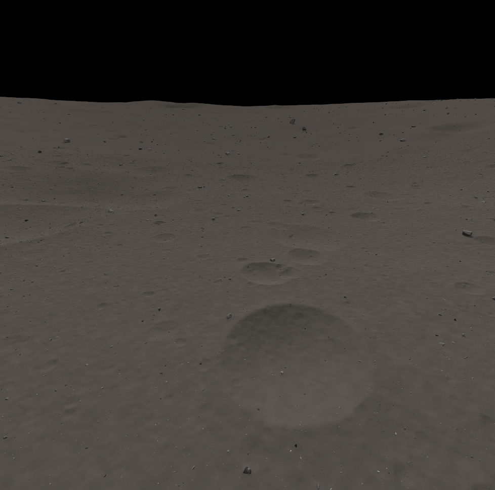
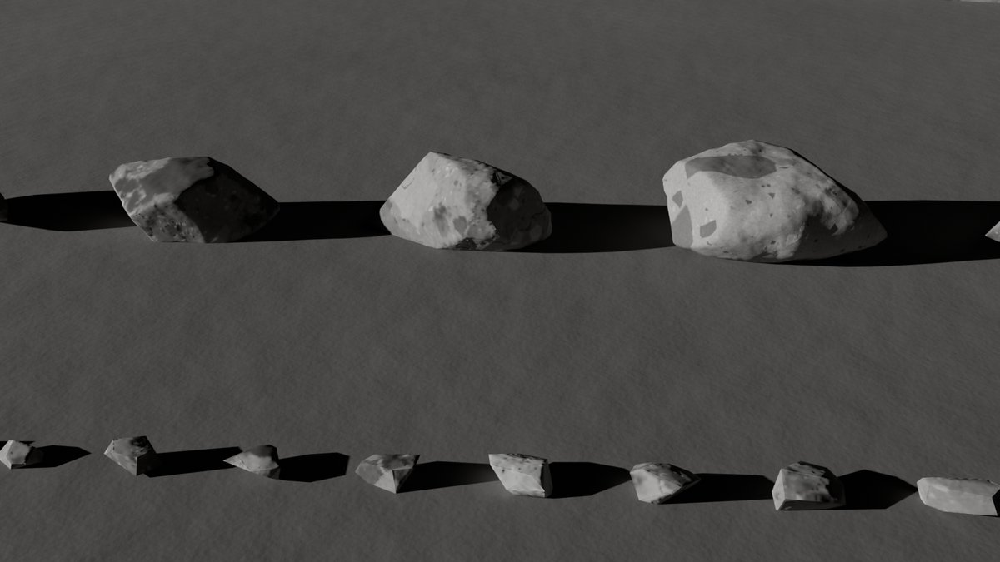

# Apollo 16 lunar world for the TOGO rover

This folder generates and runs a Gazebo Harmonic world of the **Apollo 16 landing site**: real terrain from the
LRO NAC elevation model plus synthetic small-scale relief, craters and about 250,000 rocks (215,677 of them in
the 100 m driving core). It is built for **LiDAR navigation and SLAM** with the TOGO rover (Clearpath A300 with
the Seyond Robin W LiDAR). The simulation runs natively in WSL2 (gz-sim 8.11, ROS 2 Jazzy); SLAM and Nav2 keep
running in Docker as before.

**Status (2026-10-27): ready for SLAM testing.**

- **Validated:**
  - the build and its static checks (8 / 8);
  - a 22-minute run of the launcher with flat memory;
  - the SLAM inputs;
  - the rover and LiDAR acceptance tests at four sites. All pass except the slope climb on the rough slope site
    (section 9).
- **SLAM benchmark:** a recorded bag with verified ground truth, plus replay, scoring and comparison (section 5).
- **Not done:** the visual review of the camera images, deferred until the camera work.

New here, or lost between Windows, WSL and Docker? Read section 0 first.

## Contents

0. [Start here](#0-start-here): where things run, what to run, where results go, the tests
1. [What the world is](#1-what-the-world-is)
2. [Requirements](#2-requirements)
3. [One-time setup](#3-one-time-setup): physics plugin, Python venv, building the world
4. [Running the simulation](#4-running-the-simulation)
5. [SLAM against this world: DLIO gravity must be 1.62](#5-slam-against-this-world-dlio-gravity-must-be-162)
6. [Gazebo GUI](#6-gazebo-gui)
7. [Using the old launcher (`togo_sim_wsl.sh` with `TOGO_WORLD`)](#7-using-the-old-launcher-togo_sim_wslsh-with-togo_world)
8. [Troubleshooting](#8-troubleshooting)
9. [Known limitations](#9-known-limitations)
10. [More documentation](#10-more-documentation)

## 0. Start here

### Where things run

Everything runs on this one PC, in three places:

| place | what runs there | how to open it | where it sees the repo |
|---|---|---|---|
| **Windows** | VS Code, File Explorer | | `C:\Users\Username\OneDrive\Desktop\togo_ws-slam-nav\togo_ws-slam-nav` |
| **WSL** (Ubuntu 24.04) | Gazebo and ROS 2 Jazzy: the simulation, and every script and tool in this package | Windows Terminal, the *Ubuntu* tab | `/mnt/c/Users/Username/OneDrive/Desktop/togo_ws-slam-nav/togo_ws-slam-nav`, written `$REPO` below |
| **Docker container `dev`**, inside WSL | SLAM (DLIO and the graph backend) and Nav2, with their RViz | from WSL in `$REPO`: `docker compose start dev`, then `docker compose exec dev terminator` | parts of it: `src/` as `~/ws/src`, `lidarslam_ros2/` as `~/slam_ws/src/lidarslam_ros2`, `slam_output/` as `~/slam_ws/src/lidarslam_ros2/output` |

- **How they talk.** The container shares WSL's network, so the simulation and SLAM meet on ROS domain 29 with
  CycloneDDS. A new WSL terminal is on domain 0 and sees no topics until you run
  `source $REPO/src/lunar_world_gen/scripts/env.sh`. The scripts here do that themselves.
- **Files.**
  - You edit the repo in VS Code, and WSL and the container see each change at once.
  - Big generated files (worlds, bags, results: 27 GB) live on WSL's own disk in `~/togo_assets/lunar/`. They
    never go into the repo, which OneDrive syncs.
  - In File Explorer that folder is `\\wsl.localhost\Ubuntu\home\nargon\togo_assets\lunar`.
- **Two Pythons in WSL.** The system `python3`, with ROS, runs the simulation, the tools and the SLAM scoring.
  The venv `~/.venvs/lunar_world` builds the world and runs the tests. The scripts pick the right one.

Set `REPO` once per WSL terminal, or put the line in `~/.bashrc`:

```bash
REPO=/mnt/c/Users/Username/OneDrive/Desktop/togo_ws-slam-nav/togo_ws-slam-nav
```

### What do you want to do?

Run these in a WSL terminal, after `cd $REPO`. Each script and tool lists its options with `--help`.

| task | command | more |
|---|---|---|
| start the simulation | `./src/lunar_world_gen/scripts/run_apollo16_sim.sh`; add `--headless` for no GUI | section 4 |
| open or close the Gazebo GUI | `./src/lunar_world_gen/scripts/open_gui.sh`, `open_gui.sh --close` | section 6 |
| get a terminal that sees the simulation | `source src/lunar_world_gen/scripts/env.sh` | section 4 |
| run SLAM live on the simulation | in the container: `COMBINED_PARAM_FILE=<the lunar config> ./run_live_seyond_dlio_slam.sh` | section 5 |
| replay a recorded bag into SLAM and score it | `./src/lunar_world_gen/scripts/replay_slam_bag.sh` | section 5 |
| compare a SLAM config change (3 replays each) | `./src/lunar_world_gen/scripts/benchmark_slam.sh --label NAME --config FILE --compare-to baseline` | section 5 |
| re-score old runs after the scoring changed | `./src/lunar_world_gen/scripts/rescore_slam_runs.sh --label NAME` | section 5 |
| check a bag's ground truth | `python3 src/lunar_world_gen/tools/gt_check.py BAG_FOLDER` | section 5 |
| record a new benchmark bag | `./src/lunar_world_gen/tools/bag_record/record_bag.sh` | section 5 |
| run the tests | `./src/lunar_world_gen/scripts/run_tests.sh` (1 min), or `run_tests.sh all` (5 min) | below |
| rebuild the world | `cd src/lunar_world_gen && ~/.venvs/lunar_world/bin/python -m lunar_world_gen.build --preset full` | section 3 |

### Where the results go

| what | folder |
|---|---|
| the world | `~/togo_assets/lunar/worlds/apollo16_core/` |
| the benchmark bags, each with its ground truth, checks and recording logs | `~/togo_assets/lunar/bags/<bag>/` |
| SLAM replay and benchmark runs: numbers and pictures | `~/togo_assets/lunar/bags/slam_runs/<run>/`; per label `slam_runs/summary__<label>.md` and `.png` |
| the SLAM maps of those runs | `$REPO/slam_output/replay_runs/<run>/`; live SLAM keeps using `$REPO/slam_output/` |
| build cache, physics plugin, rock library | `~/togo_assets/lunar/build/`, `plugins/`, `library/` |

### What is in this package

| folder | contents |
|---|---|
| `scripts/` | The commands above. Simulation: `run_apollo16_sim.sh`, `open_gui.sh`, `env.sh`, `apollo16_lib.sh`. SLAM benchmark: `replay_slam_bag.sh`, `benchmark_slam.sh`, `rescore_slam_runs.sh`. Tests: `run_tests.sh`. |
| `tools/` | Single-purpose programs. SLAM scoring: `slam_eval.py`, `slam_compare.py`, `gt_check.py`, `trim_bag.py`, `proc_sampler.py`, `slam_replay_check.py`. Bag recording: `bag_record/`. Gazebo checks: `bench_world.py`, `lidar_capture.py`, `run_robot_tests.py`, `rover_drive_test.py`, `render_views.py`. Build helpers: `dtm_extract.py`, `robot_collision_simplify.py`, `verify_rock_glb.py`, `gz_physics_bullet_lunar/` (the patched physics plugin). |
| `lunar_world_gen/` | The world generator (Python): terrain, rocks, meshes, SDF, validation. |
| `launch/` | `apollo16_sim.launch.py`, which `run_apollo16_sim.sh` starts. |
| `config/` | `apollo16_core.yaml` (every generator parameter); `slam/` (the lunar DLIO config); `gui/`; `robot/`. |
| `blender/` | The rock library generator (Blender on Windows). |
| `tests/` | The tests, in four groups (below). |
| `docs/` | `USER_GUIDE.md`, `DESIGN.md`, `PROGRESS.md`. `impl/` and `research/` hold the development history (section 10). |

### Tests

`scripts/run_tests.sh` runs the tests with the right Python. They check code and files only; none of them starts
Gazebo, ROS or Docker.

| group | files | what they protect | time |
|---|---|---|---|
| `world` | `tests/test_world_*.py` | Generating the world: terrain, meshes, rocks, DTM, SDF, the build and its checks. | 4 min |
| `sim` | `tests/test_sim_*.py` | Running it: the launcher scripts, the launch file, the robot's collision boxes, stopping Gazebo safely, the drive-test metrics. | 1 min |
| `slam` | `tests/test_slam_replay.py` | The SLAM replay, its scoring, the ground-truth check, and the benchmark and recording scripts. | seconds |
| `docs` | `tests/test_docs.py` | The README and the scripts' `--help` agree, linked files exist, and generated configs are current. | seconds |

- **`run_tests.sh`** on its own runs `quick`: every group except the three slowest files, about 1 minute. Use
  it after small changes.
- **`run_tests.sh all`** runs everything: about 340 tests, about 5 minutes.
- **`run_tests.sh slam -k heading`** passes extra options to pytest. `run_tests.sh --list` shows which files
  each group runs.
- **Skips:** a skipped test names the optional input it lacks, such as the elevation model or your SLAM config.
- **New test files** must start with `test_world_`, `test_sim_` or `test_slam_`. The `docs` group checks this.

## 1. What the world is

| | |
|---|---|
|  |  |
| The final world in the Gazebo GUI (`inspect` lighting, Gazebo's default camera), after 7 minutes with the memory-leak fix | Rock prototypes of the library (Blender preview, 15° sun): light-grey breccia with clasts and glass splashes |

**Site.** The core is centred 300 m east of the Apollo 16 lunar module (lat -8.973448, lon 15.511126). It
covers the west half of a degraded bowl about 180 m wide, with a fresh 23 m crater at its south edge. The frame
is local ENU: x east, y north, z up, in metres, with z = 0 at 8.20 m above the 1737.4 km lunar sphere. NavSat
reports the real coordinates.

**Zones** (each a square centred on the core):

| zone | size | detail | what it is for |
|---|---|---|---|
| core | 100 m | 1 cm terrain grid, 3 mm mesh tolerance; craters from 0.2 m; rocks from 2 cm | driving, LiDAR, cameras |
| ring | 500 m | 25 cm grid; craters from 1 m; rocks from 30 cm, plus smaller rocks in a 6 m band outside the core edge | everything the 150 m LiDAR can see from the core |
| far | 2.2 km | 2 m grid from the real elevation model | camera and GUI background |
| horizon | 20 km | 20 m grid | the skyline |

**As built** (final build of 2026-10-25; the numbers of your build are in `world_info.yaml`):

- **17.13 M visual triangles**: core ground 8.74 M, core rocks 6.58 M, ring rocks 1.49 M, ring, far and horizon
  ground 0.32 M. That is 7 % over the 16 M soft target and under the 20 M hard cap.
- **0.81 M collision triangles**, 0.44 M of them in the core.
- **215,677 core rocks** of 2 cm and larger. The 16,546 rocks of 5 cm and larger are part of the collision
  surface; the largest is 1.52 m.
- **37,029 rocks outside the core**: 3,278 of 30 cm and larger in the ring, and 33,751 smaller ones in a 6 m
  band outside the core edge, so the rock field does not stop abruptly at the edge.
- **Steepest ground 33.5°** (over 0.5 m). Crater walls steeper than 32° are slumped as loose regolith would
  (talus limiter).
- **Static checks 8 / 8 pass**: the roughness, crater and rock statistics match the Apollo 16 calibration
  (`reports/validation_report.md` in the world folder, `docs/impl/final_build.md` sections 5-6).

**Physics.** Lunar gravity 1.62 m/s², a patched classic-Bullet engine (1 ms step) whose in-place turns and mesh
friction behave correctly, ground friction mu 0.4 (rocks included).

**Lighting.** The sun as at the start of EVA-1 (21.9° elevation, from the east), a black sky and near-black
shadows. Earthshine has its calibrated strength, 3e-5 of the sun, which Gazebo's fixed-exposure cameras render
as nothing; the only shadow fill is the ambient light (0.01). The `inspect` variant adds fill light for looking
around.

**Files.** Generated assets live on WSL's own disk, not in this repo:

| path | contents |
|---|---|
| `~/togo_assets/lunar/worlds/apollo16_core/` | the world, 0.86 GB: `apollo16_core.sdf` (+ variants, below), `meshes/` (324 GLB files, 758 MB), `textures/`, `world_info.yaml` (sites, gravity, counts), `rocks_catalog.npz/.csv`, `reports/` |
| `~/togo_assets/lunar/build/apollo16_core/` | the build cache (3.2 GB); only needed to rebuild |
| `~/togo_assets/lunar/plugins/libgz-physics7-bullet-lunar-plugin.so` | the patched physics plugin |
| `~/togo_assets/lunar/library/rocks_v1/` | the rock library (Blender output) |

**World variants**, chosen with `--variant`:

| variant | file | physics | lighting |
|---|---|---|---|
| (default) | `apollo16_core.sdf` | patched Bullet, 1 ms | realistic |
| `inspect` | `apollo16_core_inspect.sdf` | patched Bullet, 1 ms | higher sun (EVA-2, 33.8°), fill light, ambient 0.25 |
| `stock` | `apollo16_core_stock.sdf` | stock Bullet, 4 ms (fallback) | realistic |
| `inspect_stock` | `apollo16_core_inspect_stock.sdf` | stock Bullet, 4 ms | inspect |

If the patched plugin is missing or cannot be loaded, the launcher falls back to the `_stock` file (with
`--variant inspect`: `_inspect_stock`) and prints a warning. Stock Bullet turns badly (in-place turns reach
roughly 40-66 % of the command) and ignores the ground friction (fixed at 0.5).

**Test sites** in `world_info.yaml`, chosen with `--site`:

| site | x, y (m) | heading | what it is |
|---|---|---|---|
| `flat` (default) | -2.00, -4.50 | -22.5° (east-south-east) | the nearest spot to the centre that passes the flat-site rules: 4.85° footprint slope, no rock of 5 cm or larger within 0.98 m; the standard drive test runs along a 4 m corridor ahead |
| `slope` | 23.50, -16.50 | -157.5° (uphill, west-south-west) | foot of a 5 m run at 12.4° mean slope (1.10 m rise), facing uphill |
| `rock` | -4.12, -7.41 | 67.5° (north-north-east) | 2 m before a lone 8.7 cm rock (4.3 cm above the ground); the left wheels roll over it |
| `turn` | -3.00, 3.00 | -67.5° (south-south-east) | no rock of 10 cm or larger within 1.5 m, for in-place turns |

Headings are ENU yaw (0° = east, counter-clockwise). The spawn height is 4 cm above the collision surface.

The `flat` corridor is not level: it falls 7.4° over its first 3 m, reaches a 9.4° footprint slope and holds 2
rocks of 5 cm or larger. On this terrain only 164 of 35,721 candidate spots pass the flat-site rules; the nearest
one with a rock-free corridor of at most 5° is 26 m out, at (-25.5, -4.0). Whether to move the site is one of
the open decisions in `docs/PROGRESS.md` (phase 7).

## 2. Requirements

- Windows 11 with WSL2 Ubuntu 24.04, ROS 2 Jazzy and Gazebo Harmonic (gz-sim 8.11) as installed here.
- The native TOGO workspace built in `~/togo_ws_native_clean/install` (the same one `src/togo_sim_wsl.sh` uses).
- A GPU through WSLg (Mesa D3D12). The world was validated on an RTX 2080 with 8 GB.
- **Memory** (measured with the memory-leak fix, section 4): the Gazebo server with the rover holds about
  3.7-3.9 GB and the Gazebo GUI about 3.7-3.8 GB, both flat over time; WSL used about 8.0 GB of its 15.9 GB with
  the GUI and 4.4 GB without. The SLAM container and other WSL programs share the same limit. VRAM (whole GPU):
  1,713 MiB idle, about 4,000 MiB with the server, up to 6,716 of 8,192 MiB with the server and the GUI
  (`docs/impl/e2e_launch.md` 9).
- Disk: 0.86 GB for the world, 3.2 GB for the build cache.
- Only to build the world: the Python venv (3.2), the elevation model
  `src/togo/togo_gz/media/dem/NAC_DTM_APOLLO16.TIF` (in the repo) and the rock library.

## 3. One-time setup

On this machine all three steps are already done. You need them after a fresh install, after a ROS or Gazebo
update (step 1), or to change the world (step 3).

### 3.1 Patched physics plugin (about 40 s)

```bash
bash $REPO/src/lunar_world_gen/tools/gz_physics_bullet_lunar/build_lunar_bullet_plugin.sh
```

- It downloads the gz-physics 7.6.0 source from GitHub (or reuses the cached tarball in
  `~/togo_assets/lunar/build/gz_physics_bullet_lunar/`), applies two patches and installs
  `~/togo_assets/lunar/plugins/libgz-physics7-bullet-lunar-plugin.so`. No sudo. The build needs cmake, make and
  g++, which are installed here. Options: `--out FILE`, `--work DIR`, `--tarball FILE`, `--jobs N` (`--help`).
- The two patches: in-place turns track the command (stock Bullet damps the yaw), and mesh collisions honour the
  SDF friction.
- **Working directory.** The script can be started from any folder and leaves nothing there: CMake runs inside
  its build folder, where gz-physics creates four unversioned `libgz-physics-*-plugin.so` symlinks. (Before the
  final integration they landed in the caller's folder; the four dangling ones in `/home/nargon` were deleted.)
- The script refuses to build if the installed gz-physics is not 7.6.0. After a ROS update, check that a
  simulation start still logs `Loaded [gz::physics::bullet::Plugin] from library [...lunar...]` and the
  `[lunar patch] mesh collision` lines; the launcher also falls back to the stock variant if the plugin no longer
  loads.

### 3.2 Python venv (only to build or validate the world)

```bash
python3 -m venv ~/.venvs/lunar_world
~/.venvs/lunar_world/bin/pip install --upgrade pip==26.2.2
~/.venvs/lunar_world/bin/pip install -r $REPO/src/lunar_world_gen/requirements-venv.txt
```

`requirements-venv.txt` is the exact `pip freeze` of the venv used for the build (Python 3.12.3). A venv recreated
from it in 27 s (pip cache warm) was package-for-package identical and passed the full test suite. Running the
world does not need the venv: the launcher and the tools use the system `python3` with ROS.

### 3.3 Build the world

```bash
cd $REPO/src/lunar_world_gen
~/.venvs/lunar_world/bin/python -m lunar_world_gen.build --preset full
```

- **Ten cached stages**: terrain, rocks, heights, ground, contact, collision, meshes, export, world, validate.
  A stage is skipped when its inputs, config keys and code are unchanged; a change re-runs that stage and every
  stage after it.
- **Time and memory.** From scratch the build took 7:18 (minutes:seconds) on this machine. The terrain stage
  takes about 2 minutes and peaks at 2.7 GiB in the elevation-model extraction it starts; the build process
  itself peaks at 2.4 GiB. The rendered ground mesh (about 2 minutes), the rock contact pass and the static
  validation (about 1 minute each) take most of the rest. With the terrain cached, the other nine stages take
  about 5.4 minutes (the sum of their stage times in that build).
- **Output**: the world in `~/togo_assets/lunar/worlds/apollo16_core/` and the cache in
  `~/togo_assets/lunar/build/apollo16_core/` (paths from `config/apollo16_core.yaml`, section `paths`). The
  build is deterministic: a second build from scratch gave byte-identical meshes, textures, SDFs and rock
  catalog CSV.
- **Options.** `--status` lists stale stages and why. `--stages a,b --force` re-runs a subset;
  `--force-downstream` also re-runs everything after it. `--set key=value` overrides a config value for one
  build, e.g. `--set mesh.core_visual_max_error_m=0.0035` (a coarser ground mesh: about 15.1 M visual triangles
  instead of 17.1 M; one of the open decisions in `docs/PROGRESS.md`). A second build on the same folders stops
  at once (`--lock-timeout S` waits instead).
- **Exit code** 0 = built and validated, 1 = a stage failed, 2 = the static validation failed or a check did
  not run (`reports/static_checks.json`, `reports/validation_report.md`).
- **`--preset fast`** (1 cm ground tolerance, rocks from 3 cm, ring rocks from 50 cm) builds into its own
  folders, `~/togo_assets/lunar/build/apollo16_core_fast` and `~/togo_assets/lunar/worlds/apollo16_core_fast`,
  and never touches the full world. It had 3.65 M visual triangles with the phase-3 code; it was not rebuilt with
  the final code.
- **Tests**: `scripts/run_tests.sh world`, or `scripts/run_tests.sh all` for everything (section 0, *Tests*).
- **Long builds and PC sleep.** Windows sleep suspends WSL and stops a build or simulation midway (it happened
  once during this work). Keep the PC awake during long runs (Windows power settings, or PowerToys Awake).
- The rock library only needs rebuilding if `~/togo_assets/lunar/library/rocks_v1` is lost: Blender 5.2 on
  Windows, see `docs/impl/rocks.md`.

## 4. Running the simulation

```bash
cd $REPO
./src/lunar_world_gen/scripts/run_apollo16_sim.sh                     # site 'flat'; the Gazebo GUI opens at READY
./src/lunar_world_gen/scripts/run_apollo16_sim.sh --headless          # no GUI window (open one later: section 6)
./src/lunar_world_gen/scripts/run_apollo16_sim.sh --site slope        # also: rock, turn
./src/lunar_world_gen/scripts/run_apollo16_sim.sh --variant inspect   # brighter lighting, same physics
./src/lunar_world_gen/scripts/run_apollo16_sim.sh --pose -2.0 -4.5 -0.485 -0.393 --rviz
./src/lunar_world_gen/scripts/run_apollo16_sim.sh --site rock --dry-run   # check and print, start nothing
```

| option | meaning |
|---|---|
| `--world PATH` | world SDF (default `~/togo_assets/lunar/worlds/apollo16_core/apollo16_core.sdf`) |
| `--variant V` | `inspect`, `stock` or `inspect_stock` (section 1) |
| `--site NAME` | `flat` (default), `slope`, `rock`, `turn` |
| `--pose X Y Z [YAW]` | explicit spawn pose instead of a site (base_link height, yaw in rad) |
| `--world-info PATH` | another `world_info.yaml` (default: next to the world) |
| `--robot-collision M` | `simplified` (default) or `original`, see below |
| `--headless` | never open the Gazebo GUI; open it later with `scripts/open_gui.sh` (section 6) |
| `--gui-early` | open the GUI right after the server starts, before READY (the old behaviour; unreliable in WSL) |
| `--ready-timeout S` | open the GUI only if READY comes within S seconds (default 600) |
| `--headless-rendering` | the server renders without an X display (EGL) |
| `--gui-config FILE` / `--default-gui` | another GUI config / Gazebo's own (section 6) |
| `--rviz` | start RViz (sensor checkout), after the controllers are up |
| `--keep-crash-dumps` | keep WSL crash dumps of this run's gz processes (default: deleted at exit, see *Crash dumps*) |
| `--dry-run` | resolve world, pose and GUI, print the commands, start nothing |
| `-- name:=value ...` | extra launch arguments for `launch/apollo16_sim.launch.py` |

**How it starts.** By default the launcher starts the server first and opens the Gazebo GUI only when the
simulation is ready:

1. `[1/2] Starting the Gazebo server and ROS nodes (the GUI follows at READY)...` The rover appears after about
   3 s. Then the simulation stalls while the robot's sensors build their render scene (in a world-only test of
   the final world the first LiDAR cloud came 27 s after the start). The launch starts the controllers after
   that and prints

   ```text
   [apollo16_sim] READY at +T s: joint_state_broadcaster and platform_velocity_controller active, /clock running
   ```

   about 35-60 s after the start (on the final world 37-47 s in 15 launches; longer while other heavy jobs run).
2. `[2/2] READY after N s: starting the Gazebo GUI through WSLg...` The window appears within a few seconds but
   **stays blank (black or grey) for about 30-60 s** while it loads its own copy of the world (on the final
   world: window 1-2 s after READY, terrain 35-41 s after READY).

Drive and start SLAM only after the READY line. In WSL the GUI worked reliably only when it was opened after the
server had loaded the world, which is why the launcher waits. The launch announces READY with a marker file
(launch argument `ready_file:=`, written atomically when its READY check passes); the launcher waits for it for
at most 600 s (`--ready-timeout`). If READY does not come (`WARNING: NOT READY`, the timeout, or the launch exits
first), the launcher opens no GUI and says why; the simulation keeps running and `scripts/open_gui.sh` can still
open the GUI.

**Other ways to start:**

- `--headless`: no GUI at all. Open it from a second terminal with `scripts/open_gui.sh` when you want to look,
  and close it again with Ctrl+C in that terminal (or `scripts/open_gui.sh --close`); the simulation keeps
  running. This saves about 3.5 GB while the GUI is closed.
- `--gui-early`: the old order, GUI 8 s after the server start, before READY. It was unreliable in WSL.

The GUI window's title should be "Gazebo Sim (Ubuntu)" (WSLg appends the distro name). If it starts with
`[WARN:COPY MODE]`, WSLg has fallen back to a slow copy mode: close all WSL terminals, run `wsl --shutdown` in a
new PowerShell window (this stops every WSL program, including Docker in WSL), and start again (section 8).

**Memory.** With the memory-leak fix (below) the memory of both Gazebo processes stays flat after loading.
Measured with this launcher on the final world over 22 minutes, with driving and a camera tour that flew 1-13 km
out and down to the ground 250-1270 m away (`docs/impl/e2e_launch.md` 3):

| process | memory (RSS) after loading | change over the last 20 minutes |
|---|---|---|
| Gazebo server with the rover (with its bridges and ROS nodes) | 3.7-3.8 GB (3.9 GB) | +2.1 MB |
| Gazebo GUI | 3.7-3.8 GB | +0.4 MB |
| WSL in total | about 8.0 GB with the GUI, 4.4 GB without (0.75 GB idle) | |

Of the GUI's memory, about 2.1 GB are the rocks, 1.0 GB the ground and 0.5 GB the base (measured with ground-only
and rock-only copies of the world). To use less memory:

- Run with `--headless` and open the GUI only while you need it (`scripts/open_gui.sh`, close it with Ctrl+C or
  `open_gui.sh --close`). The simulation, the LiDAR and SLAM do not need the Gazebo GUI.
- Watch the rover in RViz instead: it shows the LiDAR cloud and the robot model without loading the world's
  17 M triangles. `--rviz` starts the sensor-checkout RViz in WSL; the SLAM script in the container starts its
  own RViz with the map.
- WSL gets half of the PC's RAM by default: 15.9 GB here, because `%UserProfile%\.wslconfig` is empty. You can
  give it more by adding `[wsl2]` and a line such as `memory=20GB` to that file, then running `wsl --shutdown`.
  Windows keeps less then; this is a machine-wide setting and your choice.
- The open decisions in `docs/PROGRESS.md` (a 3.5 or 4 mm ground tolerance, simpler 2-5 cm pebbles) would make
  every Gazebo process smaller (estimated 0.2-0.4 GB for the ground tolerance).

**The memory-leak fix.** Mesa's D3D12 driver, which WSL uses for the GPU, leaks memory on every *indirect* draw
call (a bug in Mesa 25.2.8, the installed version, and still in 26.2.5). Gazebo's renderer draws with indirect
calls whenever the driver offers the OpenGL extension `GL_ARB_multi_draw_indirect`. Without the fix the GUI grew
by 5.5-10 MB/s and the server with the LiDAR by 2.7-3.5 MB/s until WSL ran out of memory (your first session:
GUI 9.05 GB after about 10 minutes). The fix hides that extension:
`MESA_EXTENSION_OVERRIDE=-GL_ARB_multi_draw_indirect`. Gazebo then uses plain draws; the images were
pixel-identical, the LiDAR ranges identical and the speed unchanged (`docs/impl/leak_diagnosis.md`).
`scripts/env.sh` sets it, so the launcher, `scripts/open_gui.sh` and a second terminal that sources `env.sh` have
it; so do the validation tools and `src/togo_sim_wsl.sh`. Gazebo started any other way in WSL needs it too (the
old world leaks as well, only slower). Section 8 shows how to check it.

**Robot collision.** By default the launcher replaces the rover's high-poly CAD collision meshes (four motors of
46,604 triangles each, the LiDAR body, the suspension beams and the smaller parts: 14 meshes, 368,456 triangles)
with 88 boxes that follow their shape within 15 mm. Visuals, inertia and the URDF files are unchanged. With the
original meshes, classic Bullet tests them triangle by triangle against the terrain, and the real-time factor
dropped to 0.05-0.2 on the slope (`docs/impl/gz_validation.md` 5.1). With the boxes, slope drives on the final
world ran at 0.93-0.99 and all test drives at 0.93-1.0 (headless, quiet machine; `docs/impl/final_validation.md`
1.1). `--robot-collision original` restores the meshes.

**Topics** (the same as `src/togo_sim_wsl.sh`: ROS domain 29, CycloneDDS from `REPO/config/cyclonedds.xml`):

| topic | type |
|---|---|
| `/husky/sensors/seyond/points` | LiDAR, sensor_msgs/PointCloud2, 20 Hz (sim time), frame `lidar3d_0_laser` |
| `/husky/sensors/imu_0/data_raw` | IMU, 100 Hz, frame `imu_0_link` (reads 1.62 m/s² at rest) |
| `/platform_velocity_controller/cmd_vel` | drive command, geometry_msgs/**TwistStamped** |
| `/clock`, `/tf`, `/tf_static`, the GPS topics | as in the stock chain |

**Second terminal.** A plain WSL shell is on ROS domain 0 with the default middleware and sees nothing. Load the
simulation's environment first:

```bash
source $REPO/src/lunar_world_gen/scripts/env.sh
ros2 control list_controllers                 # both 'active' after READY
ros2 topic hz /husky/sensors/seyond/points
gz model -m togo -p                           # ground-truth pose, one shot
python3 $REPO/src/lunar_world_gen/tools/rover_drive_test.py --out /tmp/drive1 --gravity 1.62   # scripted drive + report
```

**Stopping.** Ctrl+C stops everything within a few seconds (2-3 s on the final world, no crash dump; a second
Ctrl+C forces it). The launcher kills the
Gazebo server and GUI with SIGKILL on purpose: gz-sim 8 segfaults when it is stopped normally, and WSL then
writes a 1.5-3.6 GB crash dump (section 8). To close only the GUI and keep the simulation running, press Ctrl+C
in the terminal of `scripts/open_gui.sh`, or run `scripts/open_gui.sh --close` in another terminal (section 6).
Do not close the GUI with its window's X button: gz can crash then, and WSL writes a crash dump.

**Crash dumps.** When the launcher (or `open_gui.sh`) exits, it looks in `%TEMP%\wsl-crashes` (it asks `cmd.exe`
for `%TEMP%`) for dumps that WSL wrote during the run. WSL names them
`wsl-crash-<time>-<process id>-<program>-<signal>.dmp`. The launcher deletes the dumps of its own `ruby`/`gz`
processes (it records their process ids while they run) and names any other dump written meanwhile without
touching it; dumps from before the run are only counted. If WSL is still writing one, it waits (at most 60 s; a
second Ctrl+C skips). `--keep-crash-dumps` keeps this run's dumps.

**Low memory.** The launcher prints `WARNING: WSL is running out of memory` with the memory of the GUI and of the
simulation when WSL has less than 3 GB left (once more below 1.5 GB; threshold `APOLLO16_LOW_MEM_MB`). WSL stops
every program when it runs out, so close the GUI (`scripts/open_gui.sh --close`) or stop the simulation then. If
the memory climbed steadily before the warning, the leak fix is missing (section 8).

## 5. SLAM against this world: DLIO gravity must be 1.62

The world has lunar gravity, so the simulated IMU reads 1.62 m/s² at rest. The DLIO config
`lidarslam_ros2/lidarslam/param/seyond_dlio_graph.yaml` sets `odom/gravity: 9.82` (it matches the
Earth-gravity traction test in `lunar_surface.world`). DLIO calibrates its accelerometer bias at start-up as
"measured minus `odom/gravity`", so with 9.82 it stores a bias of -8.2 m/s² (its start-up line
`Accel biases [xyz]:` shows about -8.2 as the third value). As soon as the rover tilts, that bias leaks into the
horizontal motion estimate: 0.71 m/s² at 5°, 1.42 m/s² at 10°, about 1.8 m/s² on the 12.4° `slope` site. For
comparison, the rover's traction limits its own acceleration to about 0.65 m/s².

**Use the lunar copy** `config/slam/seyond_dlio_graph_lunar.yaml`. It is the user's file with exactly one value
changed (`odom/gravity: 1.62`) plus a header. Your original file stays as it is. Inside the SLAM dev container,
where `REPO/src` is mounted at `/home/er4-user/ws/src` (`docker-compose.yml`, services `dev` and `hw-dev`):

```bash
# on WSL, from REPO
docker compose start dev            # 'docker compose up dev -d' only if the container does not exist yet
docker compose exec dev terminator
# in the container
cd ~/slam_ws/src/lidarslam_ros2/scripts/togo
COMBINED_PARAM_FILE=/home/er4-user/ws/src/lunar_world_gen/config/slam/seyond_dlio_graph_lunar.yaml \
  ./run_live_seyond_dlio_slam.sh
```

- **`start`, not `up`.** The SLAM build lives inside the container (`~/slam_ws/build`, `install`).
  `docker compose up` recreates the container whenever the compose file or the image changed, and the build is
  then gone. `start` only starts the existing container.
- **In a terminal that sourced `env.sh`**, write `env -u CYCLONEDDS_URI docker compose ...`. `env.sh` sets
  `CYCLONEDDS_URI` to a `file://` URI, and compose rejects it in its volume list ("too many colons").

- `COMBINED_PARAM_FILE` feeds both the DLIO frontend and the graph backend (`run_live_seyond_dlio_slam.sh` uses
  it as the default of `SLAM_PARAM_FILE` and `DLIO_PARAM_FILE`). If you already pass your own
  `SLAM_PARAM_FILE`, set only `DLIO_PARAM_FILE=<the lunar file>`: `odom/gravity` is read only by
  `dlio_odom_node`.
- The launch file loads DLIO's `cfg/params.yaml` (gravity 9.80665) before this file, and the last file wins, so
  1.62 is what DLIO uses. Checked with the ROS 2 parameter parser: of the 143 `dlio_odom_node` parameters only
  `odom/gravity` differs from your file.
- **Start SLAM after `[apollo16_sim] READY`.** DLIO calibrates the IMU on its first 3 s and needs the rover at
  rest; it spawns 4 cm above the ground and settles first. Check its start-up line: `Accel biases [xyz]:` should
  end near 0, not near -8.2.
- For `lunar_surface.world` (9.82) keep using the unmodified file.
- After editing your `seyond_dlio_graph.yaml`, refresh the copy:
  `python3 $REPO/src/lunar_world_gen/config/slam/make_lunar_dlio_config.py` (`--check` only reports; the test
  suite also checks it).

**Other gravity assumptions in the SLAM stack** (checked in the source):

- The graph backend's hazard mapping (`graph_based_slam/hazard`) uses only the gravity *direction*: the odom
  frame's z axis, which DLIO aligns with the measured gravity at start-up. It has no magnitude to change.
- Other pipelines in `lidarslam_ros2` hard-code Earth gravity and would need their own change before being
  pointed at this world: RKO-LIO `gravity_magnitude: 9.8107` (`seyond_live_slam.yaml`) and the IMU predictor's
  `gravity_mps2: 9.8107` (`seyond_live_slam.launch.py`), the lidarslam `scanmatcher` (9.81 in the source, used
  with `use_imu`), and `seyond_dlio_graph_husky.yaml` (9.80665). The FAST-LIO pipeline's config is not in this
  checkout.
- The robot_localization EKF in `togo_deploy` (`localization.yaml`, Earth gravity removal) runs only on the real
  rover (`togo_sensors.launch.py`); the simulation does not start it.

### Replaying a recorded bag into the SLAM

`scripts/replay_slam_bag.sh` runs a whole replay in one command, from WSL. No simulation may run at the same time.

1. It starts the `dev` container if needed. It uses `docker compose start`, which never recreates the container
   and so keeps the SLAM build inside it.
2. It starts the usual `run_live_seyond_dlio_slam.sh` in the container with the lunar config.
3. It waits until `dlio_odom_node` is subscribed to the LiDAR and IMU topics and `graph_based_slam` to
   `/dlio/odometry`.
4. Only then does it play the bag, so DLIO calibrates the IMU on the bag's opening standstill.
5. It records what SLAM publishes and samples every SLAM process's RAM and CPU (`tools/proc_sampler.py`). It
   stops SLAM after the bag ends and scores the run (`tools/slam_eval.py`, see *Benchmarking the SLAM* below).

```bash
./src/lunar_world_gen/scripts/replay_slam_bag.sh                     # the one-lap bag, lunar config, RViz on
./src/lunar_world_gen/scripts/replay_slam_bag.sh --no-rviz --duration 80 --name quick_check
./src/lunar_world_gen/scripts/replay_slam_bag.sh --config <your edited copy of the lunar config>.yaml
```

- **Ground truth in RViz:** before the bag starts, the script runs
  `lidarslam_ros2/scripts/togo/gazebo_gt_path_publisher.py`. It publishes the bag's ground truth on
  `/ground_truth/path` in DLIO's odom frame, which is the path the SLAM RViz already displays. It has to start
  before the bag, because it buffers the truth until DLIO's frame exists. `--no-truth-path` turns it off, and
  `benchmark_slam.sh` always passes it: the score never reads this topic (it reads the bag's `ground_truth.tum`).
  - Since 2026-10-27 it anchors exactly like the scorer: it skips DLIO's stamp-0 placeholder poses, takes the
    first real `/dlio/odometry` pose, interpolates the truth at that stamp and applies the yaw-only transform
    that makes the two coincide. Before, it anchored on a placeholder and the oldest truth sample it held, which
    put the line 2 mm and 0.15° off (up to 8 cm sideways 30 m from the start) and only worked on bags that open
    with a standstill.
  - It is cheap now: it reads the odometry instead of the growing path, keeps a pose every 5 cm, publishes at
    most twice a second and runs without `use_sim_time` (with it, rclpy processes every `/clock` message, about
    1 kHz in the bags).
  - The replay also sets `SLAM_REFERENCE_PATH=false`, so the launch skips `gazebo_pose_to_aligned_path.py`: a bag
    carries no `/gazebo/dynamic_pose`, and the idle node still cost most of a core on the sim clock.
- **Where results go:** `~/togo_assets/lunar/bags/slam_runs/<name>/`. That folder holds:
  - `metrics.json`;
  - the pictures `map.png`, `profile.png` and `errors.png` (see *Where it goes wrong* below);
  - `errors_vs_distance.csv` and `resources.csv`;
  - the SLAM console log and the recorded output.
- **The bags:**
  - `~/togo_assets/lunar/bags/apollo16_lap1_20261027` is the default and the benchmark standard: 6 minutes, made of
    the 17.8 s standstill and one 123 m lap.
  - `apollo16_loop_20261027` is the full 13-minute recording, with two laps.
  - The route crosses a rock field, a slope and a featureless plain. Each bag's `README.md` describes it.

### Benchmarking the SLAM

To compare a change with the current state, run the same bag several times per setting. Replays are not
deterministic: SLAM's processing timing differs from run to run. Three identical replays of the lap bag gave ATE
0.17, 0.32 and 0.20 m, so a single run can mislead badly. Some metrics vary much less between runs: RPE 10 m,
zig-zag, heading lag, GICP time and RAM.

```bash
./src/lunar_world_gen/scripts/benchmark_slam.sh --label baseline              # 3 replays of the current config
./src/lunar_world_gen/scripts/benchmark_slam.sh --label frobenius \
    --config <your edited copy of the lunar config>.yaml --compare-to baseline   # a change, against the baseline
python3 src/lunar_world_gen/tools/slam_compare.py --baseline baseline --candidate frobenius   # table only
```

`tools/slam_compare.py` gives each metric as mean ± spread over a label's runs. Against a baseline it marks a
change *better* or *worse* only when the change exceeds twice the run-to-run spread; otherwise it shows `~`.
Signed metrics (vertical drift, heading lag) count as better when they move closer to 0. The tables and the
pictures are saved next to the runs: `slam_runs/compare__*.md/.png` and `summary__*.md/.png`.

**How the accuracy is measured.**

- **Interpolation.** The ground truth is interpolated to every odometry stamp.
- **Aligned (ATE).** Both frames are gravity-aligned, so only x, y, z and heading are free. One 4-DoF fit over
  the whole run gives the ATE. It also gives the error split into along the track, across it and vertical, and
  the roll, pitch and heading errors.
- **Why not 6-DoF.** Aligning roll and pitch too would hide real tilt and height errors. The 6-DoF ATE is kept
  for reference.
- **Start-anchored (drift).** A second fit only makes the first poses coincide. This gives the drift, the view
  RViz shows.

**What every run measures** (`metrics.json`):

| section | metrics |
|---|---|
| accuracy | DLIO odometry against ground truth, see above. **ATE:** RMSE and max; the 6-DoF value for reference. **Components:** along-track, cross-track and vertical RMSE; vertical max. **Orientation:** roll, pitch and heading error RMSE. **Drift (start-anchored):** at the end in m and % of the lap; vertical at the end and largest, per 100 m and per metre climbed; yaw at the end. **RPE:** over 1 m and 10 m, translation, rotation and vertical. **Zig-zag:** the error across the direction of travel minus its 2 s average, i.e. lateral jitter. **Heading lag in turns.** **ATE per route leg.** |
| scan matching | from DLIO's `/dlio/frontend_diagnostics`, per scan: GICP solve time (mean, p50, p95, p99, max), size of each pose correction (mm and degrees), fitness, overlap, inliers, Hessian minimum eigenvalue and condition (degeneracy), rejected corrections, scans processed, stale scans dropped, points after filtering |
| resources | per SLAM process (`dlio_odom_node`, `dlio_map_node`, `graph_based_slam_node`, the helper nodes): RAM at start, end and peak, RAM growth per minute, CPU (mean and p95, 100 % = one core); DLIO CPU time per scan; all SLAM processes together |
| hazard | the backend's hazard mapper: update time and dropped clouds |
| loop closure | the largest map -> odom correction; 0 confirms loop closure stays off (the lunar config disables every loop candidate source) |

Each run also records the DLIO build time, a hash of the config, the CPU and the date. Results from different
builds or machines are therefore never mixed up silently.

Two of the accuracy metrics describe a kind of error, not just its size:

- **Vertical drift per metre climbed** (`vertical_vs_climb_pct`):
  - The vertical drift fitted against the climb since the start.
  - Positive means climbs and descents come out too large. This is a height scale error, so it returns to about
    0 when the lap ends where it began.
  - R² says how much of the vertical drift it explains.
- **Heading lag in turns** (`heading_lag_ms`):
  - The heading error fitted against the true yaw rate.
  - It says how far the published pose trails its own stamp. A lag of 50 ms at 1 rad/s shows as a 3° heading
    error in every turn.

**Where it goes wrong: the pictures.** Every picture is drawn against distance along the lap. The same distance
is the same place in every run, and the route's places (start, rocks, slope, plain) are marked.

| file | shows |
|---|---|
| `map.png` | Plan view over the true terrain. Lines: the ground truth (grey); DLIO start-anchored (magenta, as RViz shows it); DLIO aligned, coloured by horizontal error (left) and signed vertical error (right). The five worst places are labelled with their error and their distance along the lap. |
| `profile.png` | Elevation along the lap: ground truth, DLIO start-anchored and DLIO aligned. Below it, the vertical error and the vertical drift. |
| `errors.png` | Along-track, cross-track and vertical error, the zig-zag, and the roll, pitch and heading errors. |
| `errors_vs_distance.csv` | The same numbers for every odometry sample, with the ground truth position. |
| `summary__<label>.png`, `compare__<a>__vs__<b>.png` | The errors along the lap averaged over each label's runs, one colour per label, band = min..max. A change shows up at the place where it happened. |

When the scoring changes, re-score the old runs so that old and new labels are compared on the same terms:
`scripts/rescore_slam_runs.sh --label baseline` (or run folders as arguments). Nothing is replayed; it rebuilds
`metrics.json` and the pictures from what each run folder holds.

### Checking the ground truth

`tools/gt_check.py` tests whether a simulation bag's ground truth is right. It has the simulator's own sensors
judge it.

```bash
python3 src/lunar_world_gen/tools/gt_check.py ~/togo_assets/lunar/bags/apollo16_lap1_20261027   # ~20 s
```

The checks, in short (details in the script):

- **Gyro.** The rotation rate implied by consecutive ground-truth orientations must match the IMU gyro.
- **Accelerometer.** The acceleration implied by the ground-truth motion, plus lunar gravity, must match the IMU
  accelerometer.
- **LiDAR heights.** Every 20th LiDAR scan is placed in the world with the ground-truth pose and the TF offsets.
  - Each ground return must then sit on the world's true 1 cm terrain grid.
  - The median must be about 0 at every range. A position or height error of the truth would shift it.
  - The spread must grow with range only as fast as the sim LiDAR's known angular quantisation allows
    (`docs/impl/validation.md`).
- **LiDAR tilt.** A plane fitted to those height residuals must be level. A roll or pitch error of the truth, or
  a LiDAR mounting angle the TF does not know, would tilt it.
- **Timing.** The pose is shifted in time to find the best fit.
  - For the gyro, the search uses all samples.
  - For the LiDAR, it uses the scans taken while turning and their returns at 3–15 m, where a stamp error moves
    points by decimetres.
  - The best fit must be at 0 ms.

It writes `gt_check.json` and `gt_check.png` into the bag folder.

Results on the one-lap bag:

- **Verdict:** consistent.
- **LiDAR heights:** median residual 0.1 mm; 87 % of returns within 1 cm.
- **Tilt:** ground level to 0.005° overall and 0.02° per scan (p95).
- **Timing:** gyro and LiDAR both best at 0 ms.

So the ground truth is good to millimetres and hundredths of a degree, well below the SLAM errors it measures.

### Recording a benchmark bag

`tools/bag_record/` holds what made the benchmark bags. Record a new one when the world or the robot's sensors
change: the realistic LiDAR mode, for example, needs its own bag.

| file | what it does |
|---|---|
| `plan_route.py` | plans the loop on the built world: a level start, then the rock field, a gentle slope, the featureless plain and back to the start. It writes `route.json` and `route.png` (runs in the venv). |
| `route.json` | the route of the current benchmark bags: 134 m, starting at (0.0, -19.5) |
| `record_bag.sh` | starts the simulation headless at the route's start, in its own ROS domain. While `bag_drive.py` drives, it records the sensors and the ground truth, then runs `check_bag.py`. |
| `bag_drive.py` | holds a standstill of 15 s for DLIO's IMU calibration, drives the route with pure pursuit and publishes `/ground_truth/odom` |
| `check_bag.py` | checks rates, gaps and the standstill; writes `ground_truth.tum`, `check.json` and `check.png` into the bag |

```bash
./src/lunar_world_gen/tools/bag_record/record_bag.sh --name apollo16_loop_<date> --laps 2       # about 15 min
python3 src/lunar_world_gen/tools/trim_bag.py ~/togo_assets/lunar/bags/apollo16_loop_<date> \
    ~/togo_assets/lunar/bags/apollo16_lap1_<date> --laps 1 --segments src/lunar_world_gen/tools/bag_record/route.json
python3 src/lunar_world_gen/tools/gt_check.py ~/togo_assets/lunar/bags/apollo16_lap1_<date>
```

- **Isolation.** Nothing else may run in Gazebo during a recording. The recording uses ROS domain 141 and its
  own `GZ_PARTITION`, so it never crosses your simulation or the SLAM container. `--dry-run` checks the inputs
  and prints the plan.
- **One lap.** `trim_bag.py --laps 1` keeps the first lap. It cuts 3 s after the rover's closest pass by its
  start, and `--segments` writes the legs' time spans for the per-leg scores. Then write a short `README.md` into
  the new bag folder, like the existing bags have.
- **Logs.** The recording's logs end up in the bag folder under `recording/`.
- **What was tested.** The scripts are the ones that recorded the 2026-10-27 bags; they moved into the package
  the same day. Since the move, only their arguments and `--dry-run` were tested, not a new recording.

## 6. Gazebo GUI

The launcher starts the GUI (after READY, section 4) with `config/gui/apollo16.gui.config`, with the camera moved
to the chosen spawn. It is Gazebo's default GUI layout with three changes:

- **Far clip 25 km** (Gazebo's default is 1000 m, which cuts off the far field and the 20 km horizon).
- **Start camera** 5 m behind the rover, 2.2 m above the ground, looking at it along its heading. At `flat` the
  view faces east-south-east, roughly towards the low sun (28° to the left of the view direction), so the
  shadows fall towards you. For other spawns the launcher moves the view with the rover and turns it with the
  rover's heading.
- A **View Angle** panel (right side): change the clip distances and the field of view, or snap to an axis.

The start camera is computed from the `flat` site in `world_info.yaml`. If a rebuild moves that site, refresh it
with `python3 $REPO/src/lunar_world_gen/config/gui/make_apollo16_gui_config.py` (`--check` only reports; the test
suite checks it too).

**Opening, closing and reopening the GUI from another terminal** (`scripts/open_gui.sh`):

```bash
$REPO/src/lunar_world_gen/scripts/open_gui.sh             # waits for READY, opens the GUI; Ctrl+C closes it
$REPO/src/lunar_world_gen/scripts/open_gui.sh --close     # closes the open GUI; the simulation keeps running
```

`open_gui.sh` finds the running `run_apollo16_sim.sh` (a session file in `/tmp/apollo16_sim-<uid>`), uses its
`GZ_PARTITION` and spawn pose (the start camera looks at the rover), waits until the simulation is READY, and
starts the GUI in its own process group. Close that GUI with Ctrl+C in its terminal: it is stopped with SIGKILL
(no crash dump) and the simulation keeps running. It also closes when the simulation stops. Typical uses: after
`--headless`, or to close and reopen the GUI while a long run continues. Only one GUI at a time (each needs about
3.5 GB of memory): `open_gui.sh` refuses while another is open and tells you to run `open_gui.sh --close` first.
Without a running `run_apollo16_sim.sh` (a simulation started some other way) it opens the GUI at once, in the
terminal's `GZ_PARTITION`, with the camera at the `flat` site. Its dumps are handled like the launcher's.

| `open_gui.sh` option | meaning |
|---|---|
| `--default-gui` / `--gui-config FILE` | Gazebo's own GUI config / another config, as for the launcher |
| `--site NAME` / `--pose X Y Z [YAW]` | start camera at another site or spawn pose |
| `--world PATH` / `--world-info PATH` | the world whose `world_info.yaml` has the sites (default: the simulation's) |
| `--no-wait` | open at once, also before READY |
| `--ready-timeout S` | wait at most S seconds for READY (default 600) |
| `--close` | close the GUI that the launcher or `open_gui.sh` opened (SIGKILL); the simulation keeps running |
| `--keep-crash-dumps` | keep WSL crash dumps of this GUI |
| `--dry-run` | find the simulation, print the command, start nothing |

Tips:

- `--variant inspect` makes everything easier to see (higher sun, fill light); the physics are identical.
- Mouse: left-drag pans, middle-drag (or Shift + left-drag) orbits, right-drag or the wheel zooms. To find the
  rover from anywhere, right-click `togo` in the Entity tree and choose *Move to*; *Follow* keeps it in view while
  it drives.
- The realistic lighting is dark by design: no sky light, and shadows are nearly black, as on the Moon.
- Your own `~/.gz/sim/8/gui.config` is not used or changed (`--default-gui` uses it). If you prefer it, add
  `<camera_clip><near>0.1</near><far>25000</far></camera_clip>` to its `MinimalScene` plugin.
- The config was checked against the installed Gazebo (every plugin library exists; Gazebo loads it without
  errors), and the start view geometrically on the final terrain at all four sites: the camera stands 1.9-2.3 m
  above the ground under it and the line of sight to the rover clears the terrain by at least 0.37 m.
- The GUI renders continuously (about 40 frames per second) even when nothing moves, and it needs about as much
  memory as the server. Close it when you do not need it.

Measured on the final world (`docs/impl/e2e_launch.md` 2, 4, 8): the window appeared 1-2 s after READY and showed
the terrain 35-41 s after READY (a reopened GUI within 25 s). A camera tour with views 1-13 km out and close-ups
of the ground 250-1270 m away rendered correctly, with flat memory. A second `open_gui.sh` was refused; Ctrl+C in
its terminal and `open_gui.sh --close` closed only the GUI while the simulation kept running. With the GUI open
the real-time factor was 0.82-0.92 (0.93 without it), lowest with distant terrain in view.

## 7. Using the old launcher (`togo_sim_wsl.sh` with `TOGO_WORLD`)

`src/togo_sim_wsl.sh` can load this world, but `run_apollo16_sim.sh` is the supported way. If you use it anyway,
give it the site position, because the default pose drops the rover from z = 2 m:

```bash
cd $REPO
TOGO_WORLD=$HOME/togo_assets/lunar/worlds/apollo16_core/apollo16_core.sdf \
TOGO_ROBOT_X=-2.0 TOGO_ROBOT_Y=-4.5 TOGO_ROBOT_Z=-0.485 TOGO_RVIZ=false ./src/togo_sim_wsl.sh
```

What to expect (measured on the phase-3 world, `docs/impl/fix_runtime.md` section 6; not repeated on the final
world):

- The world loads (the absolute path works, the patched plugin and the GPU are used). The memory-leak fix is in
  `togo_sim_wsl.sh` too (`MESA_EXTENSION_OVERRIDE`, added at your request); `GALLIUM_DRIVER=d3d12` still comes
  from your `~/.bashrc`.
- One of its two controller spawners always reports `Failed to activate controller` and exits with code 1: the
  robot is created at the same moment as the spawners, and its render scene then stalls the simulation for about
  30 s. Both controllers still end up active; check with `ros2 control list_controllers`.
- No yaw input: the rover faces east, not along the site's test corridor.
- The rover keeps its original CAD collision meshes, so the real-time factor drops on slopes (section 4).
- No fallback: if the patched plugin is missing, the world loads without physics (one red
  `[Err] ... Failed to find plugin` line, nothing moves). Use `apollo16_core_stock.sdf` then.
- The GUI uses your `~/.gz/sim/8/gui.config` (horizon cut at 1 km), and RViz starts by default.
- Ctrl+C makes gz segfault, which costs a 1.5-3.6 GB crash dump and 15-25 s (section 8).
- Do not start it while `run_apollo16_sim.sh` runs: it only detects its own launch file.

## 8. Troubleshooting

| symptom | cause and fix |
|---|---|
| `ERROR: world file not found` | build the world (3.3) |
| `WARNING: physics plugin ... is missing` (or `cannot be loaded`) `-> falling back to apollo16_core_stock.sdf` | build the plugin (3.1); until then turns are weak and the friction is fixed at 0.5 |
| `WARNING: WSL is using software rendering`, or `llvmpipe` in `glxinfo -B` | `GALLIUM_DRIVER=d3d12` is missing (the launcher and `env.sh` set it); check that `/usr/lib/wsl/lib` exists and the Windows GPU driver is current. A server that renders on the GPU maps `libd3d12.so`: `for p in $(pgrep -f "gz sim"); do grep -l libd3d12 /proc/$p/maps; done` prints one line per such process |
| Gazebo's memory keeps growing (several MB/s) until WSL runs out | the memory-leak fix is missing (section 4). The launcher, `open_gui.sh` and `env.sh` set it; a shell or script that starts gz some other way needs `export MESA_EXTENSION_OVERRIDE=-GL_ARB_multi_draw_indirect` before `gz sim`. **Check a running process:** `pgrep -af "gz sim"` lists the GUI (`-g`) and the server (`-s`) with their process ids; `tr '\0' '\n' < /proc/<pid>/environ \| grep MESA_EXTENSION` must show the setting, and `grep -c 'rw-s.*/dev/zero' /proc/<pid>/maps`, run twice a minute apart, must give the same number (with the leak it grows by about 4 per second in the GUI). Re-check after a Mesa or Gazebo update (`docs/impl/leak_diagnosis.md` 4.1) |
| `WARNING: WSL is running out of memory` | the GUI and the simulation together are close to WSL's memory limit. If the memory grew steadily before, see the row above. Otherwise close the GUI (`scripts/open_gui.sh --close`, reopen it later) or stop the simulation before WSL runs out and stops everything; section 4 *Memory* has ways to use less |
| no `READY` after about 60 s, or a `WARNING: NOT READY` | the start-up is slow on a busy machine; check `ros2 control list_controllers` (after `source env.sh`) and spawn a missing one: `ros2 run controller_manager spawner platform_velocity_controller --controller-manager-timeout 60` |
| no Gazebo GUI opened, with `[2/2] The launch reported NOT READY` or `[2/2] No READY within 600 s` | the launcher opens the GUI only after READY (section 4); the simulation keeps running. Fix the cause above, or open the GUI anyway: `scripts/open_gui.sh --no-wait` |
| GUI window title starts with `[WARN:COPY MODE]`, or the GUI window does not appear although gz runs | WSLg fell back to a slow copy mode. It happens when WSL was started by a hidden background program, for example after the PC slept. Close all WSL terminals, run `wsl --shutdown` in a new PowerShell window (it stops every WSL program, Docker in WSL too), open a WSL terminal again and start the simulation |
| `open_gui.sh`: `a Gazebo GUI is already open` | one GUI at a time: `scripts/open_gui.sh --close`, then `scripts/open_gui.sh` |
| `ros2 topic list` shows nothing in another terminal | the terminal is on ROS domain 0: `source $REPO/src/lunar_world_gen/scripts/env.sh` |
| SLAM container sees no topics | both sides need ROS domain 29 and `RMW_IMPLEMENTATION=rmw_cyclonedds_cpp`: `docker-compose.yml` sets them in the container, the launcher and `env.sh` in WSL. A shell where you exported another `ROS_DOMAIN_ID` keeps it |
| DLIO drifts as soon as the rover tilts; its `Accel biases [xyz]:` line ends near -8.2 | `odom/gravity` is still 9.82 (section 5) |
| GUI window blank (black or grey) for 30-60 s after it opens | it loads its own copy of the world; wait |
| GUI horizon cut off about 1 km away | the GUI runs with a config without the 25 km clip (section 6) |
| `Segmentation fault (core dumped)` or exit 139 at shutdown, then a long pause | gz-sim 8 crashes when stopped with SIGINT/SIGTERM. `run_apollo16_sim.sh`, `open_gui.sh` and a plain `ros2 launch` of `launch/apollo16_sim.launch.py` avoid it (SIGKILL); `togo_sim_wsl.sh`, a plain `gz sim` and closing the GUI window with its X button do not. Each crash makes WSL write a 1.5-3.6 GB dump to `C:\Users\<you>\AppData\Local\Temp\wsl-crashes` (it keeps 10, up to 30 GB). The two scripts delete the dumps of their own processes when they exit (section 4); delete others freely. To cap them, add `[wsl2]` and `maxCrashDumpCount=2` to `%UserProfile%\.wslconfig` (empty on this machine), then `wsl --shutdown` |
| a build or simulation stopped overnight | Windows went to sleep (3.3) |
| rover hovers and nothing moves, `[Err] ... Unable to load the [...] library` | a broken plugin in a world loaded without the launcher's fallback check: `ldd ~/togo_assets/lunar/plugins/libgz-physics7-bullet-lunar-plugin.so \| grep "not found"`, then rebuild (3.1) or use `--variant stock` |

## 9. Known limitations

The ones that matter most for SLAM testing on the final world:

- **The LiDAR is the simple sim model**: the robot description's `gpu_lidar` (209 x 122 points at 20 Hz), not a
  model of the Robin W. Its cloud has no per-point time field and its intensity is always 0. A realistic Robin W
  mode is the planned next step.
- **Rigid ground, no terramechanics**: no wheel sinkage, slip-sinkage or ruts in loose regolith (details below).
- **Slope climbing**: on the rough 12.4° `slope` site the rover covers 65-70 % of the commanded distance (29-35 %
  slip; the acceptance criterion is 80 %). Smooth 10-15° inclines with the same physics give 91-95 %
  (`docs/impl/final_validation.md` 2).
- **Creep at zero command**: on 4-5.5° ground the parked rover creeps about 2-4 mm/s, real motion that the IMU and
  the ground truth see. A tight forward pivot (0.53 m radius) stalled the rover once for 25 s
  (`docs/impl/e2e_launch.md` 5).
- **Real-time factor below 1**: headless 0.93-1.0 while driving; with the GUI open 0.82-0.92, lowest with distant
  terrain in view. Run SLAM with `--headless` and open the GUI only when needed (`scripts/open_gui.sh`).
- **No visual review yet**: the camera images of the final world were not reviewed (deferred until the camera
  work); the GUI screenshots of the end-to-end run looked right (`docs/impl/e2e_launch.md` 4).

Details:

**LiDAR**
- Gazebo's `gpu_lidar` quantises range: height errors of about 5 mm at 2-4 m and about 24 mm at 8-16 m. Rocks of
  2-3 cm get a return in about 60 % of cases within 2 m and rarely beyond; 10-20 cm rocks are detected reliably
  out to about 4 m (phase 3, and the same on the final world). This is the simulator, not the world.
- Checks on the final world (18 poses, `docs/impl/final_validation.md` 5): 0 returns beyond the ring, 0 below the
  ground, 0 leaks through tile seams, 4 floating returns in 260,369 (3 of them unexplained), and rock detection
  consistent with the Gazebo small-object tests in 7 of 7 size and range bins (two close to the limit).
- A Robin-W-like resolution (920 x 195 at 10 Hz) was benchmarked at real-time factor 1.0 but is not part of the
  robot.

**Terrain and rocks**
- Stay at least 10 m inside the core edge (|x|, |y| < 40 m). The fine relief fades out over the last 3 m inside
  the core, rocks smaller than 30 cm thin out over 6 m outside it, and beyond that only rocks of 30 cm and larger
  and relief above 25 cm remain, so LiDAR features drop sharply around x or y = ±50 m.
- Pebbles of 2-5 cm (199,131 in the core) have no collision: wheels pass through them visually. Rocks of 5 cm and
  larger are part of the ground collision mesh.
- The collision ground lies 2 cm below the visual ground and low-pass filters relief below 25 cm, which mimics
  about 1 cm of wheel sinkage everywhere. The regolith is rigid: no deformation, ruts or extra sinkage on crater
  rims.
- Rocks of 30 cm and larger outside the core collide up to 25 cm before their visual surface (their collision
  footprint is widened by one 25 cm grid step so that it covers the whole rock). The rover is meant to stay in
  the core.
- Rocks are part of the ground collision, so they have the ground's friction (0.4).
- The fidelity review's close-range artefacts (perched rocks with gaps underneath, rock rings around fresh
  craters, over-steep crater walls, rocks inside other rocks, plateau-shaped fillets) were fixed in the fix
  round (`docs/impl/fix_rocks.md`, `docs/impl/fix_terrain.md`).
- The `flat` test site's corridor is not level (section 1).

**Camera and lighting** (the LiDAR is not affected)
- Uniform ground albedo: no bright ejecta halos, rays or dark mature soil. One 2 m regolith texture repeats
  everywhere (barely visible).
- Earthshine has its calibrated strength (3e-5 of the sun), so it adds nothing visible: Gazebo cameras have a
  fixed exposure. Cast shadows get only the ambient light (0.01), about 1 of 255 grey levels (an estimate; on the
  phase-3 world, with the old earthshine of 1 %, they measured 3). `docs/USER_GUIDE.md` has the details.
- Far field and horizon cast no shadows.

**Simulation**
- Real-time factor: see the list above. With the rover's original collision meshes
  (`--robot-collision original`) it dropped to 0.05-0.2 on the slope (`docs/impl/gz_validation.md` 5.1, phase 3).
- Memory: about 3.7-3.9 GB for the server and 3.7-3.8 GB for the GUI, flat only with the leak fix (section 4).
- Load time: the first LiDAR cloud comes 27 s after the start on a quiet machine, close to the 30 s acceptance
  limit; a busy machine adds about 4 s.
- The visual mesh has 17.1 M triangles, 7 % over the 16 M soft target (hard cap 20 M).

## 10. More documentation

**Reference**, kept up to date:

| file | contents |
|---|---|
| `docs/USER_GUIDE.md` | what changed compared with `lunar_surface.world`; camera and physics realism notes |
| `docs/DESIGN.md` | the design: zones, height function, rocks, meshes, collision, SDF, launch, acceptance criteria |
| `docs/PROGRESS.md` | what was done and decided, in order; the open decisions |
| `docs/SLAM_SPEEDUP_PLAN.md` | the plan for SLAM speed-up and accuracy work: the user's rules, the benchmark baseline per process, ranked steps, how every change is measured, and the measured results of round 1 (speed) and round 2 (accuracy switches), kept and rejected |
| `config/apollo16_core.yaml` | every generator parameter |
| `~/togo_assets/lunar/worlds/apollo16_core/reports/validation_report.md` | the validation report of your build |
| `~/togo_assets/lunar/bags/<bag>/README.md` | each benchmark bag: how it was recorded, its route, its checks |
| `.claude/skills/lunar-world/SKILL.md` (repository root) | the summary that Claude Code sessions read before working on this world |

**Development history.** These reports were written while the world was built and are dated, not kept up to
date. The test files they name were renamed by group on 2026-10-27; `docs/PROGRESS.md` lists the old and new
names.

| file | contents |
|---|---|
| `docs/research/` | the phase-1 research: calibration, site selection, Gazebo capabilities, rover, performance, legacy review |
| `docs/impl/final_validation.md` | rover and LiDAR acceptance on the final world, the slope analysis |
| `docs/impl/e2e_launch.md` | the 22-minute launcher run on the final world: memory, start-up, SLAM inputs, Ctrl+C, real-time factor |
| `docs/impl/final_build.md` | the final build: stages, timings, counts, budgets, sites, static checks |
| `docs/impl/leak_diagnosis.md` | the Gazebo memory growth in WSL: cause (Mesa's D3D12 driver), fix, RAM by content |
| `docs/impl/leak_script.md` | the start-up after READY, `open_gui.sh`, the ready marker and the crash-dump handling |
| `docs/impl/fix_*.md` | the fix round reports (terrain, rocks, build, runtime, docs) |
| `docs/impl/integration.md` | the first integration build (phase 3) |
| `docs/impl/gz_validation.md` | Gazebo validation of the phase-3 world: load time, LiDAR checks, robot tests, the RTF diagnosis |
| `docs/impl/review_*.md` | the fidelity, code and usability reviews |
| `docs/impl/docs_final.md` | what the final documentation update changed |
