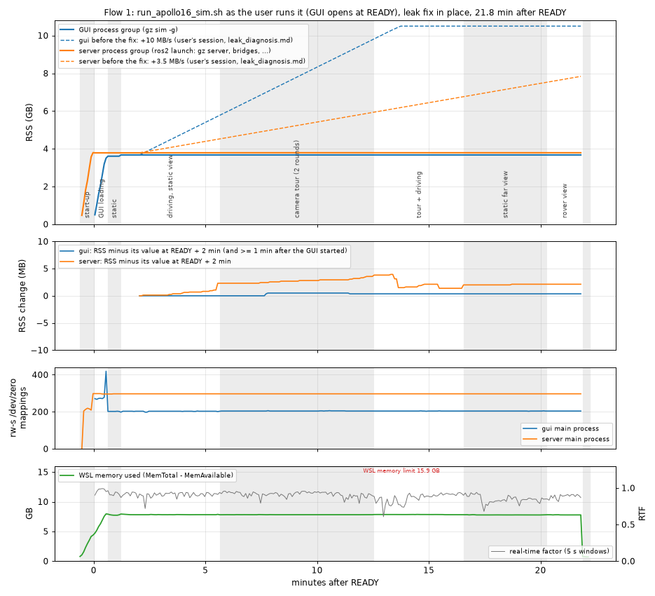
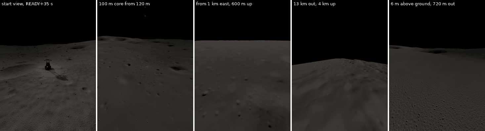
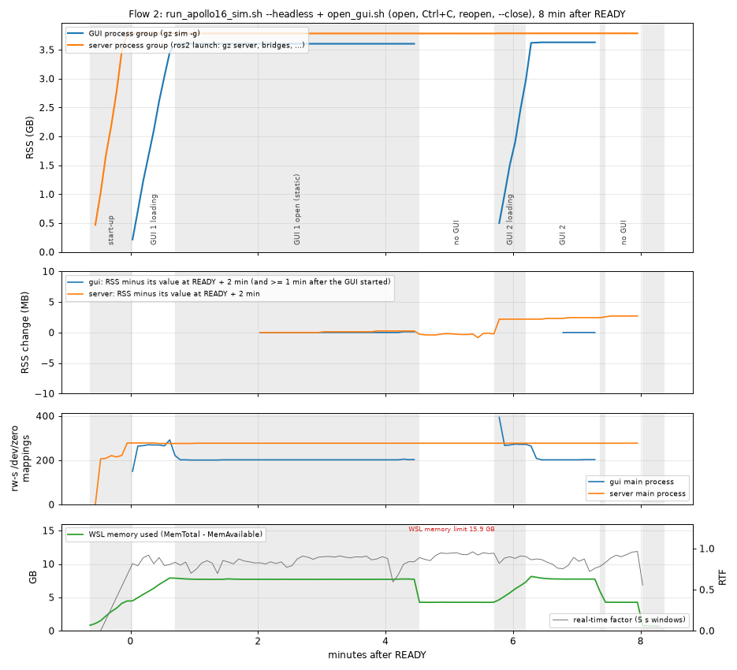

# End-to-end run of the user's launcher with the leak fix (`e2e`)

Owner: e2e agent, 2026-10-26, 21:51-23:10. Files: this file, `img/e2e_memory.png`, `img/e2e_gui_views.png`,
`img/e2e_flow2.png`. **No package file was changed**: no bug was found in `scripts/*.sh` or
`launch/apollo16_sim.launch.py` (`tests/test_sim_scripts.py` + `tests/test_sim_launch.py`: **72 passed**, 58.6 s,
run once at the end). Scratch: `/home/nargon/togo_assets/lunar/experiments/e2e/` (`EXP` below; raw data in
`EXP/runs/{smoke,r1,r2,env_compare}`). Every Gazebo process was started either by the package's own
`run_apollo16_sim.sh` / `open_gui.sh` and stopped by their Ctrl+C handling (their designed use), or was a short `gz` CLI
call under `setsid timeout -s KILL`. One simulation and at most one GUI ran at a time, and no other agent ran Gazebo
meanwhile (the sampler counted every gz server and GUI on the machine: at most 1 and 1). ROS_DOMAIN_ID was 131 and
GZ_PARTITION was the wrapper's default (1.2). Versions are as in leak_diagnosis.md: Mesa 25.2.8 (d3d12), NVIDIA 610.88
(RTX 2080), gz-sim 8.11.0, WSL kernel 6.18.33.2.

## 0. Summary

| question | answer | evidence |
|---|---|---|
| **(a) Does RAM stay flat in a long session with the GUI, including far and distant camera views?** | **Yes.** I fitted from READY + 2 min to the end of a 21.8-min session. The session had a static view, 9 min of driving, three camera-tour rounds (1-13 km views and ground close-ups 250-1270 m from the core) and a 3.7-min static far view. The GUI grew **+0.4 MB (0.0003 MB/s)** and the server process group **+2.1 MB (0.0010 MB/s)**. The `rw-s /dev/zero` mappings (the d3d12 leak's signature) stayed constant: GUI 198-206 with no trend, server 297. Before the fix the user's session grew 10 MB/s (GUI) and 3.5 MB/s (server). | 3, `img/e2e_memory.png` |
| RAM at steady state | GUI 3.69-3.76 GB; server group 3.87-3.88 GB (gz server 3.71 GB of it). WSL used 7.97-8.06 GB of 15.9 GB: 0.75 GB idle, 4.37 GB with the server alone. MemAvailable was at least 7.6 GB in every sample. | 3, 8, 9 |
| **(b) Does the sim deliver what DLIO needs?** | **Yes.** LiDAR: 209 x 122 at 20.0 Hz in sim time, no gap in 21.8 min, frame `lidar3d_0_laser`. IMU: 100.0 Hz, frame `imu_0_link`; at rest it reads 1.6200 m/s², 0.008° from the gravity direction of the ground-truth attitude, and the gyro is noise-free. Stamps are in sim time on a common 10 ms grid. The static TF matches the DLIO extrinsics (LiDAR z 0.312859 vs 0.313 m, IMU exact), and nothing published `odom -> base_link`. | 6 |
| Default launcher flow | Works as documented. READY marker at +38.9 s; GUI process 0.28 s later; window viewable at READY + 1.2 s; terrain at READY + 35 s. Windows title `Gazebo Sim (Ubuntu)`, no COPY MODE. `open_gui.sh` refuses before READY. | 2 |
| `--headless` + `open_gui.sh` | Works. It waits for READY, then the GUI starts 0.68 s after it. A second `open_gui.sh` refuses. Ctrl+C closes only the GUI (0.73 s) while the simulation keeps running (RTF 0.93, LiDAR 18.5 Hz). Reopening starts the GUI 3.5 s after the command. `open_gui.sh --close` from a third shell closes the GUI (gone 2.4 s after the command), and the GUI's terminal reports it and exits 0. | 8 |
| Ctrl+C | Everything stopped in **2.8 s / 2.0 s** (gz gone after 1.5 / 0.7 s), exit 130. No process left, run folder removed, no WSL crash dump (the folder was empty before and after all three runs). | 7 |
| Real-time factor | **0.82-0.93**, not 1. No GUI 0.93; GUI static 0.84-0.92; tour 0.91; tour + driving 0.86; static far view 0.85. | 9 |
| Observations (not package bugs) | At zero command the rover creeps 2-3 mm/s on the 4.8° spawn slope. A tight forward pivot stalled it once. The cloud has no per-point time field and its intensity is always 0. `/gazebo/dynamic_pose` (the SLAM reference-path overlay) is not published. With the GUI open the whole GPU uses up to 6,716 of 8,192 MiB. `MESA_GL_VERSION_OVERRIDE=3.3` comes from the `togo_description` environment hook. | 5, 6, 9, 10 |

## 1. Method

### 1.1 How the launcher was run

- The launcher ran from the repo root, exactly as the user types it: `./src/lunar_world_gen/scripts/run_apollo16_sim.sh`
  (flow 1, no option) or `... --headless` (flow 2). It ran in an interactive bash on its own pseudo-terminal:
  `script -qfe -T <timing> -c "bash -[l]ic 'export ROS_DOMAIN_ID=131 ROS_HOME=<scratch>; unset GZ_PARTITION; cd <repo>
  && ./src/lunar_world_gen/scripts/run_apollo16_sim.sh'" <log>`, with the pty's input read from a FIFO.
- **Ctrl+C** is the byte `^C` written to that FIFO. The pty line discipline turns it into SIGINT for the terminal's
  foreground job, exactly as a key press in a terminal does. The wrapper is in the foreground job; its `setsid`
  children (`ros2 launch`, the GUI) are not. `script`'s timing file gives the wall time of every output line, which the
  start-up timeline in section 2 is built from.
- `open_gui.sh` (flow 2) ran the same way on two more ptys. The refusal checks and `open_gui.sh --close` ran from plain
  login shells ("another terminal").
- **Environment.** Flow 2 started its ptys from WSL's start environment, which is what a new terminal has, with `bash
  -lic` (`~/.profile` + `~/.bashrc`; the latter sources ROS Jazzy and `~/clearpath_ws`). Flow 1 started its pty from my
  orchestrator shell, which had already sourced `scripts/env.sh` for the tools. `EXP/scripts/env_compare.sh`
  (`EXP/runs/env_compare/diff.txt`) prints what the wrapper hands to gz in both cases. Only two things differ. The
  order of `AMENT_PREFIX_PATH` / `CMAKE_PREFIX_PATH` / `PYTHONPATH` / `PATH` (clearpath_ws before or after the native
  install; no package name occurs in both). And two login-shell variables (`XDG_DATA_DIRS`,
  `DOTNET_BUNDLE_EXTRACT_BASE_DIR`). Every Mesa, GPU, ROS and Gazebo variable is identical. The orchestrator now keeps
  the tools' environment in a subshell (section 11).
- **Safety.** If MemAvailable dropped below 3 GB, the sampler would write ^C to the pty and SIGKILL the gz groups 30 s
  later. It never triggered: the minimum was 7.6 GB. Every pty ran under `timeout -s KILL`; if that fires, the pty hangs
  up and the wrapper's own cleanup runs.

### 1.2 GZ_PARTITION and ROS_DOMAIN_ID

The wrapper **does not choose a partition**. `env.sh` leaves `GZ_PARTITION` alone and the launch passes the
environment through. The user's simulations, and these runs, therefore use gz-transport's default `<hostname>:<user>` =
**`DESKTOP-L6C736L:nargon`** (checked with the python bindings). The session file and the ready marker record
`gz_partition=` as empty, so `open_gui.sh` uses the default too.

A collision needs a second gz server in the default partition. The wrapper's "already running" check catches its own
simulations and `togo_sim_wsl.sh`'s. The package tools (`bench_world.py`, `render_views.py`, `lidar_capture.py`,
`run_robot_tests.py`) set their own partitions. Only a bare `gz sim` started by hand in another terminal would share the
partition. Verified here: no gz process ran before each run; `gz topic -l` showed one world (`/world/apollo16_core/*`);
the sampler saw at most 1 server and 1 GUI on the machine in every sample.

ROS_DOMAIN_ID 131 was exported before the wrapper (`env.sh` keeps a value that is already set) and was in the
environment of every gz process.

### 1.3 Measurement tools (`EXP/scripts`)

| tool | what it does |
|---|---|
| `sampler.py` (system python + gz bindings) | Every 5 s: MemTotal / MemAvailable. Per process group (server = the `ros2 launch` group with gz server, gz guard, bridges and RSP; GUI = the `gz sim -g` group): summed RSS, CPU ticks, RSS of each process. For each main gz process: `/proc/<pid>/status` (RssAnon / File / Shmem) and the number of all mappings and of `rw-s ... /dev/zero (deleted)` mappings. Also `/world/apollo16_core/stats` (sim time, RTF), nvidia-smi every 15 s, and every gz server / GUI on the machine. Side threads: X windows (xwininfo every 0.5 s: name, map state); files in the state folder and gz processes appearing or disappearing (every 0.25 s); once per gz process its `/proc/<pid>/environ` and the GPU libraries in its maps. |
| `probe.py` (rclpy) | Subscribes the way DLIO would: LiDAR best effort, IMU, /clock, /tf, /tf_static, odom, joint states, plus the gz ground truth `/model/togo/pose`. Every 5 s: rates, stamp periods, stamp lag behind /clock, LiDAR-IMU stamp offset. Every 30 s and on trigger: cloud content, IMU statistics, static TF chain, /tf pairs. Also graph info (types, publishers, QoS). |
| `drive_loop.py` | Closed-loop pure pursuit on the ground-truth pose; TwistStamped at 20 Hz with sim-time stamps. Drives loops that `terrain_check.py` found gentle (≤ 8.5° over a 0.9 m corridor, obstacles < 6 cm), all within 7.2 m of the spawn, at 0.3-0.5 m/s with in-place turns. Guards: 10 m from the spawn, 25° tilt, 2 m off the path, 25 s without progress. |
| `camera_tour.py` + `plan_tour.py` | Uses the GUI's CameraTracking `/gui/move_to/pose` (GUICamera -> Boolean) and Screenshot `/gui/screenshot` (StringMsg = folder). Reads the actual camera pose from `/gui/camera/pose`. Detects the end of loading with screenshots. |
| `analyze.py`, `fig_e2e.py`, `show_slam.py`, `log_timeline.py`, `extra_numbers.py`, `env_compare.sh` | Per-phase tables, least-squares slopes, figures, log timelines. |

Slopes are least-squares fits of RSS (MB) against wall time. CPU 100 % = one core.

### 1.4 Runs

| run | content | after READY |
|---|---|---|
| smoke (22:12-22:18) | flow 1 with short phases, to check the tools | 4.2 min |
| **r1** (22:20-22:43) | **flow 1 (default)**: GUI loading; static view (only 34 s: an orchestrator bug, 10.1); 5 min driving with the start view; 2 tour rounds (6.8 min); tour round 3 + 4 min driving; static far view 3.7 min; rover view 1.5 min; Ctrl+C | **21.8 min** |
| **r2** (22:43-22:53) | **flow 2**: `--headless` + `open_gui.sh` (GUI 1 static 3.8 min); refusal of a second GUI; Ctrl+C on `open_gui.sh`; 1.2 min without GUI; reopen (GUI 2, 1.6 min); `open_gui.sh --close`; 0.6 min without GUI; Ctrl+C | 8.0 min |

## 2. Flow 1: start-up as the user sees it (r1)

| event | time | source |
|---|---|---|
| command started (interactive bash, `.bashrc` with nvm, ROS, clearpath_ws) | 0 | |
| `[1/2] Starting the Gazebo server and ROS nodes (the GUI follows at READY)...` | 2.6 s | log timing |
| `[wait_for_sensors] /sensors/lidar3d_0/scan/points advertised after 31.6 s` | 35.4 s | |
| simulation running again after the render-scene stall; spawners start | 35.9 s | |
| `platform_velocity_controller spawner exited with code 0` | 37.8 s | |
| `[apollo16_sim] READY at +35.8 s: ... active, /clock running` | 38.8 s | |
| ready marker present (= **READY** below; 0.1 s polling) | **38.9 s** | marker |
| `[2/2] READY after 37 s: starting the Gazebo GUI through WSLg...` + the GUI notice | READY + 0.17 s | log |
| GUI process `gz sim -g --gui-config /tmp/apollo16_sim-1000/run.41961/gui.config` | READY + 0.28 s | `/proc` |
| X window "Gazebo Sim" mapped (IsViewable 1200 x 1000, resized to 1000 x 845 at + 2.3 s) | READY + 1.2 s | xwininfo |
| Windows title **`Gazebo Sim (Ubuntu)`**, visible, no `[WARN:COPY MODE]` | checked at READY + 8 s | `list_wslg_windows.ps1` |
| first screenshot showing the terrain (end of the blank window) | READY + 35.2 s | screenshot file time |
| GUI RSS 3.59 GB / 3.69 GB | READY + 33 s / + 38 s | sampler |

- The ready marker appeared 44.4 s (smoke), 38.9 s (r1) and 40.9 s (r2) after the command. The launch's own READY was at
  +39.4 / +35.8 / +37.0 s; the rest is the shell start-up with `.bashrc`. This is within the documented 35-60 s. The
  window stayed blank for about 34 s (r1) and 39 s (r2), within the documented 30-60 s.
- `open_gui.sh` ran 31 s before READY. As intended it refused: `ERROR: this simulation opens
  its own Gazebo GUI when it is READY. One GUI at a time (each needs about 3.5 GB of memory). To open the GUI from here
  instead, start the simulation with --headless.` (rc 1, nothing started).
- The GUI's per-run config `run.<pid>/gui.config` is identical to `config/gui/apollo16.gui.config`: at the 'flat' site
  the camera stays at the file's view. No quick-start dialog: the only windows were "Gazebo Sim" plus Qt helper windows.
- Environment of both gz processes (`/proc/<pid>/environ`): `MESA_EXTENSION_OVERRIDE=-GL_ARB_multi_draw_indirect`,
  `GALLIUM_DRIVER=d3d12`, `MESA_D3D12_DEFAULT_ADAPTER_NAME=NVIDIA`, `MESA_GL_VERSION_OVERRIDE=3.3` (10.9),
  `ROS_DOMAIN_ID=131`, no `GZ_PARTITION`, `/usr/lib/wsl/lib` on `LD_LIBRARY_PATH`. Both mapped `libd3d12.so`,
  `libd3d12core.so`, `libdxcore.so`, `libgallium` and `libnvwgf2umx.so`, i.e. they rendered on the GPU. This was the
  same in r2.

## 3. Flow 1: memory (r1)



The dashed lines show where the GUI and the server would have been at the user's pre-fix rates (leak_diagnosis.md:
GUI 10 MB/s, server 3.5 MB/s). The GUI line is cut at 10.5 GB; the user's WSL ran out of memory near 9 GB of GUI.

| phase (r1) | s after READY | GUI RSS MB (first -> last) | GUI MB/s | GUI /dev/zero maps | server group RSS MB | server MB/s | server /dev/zero maps | RTF | WSL used MB |
|---|---|---|---|---|---|---|---|---|---|
| GUI loading | 3-33 | 511 -> 3585 | (load) | 271 -> 419 -> 202 | 3873.5 -> 3874.0 | 0.013 | 298 -> 296 | 0.975 | 6490 |
| static, start view | 38-68 | 3692.4 -> 3692.5 | 0.005 | 202 | 3874.0 -> 3874.0 | 0.000 | 296 -> 297 | 0.918 | 7965 |
| driving, static start view | 73-333 | 3759.3 -> 3759.3 | 0.000 | 198-201 | 3876.8 -> 3879.5 | 0.006 | 297 | 0.909 | 8009 |
| camera tour, 2 rounds, rover idle | 338-748 | 3759.3 -> 3759.7 | 0.001 | 203-204 | 3879.5 -> 3880.8 | 0.003 | 297 | 0.914 | 7999 |
| camera tour round 3 + driving | 753-988 | 3759.7 -> 3759.7 | 0.000 | 204 | 3881.0 -> 3878.6 | -0.011 | 297 | 0.861 | 8025 |
| static far view (6 m above ground, 720 m out) | 993-1213 | 3759.7 -> 3759.7 | 0.000 | 204 | 3879.2 -> 3879.3 | 0.001 | 297 | 0.845 | 7967 |
| rover view (end) | 1218-1308 | 3759.7 -> 3759.7 | -0.000 | 204 | 3879.3 -> 3879.3 | 0.000 | 297 | 0.885 | 7971 |
| **fit READY + 2 min -> end (123-1308 s)** | | **3759.3 -> 3759.7** | **0.0003** | 198-206, no trend | **3877.2 -> 3879.3** | **0.0010** | **297** | 0.887 | 7997 (max 8059) |

- Over the whole fit, GUI RssAnon changed by 0.0 MB (3548.1 -> 3548.1) and gz server RssAnon by +1.8 MB (0.0012 MB/s,
  about 4 MB per hour). Without new `/dev/zero` mappings this is not the d3d12 leak; it is too small to matter for SLAM
  sessions of several hours. Per process in the server group over the same window: gz server +1.8 MB, clock bridge
  +0.2, sim bridge +0.2, RSP, guard and `ros2 launch` 0.0.
- One step: the GUI went from 3692 to 3759 MB (+67 MB) between READY + 68 s and + 73 s, when the first drive started.
  It is a one-time allocation, not growth: in r2 the GUI stayed at 3690 MB for 3.8 min without driving.
- WSL in total: 0.75 GB before the start and after the stop, 4.37 GB with the server alone (r2), and 7.97-8.06 GB with
  server, GUI and my tools (tools 0.09-0.19 GB RSS: probe 79 MB, driver 68 MB, camera tool 57 MB).

## 4. Camera tour

Each round moved the GUI camera through 13 views with `/gui/move_to/pose`. Each move animates for 0.5 s and is held
8-12 s. Rounds 0 and 1 ran with the rover idle, round 2 while it drove.

| view | camera (x, y, z) m -> look at | purpose |
|---|---|---|
| core_overview | (-75, -75, 55) -> core centre | high overview of the 100 m core |
| core_top | (0, -2, 150), 85° down | top view |
| ring_oblique | (-320, -260, 260) -> centre | 300 m altitude and distance |
| far_1000_east, far_1100_north | (1000, 100, 600), (100, 1100, 1000) -> centre | across the 2.2 km far zone |
| horizon_ne_from_1km | (0, 0, 1000) -> (6000, 6000, 0) | the 20 km horizon from 1 km |
| horizon_outside_13km | (9000, -9000, 4000) -> centre | outside the far zone, 13 km out |
| fly_in_far_ground | 13 steps of 1.5 s from 600 m above the core to 6 m above (585, 390) | zoom into a distant area (720 m out) |
| ground_250m_west, ground_1270m_se, ground_860m_sw | 4-8 m above the far-zone collision height | close to the ground 250-1270 m away |
| pan_360_from_300m | 12 x 30° from (0, 0, 300) | horizon sweep |
| rover_chase | 5 m behind, 2 m above the rover | back to the rover |



- I made 110 move requests. The camera reached the target in all 41 per-step checks (`/gui/camera/pose` within 0.5 m).
  I took 28 screenshots and looked at 7: the start view, core overview, far 1000 m, horizon from 13 km, fly-in, the
  rover while driving, and the rover view after 21 min. All show the world correctly: terrain, rocks, craters, the
  rover and its shadow, black sky. None is blank and none shows garbage; the green dots are the GUI's light icons.
- Screenshots of the same view in rounds 0, 1 and 2 have identical statistics (e.g. far_1000_east mean 34.36, 69.09 %
  lit pixels each time), so the rendering did not change over the session.
- Memory during the tour was flat (section 3), including when the camera first revealed the far zone and the horizon.
  Everything is loaded at start; nothing is streamed in by camera position.
- 15 of the 138 GUI service requests in r1 got no reply within 10 s, mostly the first request of a newly started process.
  They took effect anyway (camera at the target, screenshot saved). This is a gz-transport quirk, not the GUI.

## 5. Driving (r1)

| | drive 1 (start view static) | drive 2 (with the camera tour) |
|---|---|---|
| wall / sim time | 259.1 s / 235.7 s, **RTF 0.910** | 242.1 s / 208.8 s, **RTF 0.863** |
| path (ground truth) | 76.1 m, mean 0.32 m/s | 75.5 m, mean 0.36 m/s |
| segments | to loop A; A ccw x2; 180° spin (6.6 s); C cw r 3 m; line; B ccw; B cw; line north (stalled) | to loop; A ccw x2; spin; C; line; B ccw; B cw (budget reached) |
| max distance from spawn; max abs roll / pitch | 7.10 m; 13.2° / 7.1° | 7.12 m; 12.1° / 7.0° |
| end | the driver's no-progress guard at 259 s (budget 300 s) | 240 s budget |
| `gz model -m togo -p` before -> after | (-1.788, -4.638, -0.596), yaw -0.394 rad -> (-2.630, -7.714, -0.569), yaw 2.980 | (-1.885, -7.951, -0.643) (pose topic) -> (-3.145, -6.475, -0.505), yaw -1.139 |
| LiDAR / IMU while driving (wall Hz; sim Hz) | 18.2 / 90.8; 20.0 / 100.0 | 17.2 / 86.2; 20.0 / 100.0 |

The message type was confirmed on the graph: `/platform_velocity_controller/cmd_vel` is `geometry_msgs/msg/TwistStamped`
with one subscriber, `/platform_velocity_controller`. Two physics observations came out of the driving; neither is a
package or memory issue:

- **Stall in a tight forward pivot.** At (-2.64, -7.71), heading 167°, the command was v 0.26 m/s, ω -0.49 rad/s:
  turn radius 0.53 m; with wheel separation 0.562 x 1.75 that is left wheels about 0.50 m/s, right about 0.02 m/s. The
  body stopped within 3 s, and its pose then stayed constant to 0.1 mm for 25 s while the command continued. In-place
  spins (v = 0, ω ±0.6) and wider turns worked throughout.
  - Probable cause: a pivot about the inner wheels needs more yaw moment than the outer wheels' traction (μ 0.4) can
    supply against the lateral friction of four wheels (wheelbase 0.512 m ≈ track 0.547 m). The inner wheels' velocity
    command holds the body like a brake.
  - Not investigated further; wheel speeds were not recorded.
  - Relevance: tight forward turns from Nav2 or teleop can stall the rover in this simulation (for the rover-test agent).
- **Creep at zero command.** After drive 1 the rover moved 0.78 m and turned -30° in 393 s of sim time near
  (-2.6, -7.7), about 2 mm/s; z dropped 7.5 cm, roll changed from -0.6° to +5.4°. Before any driving it moved 0.10 m and
  turned +3.8° in 37 s at the spawn (2.6 mm/s; footprint slope 4.8°). 18 s after READY it was already 0.13 m from the
  site's (-2.0, -4.5). For SLAM this is real motion, small but not zero: the at-rest gyro z mean of 3.5e-4 rad/s
  (section 6) is this rotation.

## 6. SLAM input check (what DLIO in the container needs)

Checked against `config/slam/seyond_dlio_graph_lunar.yaml` (dlio_odom_node). DLIO itself was not started.

| DLIO needs | measured (r1; r2 the same) | config | verdict |
|---|---|---|---|
| LiDAR `/husky/sensors/seyond/points`, PointCloud2 | type correct; publisher `/sim_bridge`, BEST_EFFORT, VOLATILE, depth 10 | same topic | OK |
| LiDAR rate | **20.0 Hz in sim time**: stamp period exactly 50.0 ms in every 5 s window for 21.8 min (r1) and 8 min (r2), no gap. Received 16.5-19.3 Hz wall, i.e. 20 x RTF. | | OK |
| LiDAR frame | `lidar3d_0_laser` | `frames/lidar: lidar3d_0_laser` | OK |
| LiDAR layout | 209 x 122 = 25,498 points, organized, point_step 32, fields x y z intensity (float32) and ring (uint16, 122 values), `is_dense` false. **No per-point time field.** | `pointcloud/deskew: true`, `syntheticTiming/enabled: false` | OK; deskew see 10.6 |
| LiDAR content | finite 13.0-15.8 k points (51-62 %); the rest are inf (sky, beyond 150 m), no NaN. Range min 0.141 m, median 1.4-2.0 m, p95 10-83 m, max 97-150 m. Ground 0.33-0.60 m below the sensor 2-6 m ahead. Intensity always 0. | `cropBoxFilter/size 0.50` removes the < 0.5 m returns | OK |
| IMU `/husky/sensors/imu_0/data_raw`, Imu | type correct; publisher `/sim_bridge`, RELIABLE, depth 10 | same | OK |
| IMU rate, frame | **100.0 Hz in sim time** (period exactly 10 ms); 82-97 Hz wall; `imu_0_link` | `frames/imu: imu_0_link` | OK |
| accel at rest | mean (-0.148, -0.018, 1.613) m/s², norm **1.6200**. That is **0.008°** from R^T (0, 0, 1.62) for the ground-truth attitude (roll -0.65°, pitch 5.25°). Std 1e-4. After 21 min: norm 1.6200, 0.11°. | `odom/gravity: 1.62` | OK |
| gyro at rest | mean (9e-6, -4.4e-5, 3.5e-4) rad/s; std 2-4e-5 rad/s. There is no noise model; the z mean is the rover's real creep rotation (5). | gyro calibration on, 3 s | OK, noise-free |
| covariances | all 0 (unknown) | | info |
| `/clock` | about 830-970 Hz (received), sim time advancing at RTF 0.82-0.97 | `use_sim_time: true` | OK (RTF < 1, 9) |
| stamps | sim time. At arrival the LiDAR header is 25-33 ms behind /clock (window means; max 40 ms), the IMU 0.5 ms (max 4.6). LiDAR stamps fall on IMU stamps (offset 0.0 ms). No stamp went backwards. | | OK |
| TF base_link -> lidar3d_0_laser | **(0.400, 0.000, 0.312859)**, R = I; static, from robot_state_publisher through 4 fixed joints | `t [0.400, 0.000, 0.313]`, R I | OK (0.14 mm) |
| TF base_link -> imu_0_link | **(0.059, 0.000, 0.161275)**, R = I | `t [0.059, 0.000, 0.161275]`, R I | OK, exact |
| no `odom -> base_link` from the sim | /tf carried only the 4 wheel transforms (18,568 messages each in r1); 57 static pairs on /tf_static (RSP only). `/platform_velocity_controller` has a /tf publisher endpoint (`enable_odom_tf: False`) but sent nothing. | DLIO publishes it | OK |

Outside DLIO: the SLAM stack's `reference_path_publisher` (ground-truth overlay in the same YAML and in
`lidarslam_ros2/.../seyond_live_slam.launch.py`) reads `/gazebo/dynamic_pose`. Nothing in this simulation publishes that
topic (the 35 ROS topics of r1 do not include it, and `togo_gz/config/bridge.yaml` does not bridge it). Its model-name
list does not contain `togo`. The ground truth exists in gz as `/model/togo/pose` and
`/world/apollo16_core/dynamic_pose/info` (10.7).

## 7. Stop with Ctrl+C

| | smoke | r1 (with GUI) | r2 (headless) |
|---|---|---|---|
| ^C -> gz guard has SIGKILLed the server | 0.64 s | 0.70 s | 0.63 s |
| ^C -> no `gz sim` process left | 1.36 s | 1.46 s | 0.67 s |
| ^C -> wrapper exited (rc 130) | 2.69 s | 2.79 s | 1.99 s |
| wrapper's message | `Apollo 16 simulation stopped (2.6 s).` | `(2.7 s)` | `(1.9 s)` |
| processes left (gz, ruby, ros2, bridges, RSP, spawners, launch, ros2 daemon) | none | none | none |
| `/tmp/apollo16_sim-1000/run.<pid>/` | removed | removed | removed |
| WSL crash dumps | none (folder empty before and after) | none | none |

The order was as designed: GUI group SIGKILL, guard SIGINT -> gz SIGKILL, then SIGINT to `ros2 launch`, whose bridges
and RSP stopped cleanly. With no dump written, the wrapper printed no crash-dump line. No ros2 daemon was ever started
(the tools use rclpy directly).

## 8. Flow 2: `--headless` + `open_gui.sh` (r2)

| step | result |
|---|---|
| `run_apollo16_sim.sh --headless` (terminal 1) | Printed `[2/2] No Gazebo GUI (--headless). Open it from another terminal (it waits for READY): .../open_gui.sh` at once; READY at +40.9 s (launch +37.0 s). |
| `open_gui.sh` (terminal 2, 6.6 s after the wrapper) | `Simulation: run_apollo16_sim.sh pid 67200, site flat, GZ_PARTITION <default>`, then `Waiting until the simulation is READY ...`, `READY (waited 32 s).` GUI process at **READY + 0.68 s**, window viewable at + 2.0 s, terrain at + 41 s (screenshot file time). Title `Gazebo Sim (Ubuntu)`. |
| a third `open_gui.sh` while GUI 1 is open | Refused, rc 1: `ERROR: a Gazebo GUI is already open (opened by open_gui.sh pid 67862). One GUI at a time: each needs about 3.5 GB of memory. Close it first: ./src/lunar_world_gen/scripts/open_gui.sh --close (or Ctrl+C in its terminal)` |
| **Ctrl+C in terminal 2** | `Gazebo GUI closed.` GUI gone **0.73 s** after ^C; `open_gui.sh` exited 0.94 s after (rc 0). The wrapper and simulation kept running: without the GUI, RTF 0.926, LiDAR 18.5 Hz (20.0 Hz sim), IMU 92.5 Hz. |
| `open_gui.sh` again (terminal 3) | GUI process 3.5 s after the command (READY already there; the time is login shell + `env.sh` + camera config); window viewable 1.0 s after the process. Terrain within 25 s of the process start: the screenshot requested at + 4.5 s was not served, the one at + 24.5 s showed the terrain at once (warm file cache). |
| `open_gui.sh --close` (another shell) | `Closed the Gazebo GUI of open_gui.sh (pid 77812) with SIGKILL (no crash dump); the simulation keeps running.` rc 0. The command took 2.4 s, mostly sourcing `env.sh`; the GUI was gone 2.4 s after it started. Terminal 3 printed `The Gazebo GUI was closed (SIGKILL, e.g. by open_gui.sh --close).` and exited 0. |
| Ctrl+C in terminal 1 | Stopped in 1.9 s, exit 130, nothing left, no dump (7). |



Memory in flow 2:

- GUI 1 static (225 s, start view): 3690.4 -> 3690.6 MB (0.0002 MB/s). Mappings 221 -> 203, i.e. down after the load,
  never up.
- Server: 3872.7 -> 3875.7 MB over the whole run, 277 mappings throughout. It grew +2.3 MB in one step when GUI 2
  connected (presumably the scene data sent to the new client) and released nothing when the GUI closed. Negligible.
- WSL used: 7.91 GB with the GUI, 4.37 GB without. Closing the GUI frees 3.5 GB at once.

## 9. Real-time factor, CPU, GPU

| condition | RTF (gz stats, d sim / d wall) | GUI CPU | gz server / server group CPU | GPU memory, whole GPU (nvidia-smi MiB of 8,192) |
|---|---|---|---|---|
| server only, no GUI (r2) | **0.926** | - | 210 / 251 % | 4,004-4,017 |
| GUI static, start view | 0.918 (r1, 30 s); **0.838** (r2 GUI 1, 225 s); 0.82 (r2 GUI 2) | 105-108 % | 207 / 247-249 % | 6,056-6,716 |
| driving, static view | 0.909 | 107 % | 207 / 249 % | 6,256-6,326 |
| camera tour | 0.914 | 129 % | 208 / 248 % | 6,182-6,505 |
| tour + driving | 0.861 | 122 % | 205 / 248 % | 6,259-6,644 |
| static far view (ground 720 m out) | **0.845** | **146 %** | 207 / 247 % | 6,235-6,600 |
| rover view after 21 min | 0.885 | 116 % | 208 / 249 % | 6,194-6,560 |

- The GPU used 1,713 MiB idle (Windows desktop), about 4,000 MiB with the server alone and up to 6,716 of 8,192 MiB
  with server and GUI. That leaves about 1.5 GB for other Windows programs using the GPU (browser, video). I did not
  test what happens when GPU memory runs out. The machine has 12 logical CPUs (Ryzen 5 3600X) and was never saturated.
- **RTF is below 1 in every state, and the GUI lowers it.** Without a GUI it was 0.93. With a GUI it was 0.84-0.92
  static and down to 0.85 when the view is full of distant terrain: the GUI then needs 146 % CPU, and it shares the GPU
  with the server's LiDAR rendering. RTF does not change what DLIO receives in sim time (section 6); it makes a
  sim-second take 1.1-1.2 wall seconds.
- Earlier robot runs measured 0.67-0.86 (fix_runtime 1.3, other agents running). DESIGN's "RTF ≥ 0.9 while driving" is
  met here only without a GUI or with a near view.
- The same start view gave 0.92 in r1 and 0.84 in r2. The gz environments were equivalent (1.1), so this is
  unexplained; Windows-side load is the likeliest cause.
- My probe adds load the user's session does not have: Python receives the 1 kHz /clock and the 16 MB/s cloud. DLIO
  would add comparable load.

## 10. Problems, observations, not verified

1. **My orchestrator bug (fixed, run not repeated).** `sleep_until` targets were printed with awk's `print`, which
   gives `1.79307e+09` for an epoch time. In r1 the static phase therefore ended at READY + 72 s instead of + 300 s. The
   static case is covered instead by r2's 3.8-min static GUI phase and r1's 3.7-min static far view and 1.5-min rover
   view. `run_r1.sh` now uses `printf "%.3f"`.
2. **gz-transport `NodeShared::Publish() Error: Interrupted system call`**: 11 lines in r1 (10 from the server, 1 from
   the GUI) spread over the run, 4 in r2, 4 in the smoke run. No effect was seen: no gap in LiDAR or IMU stamps. Not
   investigated.
3. **Log warnings, all known and harmless**:
   - ColladaLoader `COLOR` x25 (robot meshes)
   - sdformat `gz_frame_id` / `plugin` "not defined in SDF" (robot description, printed by the server, the GUI and
     `gz model`)
   - `Dummy SetJointVelocity` / `Dummy function SetJointPosition` x4 (bullet plugin at controller start)
   - Ogre material scripts, controller_manager deprecations, `has_jerk_limits` deprecation
   - `sim_bridge` cannot bridge `cmd_vel` TwistStamped (`togo_gz` bridge.yaml; unused)
   - zero `[Err]` lines.
4. **Rover creep at zero command** (2-3 mm/s on 4-5° slopes) and **one stall in a tight forward pivot** (section 5):
   physics observations for the rover-test agent; not investigated further.
5. **GUI service replies** may not arrive (15 of 138 in 10 s); the actions take effect anyway. Scripts using
   `/gui/move_to/pose` or `/gui/screenshot` should not rely on the reply.
6. **No per-point time field** in the cloud (fields x, y, z, intensity, ring), with `pointcloud/deskew: true` and
   `syntheticTiming/enabled: false` in the DLIO config, so deskewing has no per-point times to use. This is a property
   of the robot's gpu_lidar and the user's SLAM config, not of the world. Intensity is always 0.
7. **`/gazebo/dynamic_pose`** (input of the SLAM stack's reference-path overlay) is not published by this simulation
   (section 6). If the user's SLAM run script bridges it from `/world/<world>/dynamic_pose/info`, the world is now
   `apollo16_core` and the model `togo`. Not checked: the script lives in the container.
8. **Server +2.3 MB per GUI (re)open** (section 8): negligible unless the GUI is reopened hundreds of times.
9. **`MESA_GL_VERSION_OVERRIDE=3.3`** is set by the native install's `togo_description` environment hook
   (`install/togo_description/share/togo_description/environment/togo_description.dsv`), which `env.sh` sources.
   - It caps GL at 3.3 in every gz process, so the leak_diagnosis caveat cannot happen while the hook exists (a GL
     ≥ 4.6 context would re-enable indirect draws despite the extension override).
   - The fix does not depend on it: the extension override alone is what stopped the leak, at GL 3.3.
10. **Window title**: WSLg shows `Gazebo Sim (Ubuntu)`, while the GUI notice says 'Its title should be "Gazebo Sim"'.
    Correct in substance; see proposals.
11. **Not verified**:
    - mouse interaction in the GUI (emulated with CameraTracking moves; same render path, and the leak was per draw
      call, not per input)
    - DLIO itself (not started, as instructed)
    - sessions longer than 22 min
    - other spawn sites
    - `--gui-early`, `--rviz`, `--default-gui`, `--variant`
    - closing with the X button
    - GUI 2's Windows title (GUI 1 and the r1/smoke GUIs were checked)
    - wheel speeds during the stall
    - the cause of the r1/r2 RTF difference

## 11. Reproduction

Run from Windows with `wsl.exe -d Ubuntu --exec bash <script>`, or in WSL directly. Use one Gazebo at a time, and
nothing in the default gz partition.

```bash
EXP=/home/nargon/togo_assets/lunar/experiments/e2e
~/.venvs/lunar_world/bin/python -I $EXP/scripts/terrain_check.py      # gentle loops near 'flat' (drive_loop.py routes)
~/.venvs/lunar_world/bin/python -I $EXP/scripts/plan_tour.py          # -> $EXP/tour_plan.json (far-zone heights)
# flow 1, default launcher on a pty, ~25 min (smoke: P1_END=100 P2_DRIVE=30 P3_ROUNDS=1 P3_MAXWALL=60 P4_DRIVE=20 P5_HOLD=10 P6_HOLD=5)
bash $EXP/scripts/run_r1.sh r1
# flow 2, --headless + open_gui.sh (open, refuse a second, Ctrl+C, reopen, --close), ~10 min
bash $EXP/scripts/run_r2.sh r2
# analysis and figures
~/.venvs/lunar_world/bin/python -I $EXP/scripts/analyze.py $EXP/runs/r1 --fig $EXP/runs/r1/rss.png
~/.venvs/lunar_world/bin/python -I $EXP/scripts/fig_e2e.py memory $EXP/runs/r1 e2e_memory.png --prefix-rates
python3 $EXP/scripts/show_slam.py $EXP/runs/r1 rest_1,drive_1,final_running        # SLAM input details
python3 $EXP/scripts/log_timeline.py $EXP/runs/r1/wrapper.log $EXP/runs/r1/wrapper.timing <T_START> <T_READY>
bash $EXP/scripts/env_compare.sh                                    # wrapper env: user terminal vs r1 orchestrator
```

The window titles were read on the Windows side with
`C:\Users\Username\AppData\Local\Temp\claude\...\scratchpad\list_wslg_windows.ps1` (PowerShell, while the GUI was open).
Each run folder holds `samples.jsonl` / `events.jsonl` (sampler), `ros.jsonl` / `ros_detail.jsonl` /
`ros_summary_*.json` (probe), `cam.jsonl` and `shots/` (camera), `drive*.csv` / `drive*_summary.json`, `wrapper.log` +
`wrapper.timing` (the terminal as the user saw it), `gt_cli.txt`, `after_stop.txt`, `times.txt`, `analysis.json`.

### For the docs

These are measured numbers that the docs can replace estimates with:
- GUI about 3.7 GB, server about 3.9 GB, WSL in total about 8.0 GB with the GUI and 4.4 GB headless.
- READY at 39-44 s; GUI window 1-2 s after READY; terrain 35-41 s after READY (at most 25 s on a reopen).
- Ctrl+C in 2-3 s.
- RTF 0.82-0.93 (lower with the GUI, lowest on far views).
- The Windows title reads `Gazebo Sim (Ubuntu)`.
