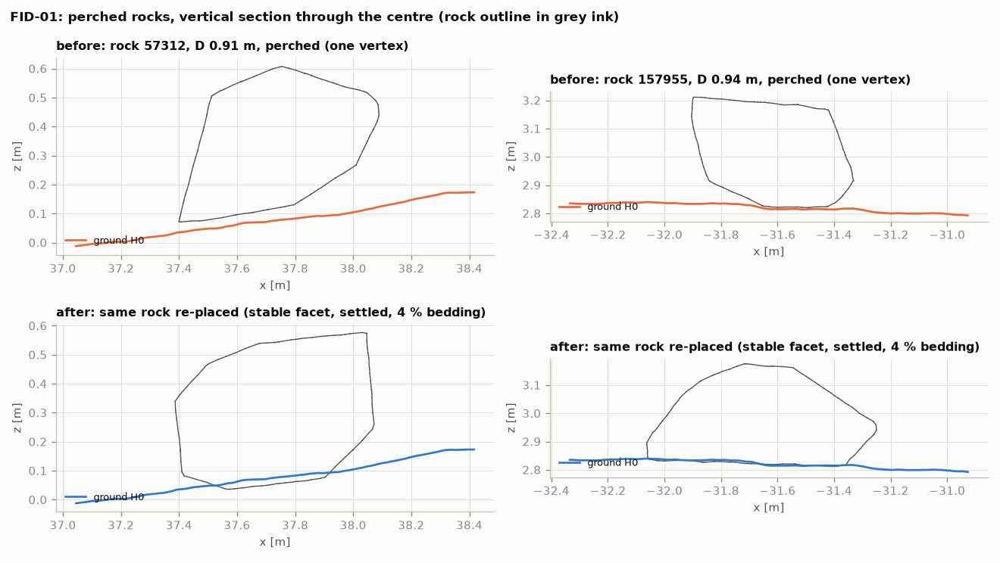
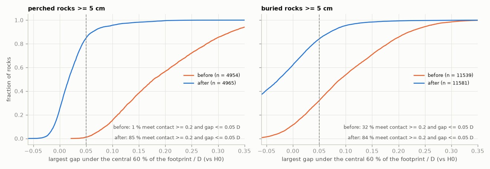
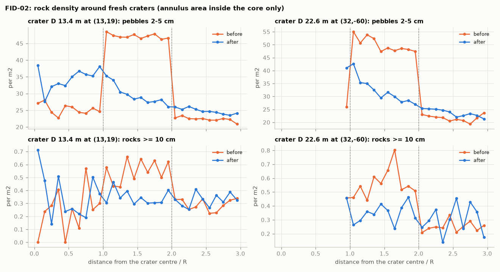
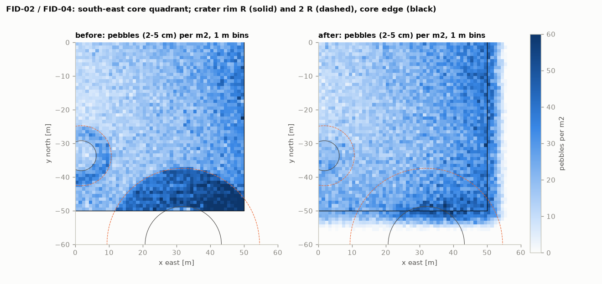
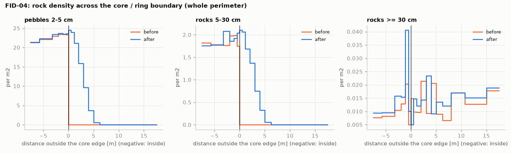
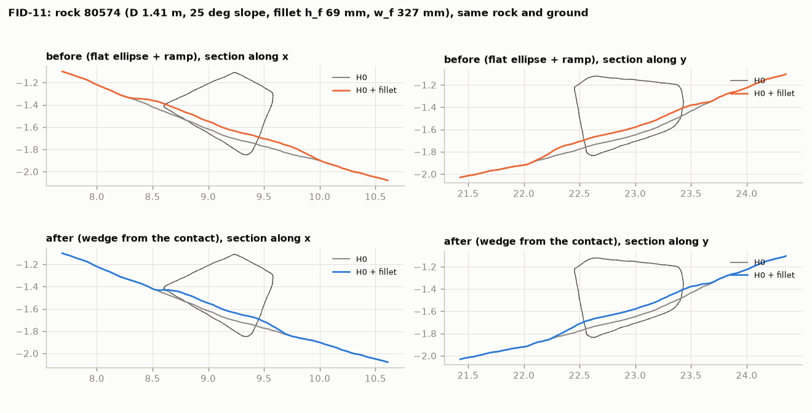
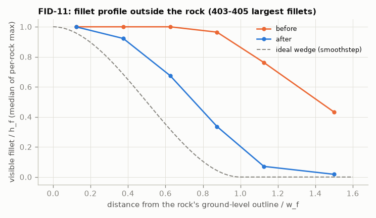
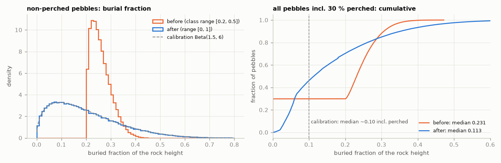

# Rock fixes (phase 3): FID-01, FID-02, FID-04 (rocks), FID-09, FID-11, FID-12

Owner: fix agent `rocks`, 2026-10-25, 16:08-18:20. Files changed: `lunar_world_gen/rocks/{population,
placement,fillets,catalog,library,collision_field}.py` (`merge.py` unchanged), `tests/test_world_rocks.py`
(updated), `tests/test_world_rocks_fixes.py` (new). No config, build or other-owner file was edited; every new
behaviour is the code default and every new key is optional (section 8 lists the proposed config).

Every number below was measured on the real inputs of the main build, read only: the cached terrain of
`build/apollo16_core` (1 cm H0 core tiles with margins, 25 cm ring H0, the `big` crater set) and the
production library `rocks_v1`. **Before** = the catalog of the validated world (copied at 16:21);
**after** = the new code (`v2`: code defaults; `v3`: code defaults + the proposed config of section 8),
sampled on the same terrain. The terrain code was being changed by the terrain fix agent while I worked
(TERRAIN_VERSION 3), so I did not build a full world; the downstream rock stages were run at full scale on
the cached terrain instead (sections 7 and 9). Scratch: `/home/nargon/togo_assets/lunar/experiments/fix_rocks/`
(`EXP` below; scripts, logs, JSON).

## 1. Result

| ID | verdict | before | after (v3) |
|---|---|---|---|
| FID-01 perched rocks on one vertex | **fixed** | perched >= 15 cm: contact 0.06, central gap 34.5 / 71.6 mm (p50 / p90), 0 % meet "contact >= 0.2 and central gap <= 0.05 D" | contact 0.70, gap 4.1 / 12.6 mm, **89 %** meet it (reviewer target 90 %), none has a gap > 0.1 D (was 80 %); perched >= 5 cm 1 % -> 85 %; buried >= 5 cm 32 % -> 84 % |
| FID-02 hard x2 crater donuts | **fixed** | x2 step at R and 2 R for every size around 60 fresh craters of 5-23 m | smooth radial profile, peak <= 1.5x for debris < 10 cm at the rim, no enhancement of rocks >= 10 cm (only craters >= 20 m can carry blocks; here 1 crater, +4 %) |
| FID-04 (rocks) core/ring cliff | **fixed** | rocks < 30 cm: 22-24 /m2 inside, 0 outside the core edge | raised-cosine band over 6 m: pebbles 24.4 / 21.2 / 15.9 / 9.7 / 3.7 / 0.6 /m2 at 0-0.5 / 1-2 / 2-3 / 3-4 / 4-5 / 5-6 m; +33.8 k rocks, **+0.53 M triangles**; >= 30 cm unchanged |
| FID-09 interpenetration | **fixed** | 1,520 pairs with a larger rock >= 5 cm, 2,926 rocks >= 5 cm pierced, 56 rocks hidden inside others, 2,476 centres inside a larger footprint | **0 / 0 / 0 / 0**; pebble-pebble touching 1,791 pairs (allowed) |
| FID-11 fillet plateaus | **fixed** | 95 % of fillets have a >= 0.9 h_f plateau beyond 0.3 w_f of the contact (up to 0.25 m2, 66 mm beyond w_f) | **0 %** (max 2 cm2); wedge decays from the real ground-level outline, also on slopes |
| FID-12 pebble burial | **fixed (with the proposed config)** | non-perched pebble burial median 0.252 (all incl. perched 0.231) | 0.171 = Beta(1.5, 6) (all 0.113; calibration "median ~10 %, many perched") |

Tests: `tests/test_world_rocks.py` 26 (6 updated to the new contracts), `tests/test_world_rocks_fixes.py` 12 new: **38
pass** (18 s). Whole package: 265 pass, 1 fails in another agent's new `tests/test_sim_launch.py`
(robot collision simplification, unrelated). The full core + ring catalog is byte-identical between two
processes (`EXP/scripts/e06_determinism.py`; the settle LP runs in parallel over independent rocks).

## 2. Method (what was measured, how)

- **Gaps (FID-01).** `EXP/scripts/fr_measure.py`: every rock's visual LOD is rasterised (cell D/32,
  0.5 mm-1 cm) into an underside; against H0 (bilinear, the placement ground) per rock: footprint
  contact fraction (gap <= max(1 mm, 3 % of the rock height), the fidelity review's definition), and the
  largest gap over the **central 60 %** of the footprint (footprint shrunk to 0.6 about its centroid).
  The reviewer's acceptance "contact >= 0.2 and central gap <= 0.05 D" is reported per class. All rocks
  >= 5 cm (16.5 k) and 30 k random pebbles. Perched flags of the new catalogs come from the placement
  (instrumented in the experiment, `cat_v3_perched.npz`), not from the burial value.
- **Overlaps (FID-09).** The fidelity review's test, re-implemented and reproduced exactly (10,392 /
  4,604 / 56 / 1,520 / 156 / 7 / 2,926): smaller rock's LOD vertices inside the larger rock's hull; plus
  "centre inside a larger footprint" (vertical line through the centre hits the larger hull).
- **Crater and edge profiles (FID-02, FID-04).** Density per m2 in 0.1 R rings (area inside the core
  only) and in bands of signed distance to the core edge.
- **Fillets (FID-11).** `EXP/scripts/b02_fillets.py`: for the 403-405 largest fillets, a 1 cm window per
  rock; contact region C = nodes where the LOD underside is at or below H0; d = distance to C. Metrics:
  visible fillet (not under the rock) >= 0.9 h_f farther than 0.3 w_f from C ("plateau beyond the
  contact"), fillet beyond w_f, profile of max f / h_f per d / w_f bin, excess over the ideal wedge
  h_f (1 - smoothstep(d / w_f)).

## 3. FID-01: perched rocks rest stably

**Reproduced.** Against H0 (the reviewer used the rendered TIN, same picture): perched rocks >= 15 cm
(n 223) contact 0.06, central gap 34.5 / 71.6 mm, 80 % > 0.1 D, 0 % acceptable; buried >= 15 cm 36 %.
`EXP/out/b01_baseline.json`.

**Fix** (`placement.py`, `library.py`):
1. `RockLibrary.rest_faces(proto)`: quasi-static rest poses of the 64-vertex hull (facets the centre of
   mass projects into), with tipping margin, solid angle, pose height and `base_gap` (underside height
   over the central 60 % of the footprint when resting on the facet; analytic, the underside of a convex
   body is convex so its maximum is at a vertex of the shrunk footprint).
2. Facet choice: stable facets with margin >= 3 deg and pose height <= 0.8 a, drawn with probability
   ~ solid angle x exp(-base_gap / 0.02 a): rocks rest on flat faces, not on keels. Analysis
   (`EXP/out/a01_hulls.json`, `a02_face_contact.json`): the lowest-centroid facet suggested in the task
   is often not flat (its normal ranges from -z to +z over the library; inherent central gap up to
   0.17 D); with the lowest-centroid rule perched >= 15 cm reached 45 % on H0, with the flat-face rule
   87-90 %.
3. Random yaw, alignment to the footprint plane, then `settle_rocks`: the rock is rotated about its
   centre of mass until its support plane is level, i.e. three visual-LOD vertices touch the real ground
   with the centre of mass over their triangle (rigid rock on rigid ground: the lower convex hull of
   (u, v, clearance) above the origin, a 2-D LP solved per rock by nested golden-section search, numba,
   parallel over rocks; iterated 4x because the ground under the vertices changes). Residual support
   slope on the final catalog: perched p50 0.000 deg, p99 0.031 deg; 201 of 64,497 perched rocks
   (0.3 %) are not at rest, on 32-41 deg crater walls (FID-03 terrain) where a rock would roll.
4. Perched means bedded, not floating: compliance burial U(0.02, 0.06) of the height; a perched rock
   whose facet is keel-shaped is bedded by (base_gap / a - 0.03) D, and perched rocks >= 5 cm settle
   further until the gap between their hull underside and the real ground over the central 60 % is
   <= 0.03 D (`inner_underside_gap`), all capped at 18 % of the height (`rocks.bedding`; inside the
   calibration's 0-20 % for young debris; 12 % gave 86 % instead of 89 % below). Buried rocks keep the
   calibrated burial (no bedding floor: it piled up at the cap and distorted Beta(1.5, 6)).
5. Buried rocks get the random tilt after settling (`tilt_max_deg`; proposed 8 instead of 15: buried
   >= 5 cm 79 % -> 84 % acceptable).

**After** (full catalogs, gaps vs H0; `EXP/out/b01_v2.json`, `b01_v3.json`):

| group | n | contact median | central gap p50 / p90 [mm] | gap > 0.1 D | acceptable (before) |
|---|---|---|---|---|---|
| perched >= 15 cm | 236 | 0.70 (0.06) | 4.1 / 12.6 (34.5 / 71.6) | 0 % (80 %) | **89 %** (0 %) |
| perched >= 5 cm | 4,965 | 0.71 (0.06) | 1.2 / 5.0 (12.5 / 26.0) | 4 % (85 %) | **85 %** (1 %) |
| perched pebbles (sample) | 9,159 | 0.77 (0.16) | 0.4 / 1.7 (5.1 / 8.3) | 3 % (91 %) | **85 %** (1 %) |
| perched >= 30 cm (large) | 28 | 0.69 (0.07) | 18.7 / 34.2 (70 / 140) | 0 % (82 %) | 71 % (0 %) |
| buried >= 5 cm | 11,581 | 0.83 (0.51) | -1.8 / 5.0 (6.2 / 16.8) | 5 % (46 %) | **84 %** (32 %) |
| buried >= 15 cm | 470 | 0.81 (0.51) | -3.1 / 15.7 (16.8 / 43.3) | 2 % (42 %) | 85 % (36 %) |

v2 (without the proposed config) is the same for perched rocks; buried >= 5 cm 79 %. The reviewer's target
(>= 90 % of perched >= 15 cm) is reached on the re-placed baseline positions (93 %, `e01_cap18`) and missed
by one point on the new catalog (89 %, n 236). The residual is terrain, not placement: on flat ground the
same rocks reach 99 % (`e01_v3_flat`); the misses are rocks bridging cm-scale hollows of the fBm ground and
boulders whose required bedding exceeds the 18 % cap (`rocks.bedding.max_frac`; raising it trades "perched"
for "buried"). Exposed height / D medians stay 0.44-0.51 (SP-8023 design value 0.5).
Figures: `img/fix_rocks_fid01_sections.png` (the reviewer's rocks 57312 and 157955 re-placed),
`img/fix_rocks_fid01_gaps.png`.




## 4. FID-02: smooth, size-gated crater enhancement

**Reproduced.** x2 step for every size at exactly R and 2 R: 13.4 m crater pebbles 24.6 -> 48.5 /m2 at R,
46.6 -> 22.7 at 2 R; 22.6 m DTM crater 25.9 -> 55.0; rocks >= 10 cm doubled too.

**Fix** (`population.py`): e(x, y) = 1 + max over fresh craters of A p(r / R), never stacking.
- p(t): floor 0.5 at the centre rising by smoothstep to 1 at the rim, then the ejecta-thickness law
  (t^-3 - q) / (1 - q) to 0 at 2.5 R; continuous everywhere (largest step between 1 mm samples 0.0003).
- Size gating per the calibration (2.4: blocky only if D >~ 4-6 regolith thicknesses, P ramps 0 at 20 m
  to 1 at 80 m; class C carries none): debris < 10 cm: A = 0.5 rho (<= 1.5x) for every fresh crater
  >= 5 m; blocks >= 10 cm: A = (factor - 1) w(D) rho with w 0 -> 1 over 20 -> 80 m. Here only the 22.6 m
  DTM crater qualifies, with A = 0.043.
- Two size bands (split at 10 cm) with their own Poisson count, intensity sampler and core
  normalisation (mean of m e = 1 over the core per band), so the core totals stay nominal (core counts
  within 0.9 sigma at 2 / 5 / 10 / 20 cm). `profile: annulus` keeps the old rule.

**After**: 13.4 m crater pebbles 32-36 /m2 over the floor and wall (0.2-0.9 R), 38 at the rim, 34-35 at
1-1.2 R, 28-30 at 1.2-1.6 R, 26 at 2 R, 24 at 2.5-3 R (background); 22.6 m crater 41-43 at the rim, 35 at
1.1-1.3 R, 30 at 1.5 R, 25 at 2-2.2 R, 22-23 beyond 2.5 R; rocks >= 10 cm flat within noise (0.3 /m2).
Side effect: with no block annuli the big-band normalisation is 0.999 instead of 0.873, so the ring's
>= 30 cm count rises 2,946 -> 3,278 (expected 3,260 for this field realisation; ring rows are
informational in the static check).




## 5. FID-04 (rock part): the core population continues past the core edge

**Reproduced.** Rocks < 30 cm: 21-24 /m2 (pebbles) and 1.8-2.0 /m2 (5-30 cm) up to x, y = +-50 m, 0 beyond.

**Fix** (`population.sample_edge_band`, called by `sample_rocks(zone="ring")`): rocks of D_min core to
D_min ring (2-30 cm) are sampled in the ring with the core's intensity (same field, crater factor and
per-band normalisation) times a raised cosine of the Euclidean distance outside the core square, 1 at
the edge and 0 at `rocks.edge_band.width_m` = 6 m. They are ring rows (zone 1, `collide` false, merged
into the ring strips), ids from 12,000,000, LOD = core class LOD with `edge_band.lod` overrides (pebbles
LOD1, a 12-triangle hull). Separation and the FID-09 overlap repair include the ring's own rocks and,
when given, the core catalog (`avoid=`).

**After**: 33,751 band rocks (expected 33,563): 31,151 pebbles (373,812 triangles), 2,391 small (117,304),
209 medium (38,276); **529,392 triangles**. Width 8 m would cost 0.72 M (the field outside the core averages
1.26x the core mean). Edge profile: see the table in section 1 and the figure. Ring rocks >= 30 cm keep their
rules and LOD.



Not covered here (other owners): the fine relief and 0.2-1 m craters at the edge, and the ring TIN's 5 cm
tolerance. Band rocks sit on the 25 cm ring H0 and need the build agent's contact stage (re-seat on the
rendered ring TIN; it handles ring rows) to touch the rendered ground. They have no collision, like core
pebbles (the 25 cm ring grid cannot represent them).

## 6. FID-09: no rock pierces a rock >= 5 cm

**Reproduced exactly** (section 2). **Fix** (`population.resolve_overlaps`, `find_conflicts`, numba
`_pair_conflicts`): after placement every pair whose bounding discs overlap is tested on the real
geometry; the smaller rock is re-drawn from its band's intensity and placed again if (a) its centre lies
inside the larger rock's footprint (any sizes), or (b) the larger rock is >= 5 cm (`overlap.pierce_min_D_m`)
and any of its LOD vertices is inside the larger hull, or a hull vertex of the larger rock is inside its
own hull (tolerance 0.01 mm). Repeated until clean (max 8 rounds, then dropped and counted).

| (core) | before | after v2 | after v3 |
|---|---|---|---|
| conflicts found / moved / rounds / dropped | - | 2,877 / 2,920 / 3 / 0 | 2,877 / 2,925 / 3 / 0 |
| pairs with larger >= 5 cm interpenetrating | 1,575 | 1 (touching, < 0.01 mm) | **0** |
| both >= 5 cm / both >= 10 cm | 156 / 7 | 0 / 0 | 0 / 0 |
| rocks >= 5 cm with a smaller rock inside | 2,926 | 2 | **0** |
| centre inside a larger footprint | 2,476 | 0 | **0** |
| fully hidden inside another rock | 56 | 0 | **0** |
| pebble-pebble partial (allowed) | 3,084 | 1,830 | 1,791 |

Ring incl. band: 0 conflicts after repair (band: 440 found, 441 moved). Cross-zone (ring vs core): 7
conflicts are resolved when the ring is sampled with `avoid=core` (section 9).

## 7. FID-11: fillets are wedges from the real contact

**Reproduced** (rock 80574, D 1.41 m on a 25 deg slope: 69 mm plateau 0.29 m2 beyond the outline).
**Fix** (`fillets.py`, profile `wedge`, default): per node, d = horizontal distance to the rock's convex
hull cut by the local ground plane through the node (H0 gradient over +-8 nodes; max of signed distances
to the hull's face planes), fillet = h_f (1 - smoothstep(d / w_f)), capped at the highest level at which
the rock is still within w_f ("never higher than the rock it leans on"). Pointwise, so tiles agree bit for
bit (measured: max |dH| 0.0 over all 180 overlapping tile margins, nodes >= 8 from a grid edge). Rocks
buried by no more than `min_burial` (default the perched compliance bound 0.06) get none; perched rocks
bedded deeper (keels, boulders on undulating ground, up to 18 %) get the same small fillet as buried ones;
`fillet_mask()` exposes the selection. `profile: ellipse` keeps the old shape.

| metric (403-405 largest fillets) | before | new code, baseline catalog | after (v3) |
|---|---|---|---|
| filleted rocks; h_f p50 / p90 / max [mm] | 1,703; 4.8 / 9.8 / 69.3 | same | 1,683; 4.4 / 9.4 / 45.6 |
| rocks with a >= 0.9 h_f plateau beyond 0.3 w_f (>= 4 cm2) | 95 % | **0 %** | **0 %** |
| largest such plateau | 0.25 m2 | 3 cm2 | 2 cm2 |
| fillet farther than w_f from the contact, max | 66 mm | 6 mm | 13 mm |
| excess over the ideal wedge p50 / p90 / max [mm] | 8.0 / 14.9 / 68.8 | 3.4 / 5.7 / 18.4 | 2.7 / 4.8 / 13.5 |
| visible f / h_f by d / w_f bin (median of per-rock max) 0-.25 / .25-.5 / .5-.75 / .75-1 / 1-1.25 / > 1.25 | 1.0 / 1.0 / 1.0 / 0.96 / 0.76 / 0.43 | 0.99 / 0.91 / 0.70 / 0.38 / 0.11 / 0.02 | 1.0 / 0.92 / 0.67 / 0.34 / 0.07 / 0.02 |

The remaining excess over the ideal is the hull-vs-LOD difference (the 64-vertex hull envelops the LOD by
a few cm in concave places). Fillet over the rock's own top at its thin edges: p90 6.6 mm (before 5.1),
max 22 mm (before 51). Cost: `apply_fillets` on the 100 tiles incl. loading them 7-12.5 s (before 1.2 s
for the fillets alone).




## 8. FID-12 and the proposed config

**Reproduced**: non-perched pebble burial median 0.252 / mean 0.260 (class range [0.2, 0.5] x
Beta(1.5, 6)); calibration (`lunar_calibration.md` 4): young South Ray debris 0-20 %, median ~10 %,
"recommend Beta(1.5, 6)", perched fraction 0.3. **Fix** = config: class burial range [0, 1] gives
Beta(1.5, 6) directly (the code reads a missing `burial` key as [0, 1]). After (v3): non-perched mean /
median 0.199 / 0.171 (Beta 0.200 / 0.174; KS test in `test_bedding_only_for_perched_rocks`), all pebbles
incl. perched median 0.113; non-perched medians of the other classes 0.14-0.15 -> 0.15-0.18. Pebble exposed
height / D median 0.43 -> 0.46.



Proposed `config/apollo16_core.yaml` changes (the code defaults already equal the new keys; only the first
two change behaviour):

```yaml
rocks:
  classes:                   # FID-12: [0, 1] = the calibration's young-debris Beta(1.5, 6)
    - {name: pebble, D_max_m: 0.05, library_class: pebble, lod: 0, burial: [0.0, 1.0]}
    - {name: small,  D_max_m: 0.12, library_class: medium, lod: 2, burial: [0.0, 1.0]}
    - {name: medium, D_max_m: 0.30, library_class: medium, lod: 1, burial: [0.0, 1.0]}
    - {name: large,  D_max_m: 50.0, library_class: large,  lod: 0, burial: [0.0, 1.0]}
  tilt_max_deg: 8.0          # buried rocks, after settling (FID-01: 15 deg leaves gaps on the high side)
  perched_fraction: 0.3      # perched = bedded: compliance perched_burial (+ keel / adaptive bedding)
  perched_burial: [0.02, 0.06]
  perched_tilt_max_deg: 0.0
  rest_face: {mode: stable, min_tip_deg: 3.0, max_extent_over_a: 0.8, flat_scale: 0.02}
  settle: {enabled: true, apply_to: all, iterations: 4, max_step_deg: 20.0}
  bedding: {target_gap_over_D: 0.03, max_frac: 0.18, apply_to: perched, adaptive_min_D_m: 0.05}
  overlap: {enabled: true, pierce_min_D_m: 0.05, max_rounds: 8}
  edge_band: {enabled: true, width_m: 6.0, lod: {pebble: 1}}
  crater_enhancement:        # FID-02 (annulus_R is only used by profile: annulus)
    profile: smooth
    factor: 2.0              # block factor around blocky craters (calibration 2-5)
    min_crater_D_m: 5.0
    min_rho: 0.73
    small_max_D_m: 0.10
    debris_factor: 1.5
    blocky_D_m: [20.0, 80.0]
    outer_R: 2.5
    floor_fraction: 0.5
terrain:
  fillets: {enabled: true, min_rock_D_m: 0.10, height_over_exposed_height: [0.0, 0.15],
            width_over_exposed_height: [0.5, 1.0], profile: wedge, min_burial: 0.06, slope_aware: true}
```

## 9. Integration notes (other owners)

1. **build.py, stage rocks**: pass `avoid=core` to the ring `sample_rocks` call. Without it the ring and
   band are not tested against core rocks crossing the edge (7 conflicts on seed 16).
2. **rocks/recontact.py** (`fillet_rows`): perched rocks now carry a compliance burial (> 0), so
   `burial > 0` selects them as filleted and keeps them on H0. Use `rocks.fillets.fillet_mask(cfg, cat)`
   (burial > 0.06), the selection the fillets actually use. The contact rule itself is compatible: the
   catalog `burial` is the effective sink fraction (incl. bedding), and orientation is kept.
3. **Validation**: `check_rocks` already exempts the band (`ring_edge_band_below_D_min` 33,751,
   `ring_below_D_min` 0) via `population.EDGE_BAND` and a Chebyshev band that contains my Euclidean one.
   Static rock check on v3: pass, 0 sanity problems.
4. **Budgets**: core rocks 6,583,432 triangles (<= 6.6 M, max tile 118,732; CR-01's missing headroom is
   unchanged); ring rock strips 1,488,360 (+626 k: band 529 k, ring >= 30 cm +97 k from section 4); total
   visual +0.62 M, i.e. about +0.5 s first-LiDAR load and +0.07 GB RSS by the DESIGN 13a fits.
5. **Cost** (real inputs, loaded machine, indicative): sampling the core 15-26 s (placement incl. settling
   and bedding 11-19 s, overlap 2-6 s), the ring incl. band 7-13 s, peak RSS 1.05 GB (before 2.4 + 1.9 s,
   stage 0.75 GB); heights about 8-13 s (before 2.2 s); collision and merge unchanged (1.5-2 s, 3.2 s).
6. Public API kept: all previous functions and signatures; new optional parameters (`place_rocks(...,
   lod=, stats=)`, `sample_rocks(..., avoid=)`, `burial_fractions(..., return_perched=)`,
   `crater_factor(..., band=)`, `fillet_field(..., params=)`, `_contact_heights(..., min_sink=,
   return_burial=)`), new helpers (`RockLibrary.rest_faces/hull_planes`, `settle_rocks`,
   `find_conflicts`, `fillet_mask`, ...). Catalog dtype, files and npz layout unchanged
   (`test_catalog_format_unchanged`).

## 10. Reproduce

```bash
E=/home/nargon/togo_assets/lunar/experiments/fix_rocks; PY=/home/nargon/.venvs/lunar_world/bin/python
cd $E/scripts
$PY b01_rock_metrics.py $E/baseline/world/rocks_catalog.npz baseline     # FID-01/02/04/09/12 before (10 s)
FR_BASELINE=1 $PY b02_fillets.py $E/baseline/world/rocks_catalog.npz baseline --fig 80574   # FID-11 before
bash run_final.sh        # catalogs v2/v3 (e03), metrics (b01, b02), downstream stages (e04), figures (f01)
$PY e01_placement.py v3 --flat ; $PY e05_residual.py ; $PY a01_hulls.py ; $PY a02_face_contact.py
cd <REPO>/src/lunar_world_gen && $PY -m pytest tests/test_world_rocks.py tests/test_world_rocks_fixes.py -q
```

`baseline/pkg` is the package as it was at 16:21 (old rock code); `FR_BASELINE=1` runs a script against it.
`fr_build.py` / `run_build.sh` (a test build pinning the old dtm_extract hash) were prepared but not used,
because the terrain code changed under them.
