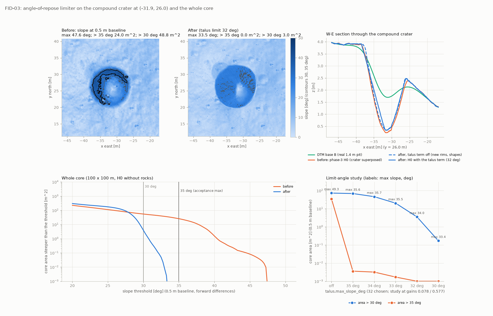
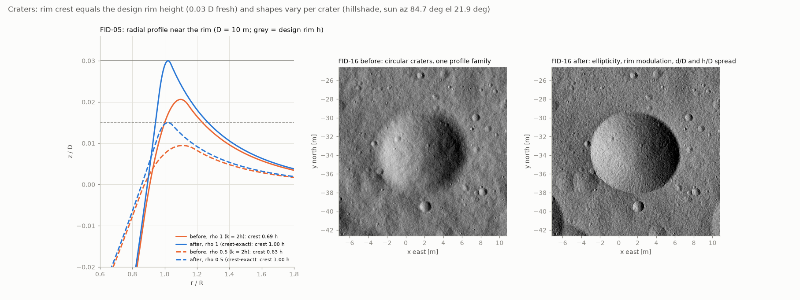
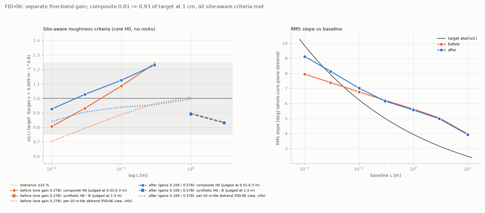
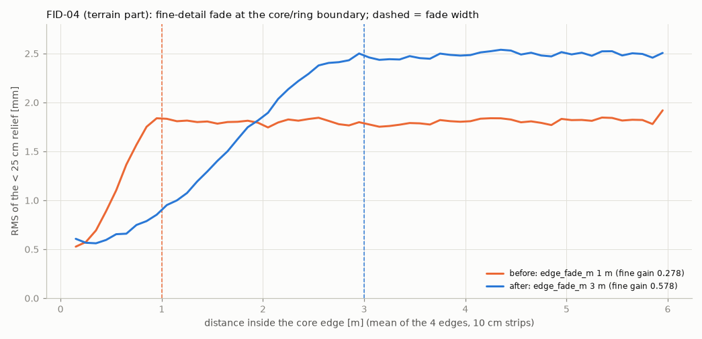
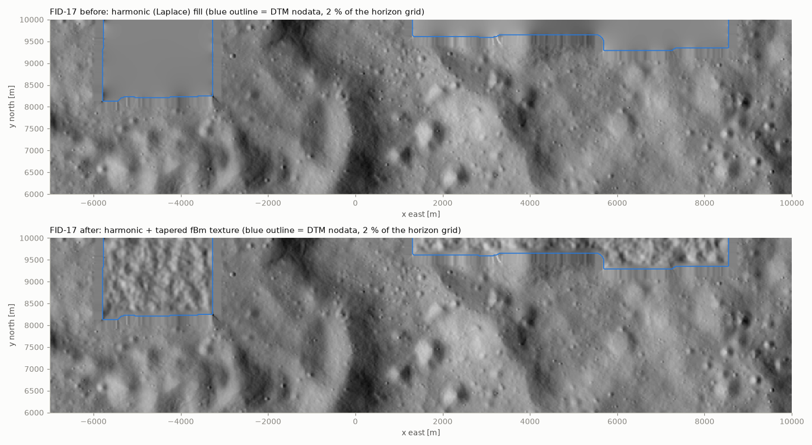

# Terrain fix round (phase 4, work package "terrain")

Owner: fix agent `terrain`, 2026-10-25, 16:08-18:10. Findings: FID-03, FID-04 (terrain part), FID-05, FID-06,
FID-16, FID-17 (review_fidelity.md) and CR-07 (review_code.md). Every finding was first reproduced on the
phase-3 build (`build/apollo16_core`, read-only), then fixed, regression-tested and measured on a terrain
rebuilt in `build/fix_terrain` with the proposed config (section 4) given as `--set` overrides. The repo
config was not edited. No Gazebo, no ROS, no git.

- Scratch: `/home/nargon/togo_assets/lunar/experiments/fix_terrain/` (`scripts/`, `out/*.json`, `logs/`, `fig/`,
  `orig_code/` = the phase-3 sources).
- Final terrain: `/home/nargon/togo_assets/lunar/build/fix_terrain/terrain/` (1.56 GB, terrain key
  `f0d7393a8558304a` of the final settings).
- Other fix agents ran builds in parallel (load average 4-9), so timings are indicative.

## 1. Result

| ID | Verdict | Before (phase-3 build) | After (this fix) |
|---|---|---|---|
| FID-03 | reproduced, fixed | core max slope (0.5 m baseline) 47.6 deg, 25.6 m^2 > 35 deg, 54.7 m^2 > 30 deg | 33.5 deg, 0 m^2 > 35 deg, 4.0 m^2 > 30 deg |
| FID-05 | reproduced, fixed | fresh crest 0.56-0.69 h (0.0194 D at rho >= 0.9) | crest = h to 1e-10 (0.0303 D at rho >= 0.9) |
| FID-06 | reproduced, fixed | composite 0.806 / 0.932 of target at 1 / 3 cm (per-tile detrend 0.70 / 0.79) | 0.926 / 1.028 (per-tile 0.84 / 0.91); every site-aware criterion met |
| FID-16 | reproduced, fixed | all craters circular, one profile family (rim azimuthal CV 1e-16) | ellipticity, rim modulation, d/D, h/D and exponent spread (rim CV 7-11 %) |
| FID-04 (terrain) | reproduced, fixed | fine relief fades over 0.8 m (10-90 %) | over 2.5 m (`zones.core.edge_fade_m` 3 m) |
| FID-17 | reproduced, fixed | horizon nodata smooth: nu(20 m) 0.86 m vs 2.26 m around it | 2.36 m; curvature RMS 1.54 vs 1.58 m in the valid ring |
| CR-07 | reproduced, fixed | far field with 100-row chunks: 74 mm max difference, 1201 of 1301 rows | bit-identical for any `--chunk-nodes`; production bases unchanged |

Also found and fixed: the fBm synthesis (`rfft2(workers=n)`) changed by up to 6e-8 m with the thread count,
which the talus thresholds amplify to centimetres. The FFT is now blocked and thread-count invariant.

Kept invariants:
- **Zone boundaries:** bit-identical (0.0 m at the core/ring, ring/far and far/horizon boundaries, tile
  overlaps and `height_at`).
- **Determinism:** 113 of 113 terrain files are bit-identical between a 12-thread incremental build and a
  3-thread build from scratch.
- **Crater population:** unchanged (positions, sizes, freshness and ids bit-identical to phase 3).
- **Tests:** `pytest tests -q` gives 266 passed.

## 2. What changed

| File | Change |
|---|---|
| `terrain/talus.py` (new) | Angle-of-repose limiter T (FID-03). Mass-conserving talus relaxation of the 10 cm composite, limit 32 deg, Catmull-Rom sampler, cache. |
| `terrain/compose.py` | H0 gets `+ w_ring * T`. Separate coarse/fine fBm scales. Talus key in the terrain key. New build stage `talus` (`ALL_STAGES`). `evaluate`/`grid` accept `fbm_scale=(coarse, fine)`. `TERRAIN_VERSION` 3. |
| `terrain/craters.py` | FID-05: crest-exact rims (`solve_rim_parameter`, `k = 0.5 hp`). FID-16: per-crater shape fields, elliptical, azimuthally modulated kernel. `CRATERS_VERSION` 2; version-1 files still load (k = 2h, circular). |
| `terrain/fbm.py` | `fbm_gains`, `fbm_scale(cfg, band)` (FID-06). Blocked thread-invariant FFT. `FBM_VERSION` 2. |
| `terrain/calibrate.py` | Five components (B, K, T, Fc, Ff). Two-gain fit against the site-aware criteria (`fit_gains`). `--apply` repeats until the gains are stable and writes `fbm_gain_fine`. Single-gain fit kept (`--single-gain`). |
| `terrain/base.py` | FID-17: `fill_nodata_textured` for far/horizon; fill parameters in the base key. |
| `terrain/__init__.py` | Docstring (module list). |
| `tools/dtm_extract.py` | CR-07: one vertical-iteration decision per extraction. `--vertical-iteration auto/always/never`. Decision recorded in the JSON. |
| `tests/test_world_terrain.py` | 34 tests (23 before; 11 new, 5 updated). |
| `tests/test_world_dtm_extract.py` | +1 chunk-invariance test (8). |
| `docs/impl/img/fix_terrain_*.png` | 5 figures. |

### 2.1 Height function

```
H0 = B + w_ring (F_coarse + K_big + T) + w_core (F_fine + K_small)
     F_coarse = sqrt(fbm_gain) * unit coarse field,  F_fine = sqrt(fbm_gain_fine) * unit fine field
```

**T, the talus term (`terrain/talus.py`)**

- **Input.** T is computed once on the fixed 10 cm lattice of the coarse fBm field (ring square + 2 m, 5041^2) from Hs = B + w_ring (F_coarse + K_big) + w_core K_small. That is everything the 10 cm grid resolves; F_fine is the exception, because the grid would only alias it.
- **Relaxation.** Explicit nonlinear diffusion with Jacobi updates: `D_pq = 0.24 * clip((G_pq - S)/(0.1 G_pq), 0, 1)`, where G_pq is the full gradient at the edge midpoint and S = tan(31 deg). It runs until every edge gradient is at most tan(32 deg).
- **Mass and locality.** D_pq is computed identically from both sides of an edge, so mass is conserved (per-window balance <= 1.1e-15 m^3). Walls slump: the rim loses height and the floor gains it. Elsewhere T = 0 exactly.
- **Windows.** Work runs only in windows around steep edges (3 m margin, boxes merged, grown if the change reaches the frame).
- **Sampling.** Catmull-Rom interpolation: exact at the 10 cm nodes, C1, and exactly 0 wherever T and its neighbours are 0. H0 is therefore bit-identical to the unlimited composition away from relaxed walls.
- **Zone consistency.** Every zone samples the same cached field with the same kernel, so zone boundaries stay bit-identical.

**Why K_small is in the input, and why 32 deg.**
- A 0.82 m fresh crater sitting on a 31 deg relaxed wall added 6 deg at 0.5 m (measured: 31.4 -> 37.5 deg), so small craters must be relaxed too.
- The limit-angle study is below (seed 16; core; 0.5 m baseline; at the intermediate gains 0.078 / 0.577). 32 deg is the largest limit that gives max <= 35 deg. Its > 30 deg area is of the order of the calibration's fresh-wall share: fresh_A walls are 26-31 deg (atan 4 d/D), which gives about 2 m^2 per hectare above 30 deg.
- Physically, walls steeper than the static angle of repose (about 35 deg) fail and come to rest a few degrees lower.

| `terrain.talus.max_slope_deg` | off | 35 | 34 | 33 | **32** | 30 |
|---|---|---|---|---|---|---|
| max slope (deg) | 49.3 | 35.6 | 35.7 | 35.5 | **34.0** | 33.4 |
| area > 30 deg (m^2) | 72.8 | 68.7 | 46.2 | 20.2 | **3.5** | 0.17 |
| area > 35 deg (m^2) | 34.7 | 0.004 | 0.003 | 0.002 | **0** | 0 |
| windows (ring square) | 0 | 100 | 142 | 174 | 206 | 1 merged |
| composite / target at 0.3 m | 1.248 | 1.232 | 1.229 | 1.225 | 1.221 | 1.210 |

### 2.2 Craters

- **FID-05 rim.**
  - The polynomial smooth minimum lowered the crest to `h - k * s_in s_out / (s_in + s_out)^2`, i.e. 0.56-0.69 h with DESIGN's k = 2h.
  - The rounding is now `k = 0.5 hp` (crest rounded over about +-4 % of R). The rim parameter `hp` is solved per crater (numba bisection on the analytic crest location) so that the rounded crest of the circular profile is exactly h.
  - hp / h = 1.08-1.23. The exterior ejecta flank scales with hp, so it is 8-23 % thicker than before.
  - The crest moved from 1.10-1.12 R to 1.02-1.03 R.
  - The nominal fresh wall (rho = 1) steepens from 28.8 to 32.1 deg. The limiter caps composite walls of craters >= 0.4 m at 32 deg.
- **FID-16 shape.**
  - Drawn from the separate stream `terrain.craters.<which>.shape`, so the population draws are unchanged:
    - `v_d ~ U(0.85, 1.15)`: fresh d/D 0.11-0.15 (calibration fresh_A 0.11-0.17);
    - `v_h ~ U(0.8, 1.2)`: fresh rim 0.024-0.036 D (calibration 0.022-0.04);
    - exponent `n = 1 + rho * U(0.9, 1.1)`;
    - axis ratio `U(0.85, 1)`, uniform orientation;
    - rim modulation `1 + a2 cos 2(az - p2) + a3 cos 3(az - p3)`, with a2 <= 0.2 and a3 <= 0.1. This modulates rim, ejecta and upper wall.
  - Measured on 400 craters per set: the azimuthal mean crest = h within 0.03 %; azimuthal crest CV median 7-11 %.
  - Before the limiter, fresh walls on flat ground are p50 27.5 deg, p90 32.7 deg; 2 % exceed 35 deg.
  - The sampling margin stays at its version-1 value. Elliptical craters centred just outside it could reach only the zone's edge-fade band.

### 2.3 Calibration (FID-06)

**Model.** H0 = B + K + T + s_c Fc + s_f Ff is linear in (s_c, s_f), so one pass over the five component fields gives nu(L) exactly for every pair of gains.

**Fit (lexicographic).** Grid search, 0.005 then 0.001:
1. Maximise the number of site-aware criteria met with a margin of 0.02:
   - composite within 1 +- 0.23 at 0.01, 0.03, 0.1 and 0.3 m;
   - H0 - B within 1 +- 0.23 at 1 and 3 m;
   - H0 <= 1.13 B at 10 m.
2. Minimise the sum of ln(ratio)^2 over the ratio criteria.

**Why least squares.** A min-max objective (tried first) left 1 cm at 0.84 to gain 0.006 at 0.3 m.

**Rounds.** T follows the coarse gain, so the fit was repeated until stable:

| round | limit | gains in (coarse / fine) | gains fit |
|---|---|---|---|
| 1 | 34 deg | 0.278 / 0.278 | 0.078 / 0.577 |
| 2 | 34 deg | 0.078 / 0.577 | 0.077 / 0.580 |
| 3 | 32 deg | 0.078 / 0.577 | 0.109 / 0.578 |
| 4 | 32 deg | 0.109 / 0.578 | 0.109 / 0.576 |
| 5 | 32 deg, thread-invariant FFT | 0.109 / 0.578 | 0.109 / 0.575 |

**Result.**
- Final gains: **coarse 0.109, fine 0.578**.
- The deviogram measured on the rebuilt tiles matches the prediction to 4e-9 relative.
- For reference, the best single shared gain (0.222) misses 3 lags.

### 2.4 Other fixes

**FID-04 core edge fade.** `zones.core.edge_fade_m` 1 -> 3 m (config only; the code already supported it).

**FID-17 horizon nodata.** Harmonic fill plus a textured residual:
- fBm noise; Hurst exponent and amplitude fitted on the valid DTM within 100 nodes (H = 0.95);
- high-passed at 1 km, so the harmonic fill keeps the large-scale shape;
- smoothed with a Gaussian of 1.2 nodes, matched to the block-averaged DTM's curvature;
- tapered in from 0 over 10 nodes, so it is continuous with the real data;
- seeded from `terrain.base.<zone>_fill`.

Valid nodes are unchanged; only the 20,436 nodata nodes change. The far field has no nodata and is unchanged.

**CR-07 (dtm_extract).**
- **Decision.** `iterate = max|h| over the processed DTM window inside the grid's pixel box (+2 px) * max node distance / R > max(0.05 spacing, 5 mm)`. It is taken once per extraction.
- **Metadata.** The reported max shift is now pointwise (`|h| d / R`), so it is chunk-independent too.
- **Production decisions are unchanged.** Core: no iteration (0.6 mm). Ring: no (6.05 mm < 12.5 mm). Far: yes (0.115 m > 0.1 m). Horizon: yes. Core, ring and far bases are bit-identical to phase 3.

**Determinism (FFT).**
- `rfft2/irfft2(workers=n)` gave results that differ by 3e-8 to 6e-8 m between 1, 4, 8 and 12 workers. The phase-2 note "bitwise identical across worker counts" does not hold at 6400^2 / 10800^2.
- That difference once made T differ by up to 4.7 cm (74,329 vs 74,432 changed nodes) between a build-CLI run (12 workers) and a compose run (8 workers).
- `synthesize` now runs 1-D passes over fixed 64-row/column blocks, each single-threaded, on a thread pool. Measured bit-identical for 1, 3, 4, 8 and 12 threads; the fine field takes 5.3-5.9 s versus 7.2 s single-threaded.

## 3. Measurements

All values are on the core H0 (100 x 100 m, 1 cm, no rocks). "Before" is the phase-3 build; "after" is `build/fix_terrain` with the proposed config.

### 3.1 Slopes and the compound crater (FID-03)

Gradient slope from forward differences over baseline L (validate.stats definition, no detrend), over 98-100 M nodes.

| L | max before (where) | max after (where) | > 30 deg before / after (m^2) | > 35 deg before / after (m^2) | > 40 deg before / after (m^2) |
|---|---|---|---|---|---|
| 0.15 m | 51.8 (-34.86, 21.95) | 39.3 (-24.84, 1.80) | 62.4 / 38.8 | 27.9 / 0.34 | 4.2 / 0 |
| 0.5 m | 47.6 (-34.87, 22.05) | 33.5 (-28.47, 26.78) | 54.7 / 4.0 | 25.6 / 0 | 1.5 / 0 |
| 1 m | 42.2 (-29.21, 30.25) | 32.9 (-8.02, -45.49) | 51.2 / 2.6 | 22.3 / 0 | 0.6 / 0 |

- The reviewer's 15 cm estimator (5 cm subsample, 3x3 mean) gives max 49.8 -> 34.8 deg, and 0.28 % -> 0 % of the core above 35 deg.
- The remaining 0.15 m maximum (39.3 deg at (-24.84, 1.80)) is a fresh 0.2-0.4 m crater on flat ground. The 10 cm grid does not resolve it, and it is below the 0.5 m acceptance baseline.
- More area lies at 20-28 deg after the fix (exceedance curve in the figure): higher rims (FID-05) and the larger fine gain (FID-06).
- Static `slope_distribution` (plane-detrended): mean 7.76 -> 8.06 deg at 0.1 m, 6.31 -> 6.21 deg at 1 m, 4.70 -> 4.67 deg at 10 m. The fraction above 25 deg at 0.1 m is 1.34 -> 1.84 %.

| site (disc) | L | max before / after | > 35 deg before / after | > 30 deg before / after |
|---|---|---|---|---|
| compound crater (-31.9, 26.0), D 11.85 m on the 1.4 m DTM pit, r <= 7.7 m | 0.5 m | 47.6 / 33.5 deg | 24.0 / 0 m^2 | 48.8 / 3.0 m^2 |
| same | 1 m | 42.2 / 31.7 deg | 22.0 / 0 m^2 | 47.8 / 2.1 m^2 |
| second case (-6.5, -47), r <= 3 m | 0.5 m | 40.6 / 33.3 deg | 1.6 / 0 m^2 | 4.6 / 0.46 m^2 |

**Compound pit.**
- Depth below the 1.4-1.6 R annulus: 2.94 -> 2.87 m; crest to floor 3.86 -> 3.78 m. The floor rose 0.19 -> 0.30 m: the walls slumped and the pit stays.
- The B pit alone is 1.40 m deep. B's maximum slope in the core is 21.9 deg, so B is never limited.

**Talus field (final).**
- 218 windows over the ring square. 74,468 nodes (745 m^2) changed in total, 18,386 nodes (184 m^2) in the core.
- max |T| 0.470 m (compound crater). Net mass 2e-7 m^3.
- Iterations: median 25, maximum 550. All windows converged; no window's frame was touched.
- Steepest input edge 53.8 deg -> 31.0 deg.
- Compute: 17.7 s (10.6 s of it evaluating Hs at 10 cm); 102 MB on disk.



### 3.2 Craters (FID-05, FID-16)

400 craters per set, each evaluated alone; crest = maximum over 0.8-1.6 R along 8 azimuths.

| set, rho | crest / h before | crest / h after | crest / D before | crest / D after | crest r/R before / after | azimuthal crest CV after |
|---|---|---|---|---|---|---|
| big, >= 0.9 | 0.682 | 1.000 | 0.0194 | 0.0303 | 1.10 / 1.03 | 0.107 |
| big, 0.73-0.9 | 0.667 | 1.000 | 0.0161 | 0.0240 | 1.10 / 1.03 | 0.096 |
| big, 0.4-0.73 | 0.637 | 1.000 | 0.0105 | 0.0158 | 1.11 / 1.02 | 0.075 |
| big, < 0.4 | 0.575 | 1.000 | 0.0024 | 0.0041 | 1.12 / 1.02 | 0.081 |
| small, >= 0.9 | 0.681 | 0.999 | 0.0197 | 0.0300 | 1.10 / 1.03 | 0.081 |

The review's acceptance is crest/D >= 0.027 for rho >= 0.9: the median is now 0.0303 (big) and 0.0300 (small). Individual craters range 0.024-0.036 D x rho because of the FID-16 rim spread.



### 3.3 Roughness: deviogram against the site-aware criteria (FID-06)

Whole-core plane detrend (DESIGN estimator). Target ν = 0.069 m L^0.8. The official
`validate.static_checks.check_roughness` on the tiles + core B reports **pass** before and after.

| L (m) | target ν (m) | H0 before: ν (m) / ratio | H0 after: ν (m) / ratio | H0 - B / target before / after | H0 / B before / after | RMS slope (deg) before / after | criterion |
|---|---|---|---|---|---|---|---|
| 0.01 | 0.00173 | 0.00140 / 0.806 | 0.00161 / **0.926** | 0.672 / 0.816 | 1.898 / 2.182 | 7.95 / 9.12 | composite +-25 % |
| 0.03 | 0.00417 | 0.00389 / 0.932 | 0.00429 / **1.028** | 0.749 / 0.871 | 1.762 / 1.944 | 7.39 / 8.14 | composite +-25 % |
| 0.1 | 0.01094 | 0.01187 / 1.085 | 0.01231 / **1.125** | 0.825 / 0.885 | 1.614 / 1.673 | 6.77 / 7.02 | composite +-25 % |
| 0.3 | 0.02634 | 0.03268 / 1.241 | 0.03240 / **1.230** | 0.877 / 0.874 | 1.482 / 1.470 | 6.22 / 6.16 | composite +-25 % |
| 1 | 0.06900 | 0.09864 / 1.430 | 0.09753 / 1.413 | 0.898 / **0.892** | 1.348 / 1.333 | 5.63 / 5.57 | H0 - B +-25 % |
| 3 | 0.16617 | 0.26479 / 1.594 | 0.26179 / 1.575 | 0.835 / **0.831** | 1.228 / 1.214 | 5.04 / 4.99 | H0 - B +-25 % |
| 10 | 0.43536 | 0.69560 / 1.598 | 0.68832 / 1.581 | 0.494 / 0.484 | 1.071 / **1.060** | 3.98 / 3.94 | H0 <= 1.15 B |

**Per-10 m-tile plane detrend** (FID-06's rover-scale view, information only), ratio to target at 0.01 / 0.03 / 0.1 / 0.3 / 1 m:
- before: 0.704 / 0.793 / 0.888 / 0.964 / 1.009;
- after: 0.841 / 0.906 / 0.940 / 0.955 / 0.995.

**Components after** (ν in m at 0.01 / 0.3 / 3 m):

| component | 0.01 m | 0.3 m | 3 m |
|---|---|---|---|
| B | 0.00074 | 0.0220 | 0.216 |
| K | 0.00083 | 0.0218 | 0.142 |
| T | 0.00023 | 0.0058 | 0.026 |
| Fc at 0.109 | 0.00028 | 0.0077 | 0.030 |
| Ff at 0.578 | 0.00113 | 0.0062 | 0.006 |

**Remaining shortfall.**
- The cm scale cannot reach 1.0 without pushing 0.3 m out of tolerance: B + K + T alone are already 1.19 of the target at 0.3 m, because of the bowl's 4-6 deg slopes and the crater rims.
- The coarse gain therefore drops to 0.109. Craters now supply most of the 0.5-10 m relief.



### 3.4 Core edge (FID-04, terrain part)

RMS of the < 25 cm relief (Gaussian high-pass, sigma 4.7 cm) in 10 cm strips from the core edge, as the mean of the four edges:

| | at 0.1-0.4 m | 10-90 % rise | interior | steepest change |
|---|---|---|---|---|
| before (fade 1 m, fine gain 0.278) | 0.60 mm | 0.05-0.85 m (0.8 m) | 1.82 mm | 2.63 mm/m |
| after (fade 3 m, fine gain 0.578) | 0.58 mm | 0.05-2.55 m (2.5 m) | 2.50 mm | 1.41 mm/m |

- The transition is now three times wider and half as steep, while the interior carries more cm relief.
- The rock part of FID-04 (no rocks < 30 cm in the ring) is the rocks package's job.



### 3.5 Horizon fill (FID-17)

ν inside the filled nodes, 20,436 nodes at 8.1-10 km north:

| | 20 m | 40 m | 100 m | 200 m | Laplacian RMS |
|---|---|---|---|---|---|
| harmonic fill (before) | 0.85 | 1.69 | 4.11 | 8.02 | 1.8e-5 |
| textured fill (after) | 2.36 | 4.64 | 10.49 | 16.70 | 1.54 |
| valid DTM (all valid pairs / 10-node ring) | 2.26 | 4.45 | 10.70 | 20.21 | 1.58 |

- The boundary step p99 is unchanged (7.45 m, against 6.95 m between valid neighbours).
- Cost: 0.5 s.
- Cast shadows of the far field and horizon remain off (integration decision, camera only).



### 3.6 dtm_extract chunk invariance (CR-07)

| case | chunks | before: max diff / rows > 1 mm | after |
|---|---|---|---|
| production far (2.6 km, 2 m, low-pass, deseam) | 100 rows (130,100 nodes) | 74.2 mm, rms 2.1 mm / 1201 of 1301 | bit-identical |
| same | 400 rows | 26.9 mm / 901 of 1301 | bit-identical |
| far at 10 m (no iteration) | 10 / 100 rows | identical | identical |
| production ring (540 m, 25 cm) | 100 rows | identical | identical |

The new tool reproduces the cached phase-3 core, ring and far bases bit for bit.

### 3.7 Crater counts, zone boundaries, determinism, cost

**Crater counts** are unchanged; the population is bit-identical to phase 3.
- Core N(>=D) at 0.2 / 0.5 / 1 / 2 / 5 / 10 m: 12433 / 2026 / 524 / 125 / 21 / 2. Expected 12496 / 1996 / 496 / 121 / 16.1 / 1.4, so the ratios are 0.995 / 1.015 / 1.056 / 1.032 / 1.30 / 1.42 (the static check judges 0.2-2 m).
- Ring square, at 1 / 2 / 5 / 10 m: 12318 / 3034 / 373 / 44.

**Zone boundaries** (terrain manifest checks) are all 0.0 m, i.e. bit-identical:
- core tiles vs ring grid on the core boundary (1604 nodes);
- ring vs far on the ring boundary (1004);
- far vs horizon on the far boundary (444);
- neighbouring tile overlaps;
- `height_at` vs tile and ring nodes.

The underlying extraction differences are unchanged: B_core vs B_ring 5.4 um, B_ring vs B_far 1.29 mm.

**Determinism.**
- `compose --all`, incremental with 12 threads (default), against a from-scratch build with LUNAR_WORKERS=3 and NUMBA_NUM_THREADS=3: all 113 files are bit-identical (4 bases, the horizon mask, 2 fBm fields, T, 100 tiles, 3 zone grids, both crater sets).
- Changing only the FID-17 smoothing left T, all tiles and ring/far bit-identical; only the horizon base and grid changed.

**Cost** (indicative, under load):

| item | phase 2 | now |
|---|---|---|
| clean terrain build | 1:57 | 2:17-2:58 (talus stage 16-25 s; crater rim solve 1.3-7.6 s, 15-17 s with 3 threads) |
| incremental rebuild (bases, fBm, T cached) | | 1:00-1:34 |
| terrain-stage peak RSS | 2.18 GB | 2.38 GB (child dtm_extract 2.78 GB, unchanged) |
| terrain disk | 1.46 GB | 1.56 GB (+102 MB talus) |
| calibration run (5 components) | 3.3 GB peak | 4.17 GB peak, 116 s |

The build CLI's terrain stage was run once in my build dir (`python -m lunar_world_gen.build --stages terrain`, exit 0). The new build.py forced a full rebuild there ("no build record"), which with the thread-invariant FFT is bit-identical.

## 4. Proposed config

Apply the first three together. The gains were calibrated with the 3 m fade, the 32 deg limiter and the version-2 craters.

> **Required.** With the new terrain code and the old single gain (`fbm_gain` 0.278 for both bands), the composite at 0.3 m is 1.27-1.28 times the target, so the static roughness check fails. I measured 1.277 (round-1 "pre"), and fix_build.md reports 1.27 from its build. With the values below it is 1.230 and every site-aware criterion passes.

The config comment of `fbm_gain` ("multiplier on the synthetic fBm amplitude") should become "coarse-band (>= split wavelength) PSD gain".

```yaml
zones:
  core:
    edge_fade_m: 3.0            # FID-04: fine-detail fade 1 -> 3 m
terrain:
  roughness:
    fbm_gain: 0.109             # coarse-band (>= split_wavelength_m) PSD gain; was 0.278 for both bands
    fbm_gain_fine: 0.578        # NEW, FID-06: fine-band (2 cm - 0.5 m) PSD gain
  talus:                        # NEW, FID-03 (these equal the code defaults)
    enabled: true
    max_slope_deg: 32.0
  craters:                      # NEW, FID-05 / FID-16 (these equal the code defaults)
    rim_rounding_k_over_h: 0.5
    shape: {d_spread: 0.15, rim_spread: 0.2, n_spread: 0.1, axis_ratio_min: 0.85,
            rim_mod_a2_max: 0.2, rim_mod_a3_max: 0.1}
```

## 5. Tests

`tests/test_world_terrain.py` (34 tests; 11 new, 5 updated) and `tests/test_world_dtm_extract.py` (8 tests, 1 new):

- **Craters:**
  - profile continuity with crest = h;
  - crest = h for 200 sampled craters, and the review's median acceptance;
  - FID-16 ranges, determinism, population unchanged, elliptical outline, version-1 file loads as before;
  - superposition with shaped craters (brute force).
- **Talus:**
  - relaxation limits the slope, conserves mass, leaves far nodes exactly 0, is deterministic, and leaves gentle surfaces untouched;
  - the Catmull-Rom sampler interpolates and is exactly 0 elsewhere;
  - real-DTM small layout at a 28 deg limit: slope limit met, H0 bit-identical away from windows, zone boundaries 0.0, T deterministic.
- **fBm:**
  - two gains;
  - synthesis bit-identical for 1, 3 and 8 threads.
- **Calibration:**
  - two-gain site-aware fit recovers known gains, where a single gain fails;
  - `fbm_gain_fine` line inserted with an aligned comment;
  - end-to-end `--apply` on a temporary config (stable after the rounds, verification < 1e-3).
- **Other:**
  - FID-17 textured fill: valid nodes unchanged, roughness 0.6-1.6 of the surroundings against < 0.5 harmonic, continuous, deterministic;
  - FID-04 fade weights and key;
  - CR-07 chunk invariance on the production far parameters, plus `always` / `never`.

Whole package: `pytest tests -q` gives **266 passed in 198 s**.

## 6. Notes for other owners and the docs

- **DESIGN.md.** These items are outdated by this round; I may not edit the file:
  - section 3: the T term, two fBm gains, the site-aware two-gain calibration, and the core fade of 3 m;
  - section 4: k = 0.5 hp with a solved hp so the crest equals h, and the per-crater shape variation.
- **terrain.md.** Its profile, calibration and fade statements are superseded by this report.
- **build.py.** The terrain stage key is `TerrainModel.key`, which now covers the gains, talus parameters and versions. A new terrain module (`talus.py`) exists if module sources are hashed (CR-11).
- **dtm_extract.py.** Its SHA is part of the base keys, so the next main build re-extracts all bases (about 1 min, 2.8 GB child). The results are identical except the horizon nodata.
- **rocks.** Crater sets keep `x, y, D, rho, d, h, R, id`; `h` is still the rim crest height. Rocks follow the new H0 through the cached tiles and `height_at`.
- **calibrate.** `--apply` edits the config file. Without a config file it writes the default config, so use `--config` with a copy, or apply the values manually. Its default figure path is `docs/impl/img/terrain_deviogram.png`.

## 7. Reproduce (WSL, from `src/lunar_world_gen`)

```bash
PY=/home/nargon/.venvs/lunar_world/bin/python
S="--set paths.build_dir=/home/nargon/togo_assets/lunar/build/fix_terrain --set zones.core.edge_fade_m=3.0 \
   --set terrain.roughness.fbm_gain=0.109 --set terrain.roughness.fbm_gain_fine=0.578"
$PY -m lunar_world_gen.terrain.compose --all $S                       # about 2:20 clean, 1:00 incremental
$PY -m lunar_world_gen.terrain.calibrate $S --figure /tmp/dv.png      # stable fit 0.109 / 0.575-0.578
E=/home/nargon/togo_assets/lunar/experiments/fix_terrain/scripts      # measurement scripts (run from $E):
#   measure.py <terrain_dir> <label>       slopes, compound crater, pit, edge fade
#   deviogram_compare.py <terrain_dir> <label> [--set ...]   site-aware table + static check + per-tile
#   findings_misc.py <terrain_dir> <label> crests, shapes, horizon fill
#   cr07_chunks.py <dtm_extract.py> <label>   variant_study.py off 35 34 33 32 30   determinism.py   figures.py
```

## 8. Limitations

- **Small craters at the 0.15 m baseline.** 0.2-0.4 m fresh craters are not resolved by the 10 cm limiter. Their walls reach 33-39 deg at 0.15 m (0.34 m^2 above 35 deg in the core); at 0.5 m nothing exceeds 35 deg.
- **Coarse fBm.** It drops to 0.109 because the corrected rims and the site's own slopes already fill 0.3-3 m.
  - Synthetic H0 - B at 1 / 3 m is 0.89 / 0.83 of the target: inside the tolerance but low.
  - The per-tile cm scale is 0.84-0.91.
  - Raising either needs a decision on the 0.3 m composite rule. B + K + T alone are already 1.19 there.
- **Window merging.** At 32 deg, nearby boxes merge into one large window (102 x 130 m around the core). This is correct; the whole relaxation takes about 7 s. A limit of 30 deg merges everything into one window (101 s talus + tiles build).
- **Final validation.** World-level validation (rocks, meshes, Gazebo) was not run on this terrain; other agents were editing build.py and rocks while I worked. The quiet-machine validation should include it.
