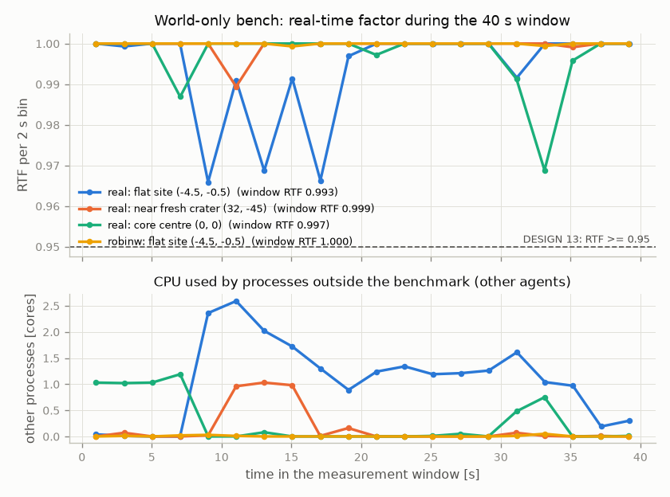
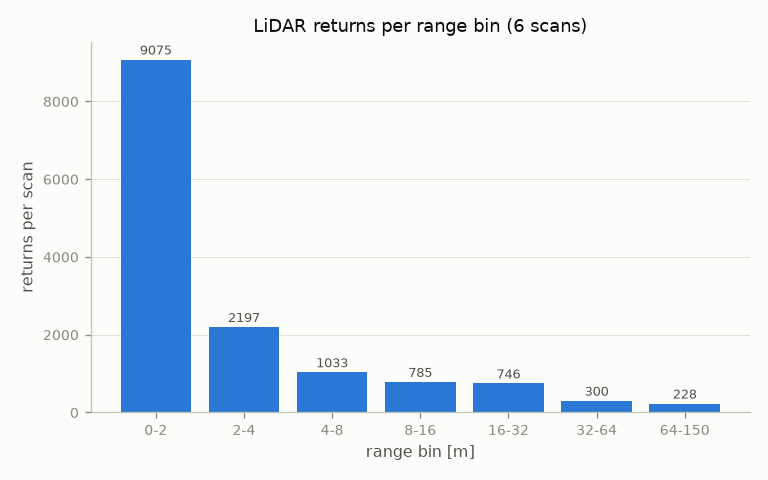
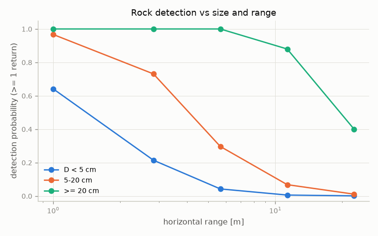
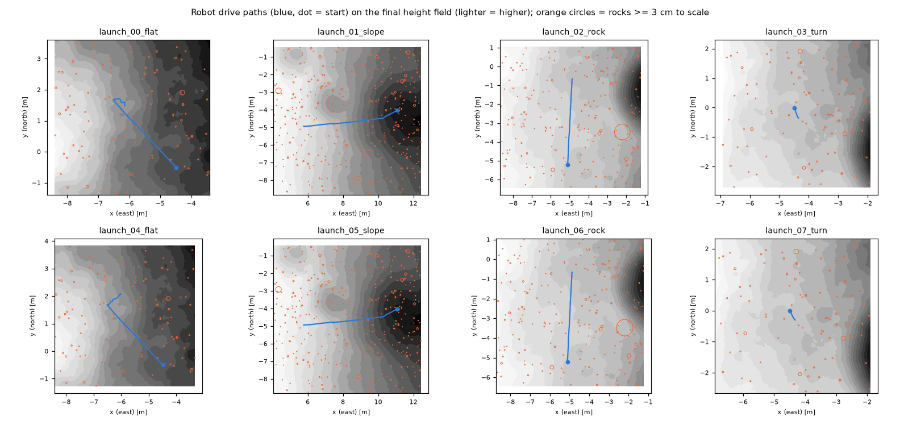
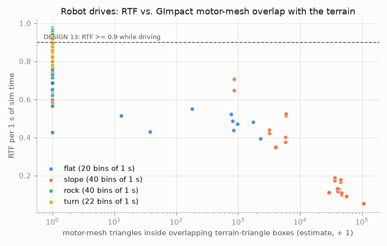

# Gazebo validation of the built world (phase 3)

Owner: gzvalidation agent, 2026-10-25, 13:20-14:15. The world under test is the integration build
`/home/nargon/togo_assets/lunar/worlds/apollo16_core/` (9.53 M visual / 0.90 M collision triangles,
215,678 core rocks, see `integration.md`). Every Gazebo run used `GZ_PARTITION=claude_p3val`,
`ROS_DOMAIN_ID=82`, a private `ROS_HOME`, `setsid`, process-group stop and coreutils `timeout`.
Scratch data: `/home/nargon/togo_assets/lunar/experiments/p3_gzvalidation/` (`EXP` below). Result
JSONs and the report are in `world_dir/reports/`.

## 1. Verdict per DESIGN 13 criterion

| area | criterion | measured | verdict |
|---|---|---|---|
| world only | loads with no errors | 0 `[Err]`, 0 `[Wrn]` in all 8 bench runs and the capture run | PASS |
| world only | D3D12 renderer | `libd3d12.so`, `libd3d12core.so`, `libdxcore.so` mapped in every server, no llvmpipe/swrast | PASS |
| world only | load time <= 30 s | first LiDAR cloud 19.6 / 21.0 / 21.1 s (real) and 23.3 s (robinw) | PASS |
| world only | RTF >= 0.95 | 0.993 / 0.999 / 0.997 (real), 1.000 (robinw), 40 s windows | PASS |
| world only | server RSS <= 5 GB | peak 2.66-2.76 GB | PASS |
| LiDAR | no returns beyond the ring | 0 of 86,189 returns; farthest 167.5 m (Chebyshev) of 250 m | PASS |
| LiDAR | ground residuals | 0 below ground, 2 "floating" (2.3e-5; both rock-side hits, see 4.3) | PASS |
| LiDAR | leaks (missing returns) | 0 leak candidates of 86,189 expected ground hits | PASS |
| LiDAR | rock detection vs size and range | 7 of 7 judged bins consistent | PASS |
| robot | controllers active, no spawner failure | 8 / 8 launches active, spawner exit codes 0 / 0 in 8 / 8 | PASS |
| robot | flat: v_ss >= 0.95, distance >= 0.93 | v_ss 1.004 / 1.004; distance **0.9277 / 0.9283** (2.783 / 2.785 m of 2.79 m) | **FAIL** (by 5-7 mm; site grade, 5.2) |
| robot | flat: yaw tracking >= 0.85, airborne <= 2 % | 0.883 / 0.925; 0.33 % / 0 % | PASS |
| robot | slope climbed | 85.3 % of 6 m, mean climb 11.4 deg, no stall (x2) | PASS |
| robot | rock traversed without stalling | 99.7 / 99.8 % of 4.5 m, slowest 1 s window 0.294 m/s (cmd 0.3) | PASS |
| robot | turn yaw tracking >= 0.85 | 0.954 / 0.953 | PASS |
| robot | RTF >= 0.9 while driving | 0.443 (contended), 0.191, 0.919, 0.854, 0.566, 0.198, 0.826, 0.908 | **FAIL** (5.1) |

`validation_report.md`: **Overall FAIL**, 23 passed, 2 failed (`rtf_driving`, `drive_flat`), 1 skipped
(camera images, a later stage). The stock-variant comparison is listed as INFO and not judged.

**Root cause of the RTF failure (measured, 5.1).** The rover's own collision geometry contains 368,456
triangles of CAD meshes: 4 motors at the wheel hubs have 46,604 triangles each, and the LiDAR body has
173,872. Classic Bullet treats every mesh as GImpact. Where the terrain collision TIN has large tilted
triangles, their bounding boxes reach the motor meshes about 10 cm above the ground, and GImpact's
BVH-vs-BVH test then visits tens of thousands of motor triangles every 1 ms step. The main sim thread runs
at 96-100 % and RTF drops to 0.05-0.2 while climbing the slope. With the terrain collision replaced by a
box, or by a flat GImpact grid, RTF is 0.97 / 0.94 at the same site with the same rendering. Across 122
uncontended one-second bins, RTF follows the estimated motor-mesh overlap with r = -0.915. The world's
rendering and sensors are not the cause.

## 2. Tool changes (validation tools only; generator untouched)

| file | change | why |
|---|---|---|
| `tools/bench_world.py` | `clock = time.monotonic` for every interval (`GzServer`, `Watcher`, `GpuSampler`, run loops); wall time kept only as a label (`t0_wall`) | WSL2 steps the wall clock (integration open issue 3: -1.12 s) |
| `tools/bench_world.py` | `--pose-agl` with `--config` (and no `--grid`/`--ground-from-sdf`) takes the ground from the build: `build_ground_fn` -> final per-tile heights `heights/tile_ii_jj` + ring grid; result gets `ground` | the build has no single core grid, so the sensor silently sat at z = 0 + h (flat site: 0.62 m too high) |
| `tools/bench_world.py` | `--label`; `contention()` counts processes started during the window (all their CPU), takes a set of own process groups, reports `own_group_cpu_pct`; new `load_point()` + `contention_series()` -> `window_series` (2 s bins: RTF, other processes' cores from per-process tick deltas every 0.5 s, `rtf_other_lt_1core`, `other_top`) | another agent's jobs started mid-window were invisible (round-1 centre run: 5.76 busy cores, 0.9 % attributed). `/proc/stat` busy time under-counts gz's 1 kHz sleep/wake pattern in WSL2 (0.41 busy cores while the server alone used 0.68; exact for CPU hogs: 2.02 / 4.02 cores for 2 / 4 busy loops), so other agents' CPU is taken from per-process ticks |
| `tools/lidar_capture.py` | same build ground with `--config`; monotonic loop; `ground` in `capture_run.json` | same bug as above |
| `tools/run_robot_tests.py` | monotonic timing; `--role acceptance\|comparison`, `--label`; `LoadSampler` thread -> `load_series_drive` per launch; the drive tool's own group counts as ours in `contention_drive`; slope/rock evaluations add `airborne_frac`, `speed_tracking`, `long_slip_ratio`, max pitch/roll; turn adds `turn_dyaw_deg`, `turn_drift_m`, `airborne_frac` (info, not judged) | a 1-launch stock comparison would fail "3 launches"; per-launch contention evidence |
| `lunar_world_gen/validate/lidar_checks.py` | `final_core_tiles()`, `build_height_sources()`, `point_height_fn()`; `--auto-inputs` assembles the 1 cm core from the final per-tile heights when there is no single core grid; `run_lidar_checks(..., inputs=)` records the height sources | before, the core was judged against the 25 cm ring grid |
| `lunar_world_gen/validate/report.py` | bench rows show the label (pose); `role: comparison` robot runs give INFO rows not counted in the verdict; robot table adds v_ss, climb angle, airborne for every site | readable report with 4 bench poses and the stock comparison |
| `tests/test_world_validation.py` | 3 new tests (27 in the file, all pass): contention with a mid-window process + 2 s series, height sources prefer the final tiles, report labels / comparison rows | |

`pytest tests -q` (whole package): 142 passed (section 8).

## 3. World-only benchmark (`tools/bench_world.py`, one static gpu_lidar, 5 s warm-up, 40 s window)

Final runs (round 2, 13:38-13:44, in `reports/bench_world_*.json`). The sensor is placed 0.449 m above
the final 1 cm height field; `real` = 209 x 122 @ 20 Hz, `robinw` = 920 x 195 @ 10 Hz.

| run | sensor (x, y, z, yaw) | world loaded / render init / LiDAR advertised / first cloud (s) | RTF window (min 2 s bin) | server CPU % | peak RSS MB | GPU util % (idle) | VRAM in window MiB (idle) | points / finite | other agents' CPU in window |
|---|---|---|---|---|---|---|---|---|---|
| flat_real | -4.5, -0.5, -0.173, 135 deg | 2.13 / 3.56 / 19.43 / **19.57** | **0.9930** (0.966) | 83.5 | 2742 | 6.0 (0.0) | 4288 (2651) | 25,498 / 14,561 | python 1.06 cores mean, 2.59 max; RTF in bins < 1 core: 0.9995 |
| crater_real | 32, -45, 0.102, -90 deg | 2.16 / 3.97 / 20.88 / **21.03** | **0.9994** (0.989) | 76.3 | 2660 | 4.4 (1.7) | 4275 (3873) | 25,498 / 15,564 | 3 other `gz sim` processes up at start (GPU baseline +1.2 GB); 0.17 cores mean |
| centre_real | 0, 0, -0.867, 0 deg | 2.15 / 3.65 / 20.97 / **21.11** | **0.9971** (0.969) | 85.0 | 2760 | 10.4 (0.0), max 22 | 4428 (2648), peak 5097 | 25,498 / 13,698 | 0.28 cores mean |
| flat_robinw | -4.5, -0.5, -0.173, 135 deg | 2.16 / 3.98 / 23.10 / **23.31** | **0.9999** (0.9993) | 69.5 | 2679 | 8.2 (6.7) | 4565 (2865) | 179,400 / 102,529 | 0.01 cores |

- LiDAR rates: 20.0 Hz sim (19.86-20.00 Hz wall) for `real`, 10.0 Hz for `robinw`. Every run: 0 `[Err]`, 0 `[Wrn]`. Every stop needed SIGKILL after the 8 s SIGTERM grace (gz shutdown hang); 0 processes left in the group.
- **Round 1** (13:29-13:35, `EXP/bench_round1/`, old contention metric): flat 19.45 s / RTF 0.9961 / 2723 MB; crater 20.54 s / 0.9998 / 2656 MB; robinw 20.15 s / 1.0000 / 2685 MB. **Centre 21.80 s / RTF 0.8827 (FAIL)**. During that window `/proc/stat` showed 5.76 busy cores while the server used 0.72: the code and fidelity reviewers had started `dtm_extract.py` (180 % CPU) and a rock-contact script (124 %) mid-window, which the old metric did not see. Rerun in round 2: 0.9971. Round-1 load times agree with round 2 to 0.1-0.7 s for `real`; `robinw` took 20.15 s in round 1 and 23.31 s in round 2.
- **Load time and memory vs the DESIGN 13a fits.** First cloud 19.6-23.3 s against 2.95 + 0.81 T = 10.7 s, and RSS 2.66-2.76 GB against 0.33 + 0.107 T = 1.35 GB (T = 9.53 M). Both are about 2x the fits, but within the limits. The server log is silent between "Rendering Thread initialized" (3.6 s) and the LiDAR advertisement. During that time the server runs about 1.0 core (single-threaded) and RSS grows linearly at about 150 MB/s, so the render scene build is mesh import. The likely reason for the 2x: the rock GLBs carry 10,415,883 vertices for 6,591,400 triangles (1.58 vertices per triangle, split vertices). Ground and collision GLBs have 0.51; the perf study's test meshes were smooth grids. In total the visuals have 12.2 M vertices (rocks 11.1 M).
- `reports/bench_world_*.json` carry `window_series` (2 s bins); figure `img/gzval_bench_rtf.png`.



## 4. LiDAR captures and checks

### 4.1 Captures (`tools/lidar_capture.py`, `real` preset at 10 Hz, one server, 6 sensors)

| capture | pose (x, y, yaw) | sensor z (ground) | returns of 25,498 | max range (m) | max distance from centre, Chebyshev (m) |
|---|---|---|---|---|---|
| 000 | core centre 0, 0, 0 deg | -0.867 (-1.316) | 13,698 | 149.8 | 138.1 |
| 001 | NE corner 47, 47, 45 deg (outward) | -0.265 (-0.714) | 14,551 | 124.8 | 167.5 |
| 002 | NW corner -47, 47, 135 deg (outward) | 5.825 (5.376) | 14,395 | 59.8 | 105.9 |
| 003 | SW corner -47, -47, -135 deg (outward) | 3.504 (3.055) | 12,783 | 117.5 | 164.1 |
| 004 | SE corner 47, -47, -45 deg (outward) | 0.664 (0.215) | 15,198 | 83.3 | 130.0 |
| 005 | fresh crater 32, -45, -90 deg (into the 22.6 m crater) | 0.102 (-0.347) | 15,564 | 46.1 | 83.4 |

The first clouds arrived 23.51-23.57 s after the server start. Server peak RSS was 2672 MB, there were 0 `[Err]`, and D3D12 was used. Beam directions agree with the nominal angles to 4.2e-5 deg (azimuth) and 1.3e-5 deg (elevation); the checks' maximum deviation is 2.4e-4 deg.

### 4.2 Checks (`python -m lunar_world_gen.validate.lidar_checks reports/lidar --config ... --auto-inputs`)

Height sources: the 1 cm core assembled from the 100 final tiles (`heights/`, TIN tolerance 5 mm) and the
25 cm ring grid (TIN tolerance 50 mm). Rock catalog: 218,624 rocks. The run took 13.3 s wall at 772 MB peak RSS.

- **Edge:** returns per zone: core 70,621, ring 15,568, far 0, horizon 0, beyond 0. With a 150 m range no core pose can reach past 199 m, so the ring (250 m) covers everything, as designed.
- **Returns per range bin, per scan:** 9,075 (0-2 m), 2,197 (2-4), 1,033 (4-8), 785 (8-16), 746 (16-32), 300 (32-64), 229 (64-150). Return fraction 0.563.
- **Ground residuals** (z minus final H; positive = above ground, mostly rock hits):

| range (m) | returns | median (mm) | p1 (mm) | p99 (mm) | std (mm) | above (rocks) | below |
|---|---|---|---|---|---|---|---|
| 0-2 | 54,449 | +0.1 | -5.9 | +28.0 | 6.1 | 416 | 0 |
| 2-4 | 13,184 | +0.3 | -28.4 | +39.0 | 13.1 | 128 | 0 |
| 4-8 | 6,199 | +2.1 | -40.8 | +150.0 | 36.4 | 124 | 0 |
| 8-16 | 4,709 | +3.8 | -56.3 | +164.9 | 40.1 | 58 | 0 |
| 16-32 | 4,478 | +2.3 | -97.6 | +134.1 | 54.3 | 18 | 0 |
| 32-64 | 1,799 | +9.1 | -193.2 | +215.2 | 96.7 | 1 | 0 |
| 64-150 | 1,371 | +9.4 | -370.6 | +443.1 | 190.3 | 0 | 0 |

  The negative tail grows with range as the gpu_lidar range quantisation predicts (sigma_z = 0.176 x 0.01 x r).
- **Leaks:** 13,623 no-return rays marched, 0 leak candidates.
- **Floating (2 of 86,189):** one is a hit on the side of a 0.358 m core rock, 0.200 m from its centre where the footprint cylinder ends at 0.199 m. The other is a hit on a 1.003 m ring rock, 0.533 m from its centre against 0.521 m. These are footprint-boundary effects, not floating geometry.

### 4.3 Rock detection (p_detect, mean returns per rock in brackets, n = visible rocks; * = judged bin)

| D | 0-2 m | 2-4 m | 4-8 m | 8-16 m | 16-32 m |
|---|---|---|---|---|---|
| 2-3 cm | 0.58 (1.07, 502) | 0.16 (0.17, 1235) | 0.036 (954) | 0.005 (2411) | 0.0009 (8080) |
| 3-5 cm | 0.82 (2.43, 182)* | 0.36 (0.42, 431) | 0.060 (366) | 0.008 (899) | 0.0014 (2929) |
| 5-10 cm | 0.96 (6.6, 52)* | 0.70 (1.35, 103) | 0.25 (0.27, 128) | 0.043 (211) | 0.006 (802) |
| 10-20 cm | 1.00 (33.6, 9)* | 0.94 (4.3, 16)* | 0.65 (1.18, 17) | 0.21 (0.23, 39) | 0.050 (101) |
| 20-50 cm | 1.00 (95, 1) | 1.00 (9.5, 2) | 1.00 (9.1, 7)* | 0.90 (2.1, 20)* | 0.32 (0.38, 63) |
| 0.5-1 m | - | 1.00 (41, 1) | 1.00 (13, 1) | 0.80 (9.2, 5)* | 0.71 (2.2, 17) |

- In the judged bins, returns / ideal ray-casting count lie between 0.53 and 0.69, inside [0.4, 1.6]. Where at least 5 ideal returns are expected, p_detect is at least 0.8.
- These match the validation owner's 216k-rock perf world (2-3 cm 0.60 / 0.18; 3-5 cm 0.88 / 0.32; 5-10 cm 1.00 / 0.59 / 0.19; 10-20 cm 1.00 / 0.95 / 0.56 / 0.18) and the gazebo cube tests.




## 5. Robot tests (`tools/run_robot_tests.py`, world owner's `launch/apollo16_sim.launch.py`)

Series (13:48-14:01): 8 launches of the default variant (patched Bullet, 1 ms), sites
flat, slope, rock, turn twice each. Then 1 launch of the stock variant (4 ms) at flat (14:01-14:03,
`reports/robot_tests_stock.json`, role comparison).

**Startup timeline** (seconds after `ros2 launch`; 8 patched launches):

| robot created | LiDAR advertised (server) | gate passed ("sensors ready") | joint_state_broadcaster active | platform_velocity_controller active | seen active via `list_controllers` | spawner exit codes | server peak RSS |
|---|---|---|---|---|---|---|---|
| 2.50-3.29 | 26.93-29.99 | 28.05-31.29 | 29.10-33.35 | 32.46-35.89 | 35.43-38.81 | 0 / 0 in 8 / 8 | 2.97-3.03 GB |

- The render-scene stall after the spawn lasts 24.4-27.2 s; the DESIGN 13a fit predicted 3.2 + 1.2 T = 14.6 s.
- `wait_for_sensors` sees the topic name in `topic_list()` about 2 s after start, long before the server creates the sensor. The gate that actually holds is its "sim time advanced 0.5 s" check, because the sim is frozen during the stall. In all 13 launches (incl. diagnostics) the gate passed 0.73-1.30 s after the server's `Lidar points for` line.
- All launches stopped cleanly (SIGTERM, then SIGKILL after 15 s when gz hung), with 0 processes left.

**Drives** (RTF = sim / real over the drive, from gz stats):

| # | site | RTF driving | result | key numbers |
|---|---|---|---|---|
| 0 | flat | 0.443 * | FAIL | distance 0.9277, v_ss 1.0044, yaw tracking 0.883, airborne 0.33 % |
| 1 | slope | 0.191 | PASS | 5.12 m of 6 m (0.853), climb 11.42 deg, dz +1.086 m, slowest 1 s 0.222 m/s, v_ss 0.899, slip 0.141, pitch max 16.1 deg, airborne 1.2 % |
| 2 | rock | 0.919 | PASS | 0.9966, v_ss 1.018, slowest 1 s 0.294 m/s, roll max 5.6 deg (left wheels over the 6.1 cm rock) |
| 3 | turn | 0.854 | PASS | yaw tracking 0.9545, 186.9 deg, drift 0.36 m |
| 4 | flat | 0.566 | FAIL | distance 0.9283, v_ss 1.0043, yaw tracking 0.925, airborne 0 % |
| 5 | slope | 0.198 | PASS | 0.8535, climb 11.42 deg (same as launch 1: the physics is deterministic) |
| 6 | rock | 0.826 | PASS | 0.9981, v_ss 1.019, slowest 1 s 0.294 m/s |
| 7 | turn | 0.908 | PASS | yaw tracking 0.9534, 187.0 deg, drift 0.30 m |
| stock | flat | 0.999 | (info) | distance 0.9307, v_ss 0.986, **yaw tracking 0.453** (stock turning defect), airborne 0 % |

\* Launch 0 overlapped with another agent's full simulation of this world (usability reviewer
`t6_wrapper_headless`, started in the same second; its server used 206 % CPU during the drive). Its physics
outcome equals launch 4 to 0.6 mm, so only its RTF is affected. An earlier start of the series (13:46) was
stopped by me after 3 s for the same reason (reviewer test `t5_stock_togo_world`); it is kept in
`EXP/robot_aborted_1/`.



### 5.1 Diagnosis: RTF while driving

- **RTF depends on where the rover stands.** Uncontended launches, RTF per segment:
  - flat: pre 0.85, then 0.42-0.69 after the rover has moved;
  - slope: pre 0.60-0.65, climb **0.153 / 0.158** (1-s bins 0.05-0.12), stop at the top 0.79 / 0.88;
  - rock: 0.77 then 0.92;
  - turn: 0.80-0.91.

  Thread sampling of the live server shows the main simulation thread, where Bullet runs, at 77-89 % on flat and **96-100 %** while climbing. The render thread stays at 2-19 %. The physics step itself is the bottleneck: about 6 ms of wall time per 1 ms step during the climb.
- **Rendering and sensors are excluded.** Two diagnostic world copies in `EXP/worlds/` keep all 216 visuals, the lights and the robot's LiDAR, and change only the terrain collision. Same flat-site drive:

| terrain collision | RTF driving | distance | v_ss | yaw tracking |
|---|---|---|---|---|
| real per-tile TIN (launch 4) | 0.566 | 0.9283 | 1.004 | 0.925 |
| one box primitive (A) | **0.968** | 0.9468 | 1.016 | 0.970 |
| flat GImpact grid, 25 cm, 3,200 triangles per tile (C) | **0.943** | 0.9455 | 1.014 | 0.970 |

  GImpact terrain meshes are cheap when flat, so the cost comes from the real relief.
- **The rover's collision meshes.** Expanding the robot xacro read-only (`EXP/robot_model/`) gives these collision geometries:
  - wheels: cylinders;
  - `base_link` (lumped): 14 meshes, all GImpact in classic Bullet:
    - motor.stl x 4: 46,604 triangles each, 12.6 cm blocks spanning ±6.3 cm around each wheel axle, so their bottoms sit about 10 cm above the ground;
    - seyond_robin_w.stl: 173,872 triangles;
    - suspension_beam.stl x 2: 3,004 each; suspension_spacer.stl x 2: 748 each;
    - chassis 196, enclosure 140, arch 116, bumpers 106 each.

  In total there are 368,456 robot collision triangles.
- **Mechanism, quantified.** The collision TIN is adaptive (1.5 cm tolerance), so smooth slopes get large triangles with tall bounding boxes. Around the slope path the triangle-box heights are p50 3.5-4.4 cm, p99 14-24 cm and up to 36 cm. A box that reaches a motor makes GImpact descend the 46.6k-triangle motor tree. `EXP/analysis/motor_overlap.json` estimates, for every logged pose, how many motor triangles lie inside overlapping terrain-triangle boxes (margin 1 cm). Over the 122 uncontended 1-s bins of launches 1-7:

| estimated motor triangles | bins | mean RTF |
|---|---|---|
| 0 | 85 | 0.842 |
| 1-1,000 | 9 | 0.529 |
| 1,000-10,000 | 10 | 0.426 |
| 10,000-100,000 | 16 | 0.129 |
| over 100,000 | 2 | 0.055 |

  The correlation of RTF with log10(overlap) is r = -0.915. With margins of 0 / 4 cm and all runs included it is -0.77 / -0.63.
- **Mesh-size test on the slope.** The six collision tiles around the slope path were re-meshed as a regular 10 cm grid of the same 2 cm collision height field (box height p99 drops to 4.4-6.1 cm). The climb RTF rises from 0.153-0.158 to **0.687**, and the drive RTF from 0.19 to 0.72. The climb still passes (86 %, 10.6 deg, no stall, airborne 4 %). The rest is rock bumps against the same dense motor meshes.
- **Stock plugin (4 ms).** RTF 0.999 at flat, because it takes a quarter of the steps. On the slope it reaches 0.585: climb 0.667, and 0.37 standing at the end pose, i.e. about 11 ms per 4 ms step. The stock run also climbs worse (76 %; stock mesh friction fixed at 0.5) and turns badly (0.45).



**Fix options** (not applied: the robot description, the physics plugin and the generator are other
owners' and the user's decisions):
1. **Physics plugin, robot-side (recommended).** Add a third patch that gives non-static links a convex-hull shape (`btConvexHullShape` of the mesh vertices, optionally reduced with `btShapeHull`) instead of `btGImpactMeshShape`. This needs no change to the robot description, and convex against the terrain TIN is a cheap per-triangle GJK test. The motor, LiDAR, beam and bumper hulls are close to their meshes. Alternatively the user can switch the robot's sim collisions to primitives (an xacro option), but the robot description is theirs.
2. **Generator mitigation (partial).** Cap the collision TIN's triangle size (for example a maximum edge of 10-25 cm, or a regular grid at rocks-free spots). The 10 cm grid gave 4.4x on the climb, but costs triangles: 20,000 per tile instead of 2-12 k, about 2 M for the core, above the 1 M cap. A 25 cm cap would be about 0.5-0.8 M.
3. The stock 4 ms variant is not an alternative: RTF 0.585 on the slope and yaw tracking 0.45.

### 5.2 Diagnosis: flat-site forward distance 0.928 < 0.93

The physics is consistent; the site is not level. From the logged poses (`EXP/analysis/flat_fwd.json`):
- The forward path rises 0.18 m over 2.78 m, a mean grade of 3.3 deg (2.0 deg over the first metre), with the rover pitched about 2.8 deg nose-up. `world_info.yaml` lists the corridor's maximum slope as 6.43 deg.
- On a 3.3 deg uphill the traction-limited start is slower (0.84 s to 95 % speed instead of 0.74 s; mu g cos theta - g sin theta = 0.55 instead of 0.65 m/s^2), and v_ss is 1.004 instead of 1.016.
- The same commands at the same spot on the box (A) and the flat mesh (C) give 0.9468 / 0.9455, the level-mesh value the 0.93 threshold was set from.
- The patched runs (0.9277 / 0.9283) miss the 2.79 m threshold by 5-7 mm. The stock run passes by 2 mm (tool value 0.9307; this script's slightly different metric gives 0.9287). All three lie within 8 mm of each other, against 0.946-0.947 on level ground at the same spot.
- Fix: give the flat site a level corridor (for example require a corridor grade of 1 deg or less in `world/spawn.py`), or make the distance threshold grade-aware. Both belong to the world owner / DESIGN.

## 6. Report and figures

- `python -m lunar_world_gen.validate.report` -> `world_dir/reports/validation_report.md` with figures `fig_deviogram.png`, `fig_sfd_craters.png`, `fig_sfd_rocks.png`, `fig_dz_hist.png`, `fig_lidar_range.png` and `fig_rock_detection.png`.
- Copied to `docs/impl/img/`: `gzval_lidar_range.png`, `gzval_rock_detection.png`, and from this stage's analyses `gzval_bench_rtf.png`, `gzval_rtf_vs_motor_overlap.png` and `gzval_robot_paths.png`.

## 7. Reproduce (WSL, from `src/lunar_world_gen`)

```bash
SYS=/usr/bin/python3; W=~/togo_assets/lunar/worlds/apollo16_core; R=$W/reports
C="--config config/apollo16_core.yaml --partition claude_p3val --domain 82"
$SYS tools/bench_world.py $W/apollo16_core.sdf --out $R/bench_world_flat_real.json --pose-agl=-4.5,-0.5,0.449,2.356194 \
    --lidar real --window 40 --label "flat site" $C          # note '=': the value starts with '-'
$SYS tools/lidar_capture.py $W/apollo16_core.sdf --out $R/lidar --poses-file poses.json --lidar real $C
~/.venvs/lunar_world/bin/python -m lunar_world_gen.validate.lidar_checks $R/lidar --config config/apollo16_core.yaml \
    --auto-inputs --out $R/lidar_checks.json
$SYS tools/run_robot_tests.py --out OUT --world $W/apollo16_core.sdf --sites flat,slope,rock,turn --repeats 8 \
    --partition claude_p3val --domain 82
$SYS tools/run_robot_tests.py --out OUT2 --world $W/apollo16_core_stock.sdf --sites flat --repeats 1 --role comparison \
    --label "stock variant" --partition claude_p3val --domain 82
~/.venvs/lunar_world/bin/python -m lunar_world_gen.validate.report
```

The driver scripts used are in `EXP/scripts/` (`run_bench.sh`, `run_capture.sh`, `run_robot.sh`,
`run_exp.sh`, `run_exp2.sh`); the analyses are `motor_overlap.py`, `analyze_drives.py`, `flat_fwd.py` and
`fig_bench.py`; the diagnostic worlds are built by `make_exp_worlds.py` and `make_finecol_world.py`.

## 8. Tests, cleanliness, open issues

- `tests/test_world_validation.py`: 27 passed. Whole package (`pytest tests -q`, venv): **142 passed** in 86 s (139 before this stage, plus 3 new).
- No process of this stage is left (checked by GZ_PARTITION / ROS_DOMAIN_ID and by name). No ros2 daemon was started (`list_controllers` goes through rclpy).
- Other agents started Gazebo during this stage despite the exclusive-GPU arrangement: the usability reviewer's `t5_stock_togo_world` and `t6_wrapper_headless` (each a full launch of this world), and the code / fidelity reviewers' multi-core Python jobs. The affected runs are named above; every result JSON carries `machine_before`, `contention_*` and the 2 s load series.
- Open:
  - the RTF fix (5.1, option 1 or 2);
  - the flat-site corridor (5.2);
  - load time and RSS at about 2x the DESIGN 13a fits. Sharing rock vertices would shrink them, since 1.58 vertices per triangle is set by the rock library's split normals;
  - camera images for DESIGN 13 "Visual" (not part of this stage).
