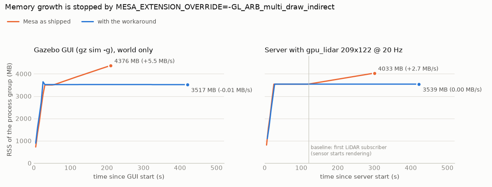
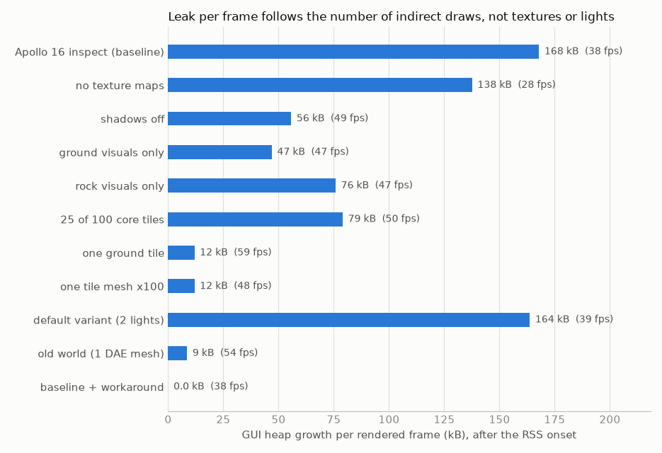

# Gazebo memory growth in the Apollo 16 world: diagnosis and fix (`diag`)

Owner: diagnosis agent, 2026-10-25, 22:05-23:55. Files: this file, `img/leak_rss.png`, `img/leak_per_frame.png`,
`img/leak_gui_workaround.png`. **No generator or runtime file was changed** (the fix is reported in section 4 for
the owner of `scripts/env.sh`). Every Gazebo run used `GZ_PARTITION=claude_leak`, `ROS_DOMAIN_ID=121`, a private
`ROS_HOME`, `setsid` + `timeout -s KILL`, and was stopped with SIGKILL to its process group only; at most one server
and one GUI ran at a time and no other agent ran Gazebo. Scratch: `/home/nargon/togo_assets/lunar/experiments/leak_diag/`
(`EXP` below). Versions: Mesa 25.2.8-0ubuntu0.24.04.2 (d3d12 Gallium driver), NVIDIA driver 610.88 (RTX 2080),
WSL kernel 6.18.33.2, gz-sim 8.11.0, Ogre-Next 2.3.3 (gz_ogre_next_vendor 0.0.5).

## 0. Summary

| finding | evidence | consequence |
|---|---|---|
| The growth is a **leak in the OpenGL-on-Direct3D 12 driver path**, not in the world: Mesa's d3d12 driver leaks one `ID3D12CommandSignature` (≈ **2.7 kB of process heap** + ≈ 0.25 kB of GPU-visible Windows memory) **per indirect draw call** | heap profiler (section 3.3): of the heap allocated after load and never freed, 77 % has complete stacks into `ID3D12Device::CreateCommandSignature` called by Mesa's d3d12 driver and another 23 % (NVIDIA driver, stacks cut at 14 frames) runs through the same D3D12-runtime frames (99.7 % in total); llvmpipe does not leak; the leak per frame follows the number of indirect draws, not textures or lights (3.2) | every Gazebo process that renders with Ogre-Next on WSL leaks while it renders: GUI and server sensors alike |
| **Bug**: `d3d12_get_cmd_signature()` looks its cache up with `&key` (address of the pointer) instead of `key`, so it never hits; the insert then overwrites the previous entry without releasing it | Mesa source (3.4); disassembly of the installed `libgallium` matches (vtable slot 41 = `CreateCommandSignature`, 24-byte cache entries in the heap profile) | unbounded: the user's GUI reached 9.05 GB in 573 s |
| Present in **Mesa 25.2.8 (installed), 25.3.0 and 26.2.5 (latest stable)** | `grep` of the release tarballs | upgrading Mesa does not help |
| Ogre-Next draws everything with `glMultiDrawElementsIndirect` when the driver advertises `GL_ARB_multi_draw_indirect` | Ogre-Next 2.3.3 source: indirect buffers = GL ≥ 4.6 or that extension; GL contexts here are 3.3 (GUI compatibility, server core), so the extension alone decides | Apollo 16 world: **≈ 54 indirect draws per GUI frame** (216 visuals, sun shadow with 3 PSSM splits) at 37-39 fps → **5.5-6.3 MB/s** (GUI); server gpu_lidar 209x122 @ 20 Hz: **2.7 MB/s**. The old one-mesh world leaks too (**0.46 MB/s**), it only looked flat because the RSS onset is delayed (3.1) |
| **Fix (verified)**: `export MESA_EXTENSION_OVERRIDE=-GL_ARB_multi_draw_indirect` for the gz server and GUI | 7-min run, server + gpu_lidar + GUI (section 4.2): GUI **-0.009 MB/s**, server **0.000 MB/s**, no new host mappings; screenshots **pixel-identical** and LiDAR ranges **bit-identical** to the leaking baseline; GUI 39.3 fps, LiDAR 20.0 Hz | RAM stays at the load plateau (GUI ≈ 3.5 GB, server + LiDAR ≈ 3.5 GB in these runs); no world change needed |

World-level changes are not a fix: they only scale the leak with the number of indirect draw calls (shadows off:
-66 % per frame; a quarter of the core tiles: -50 %; even one mesh still leaks 9-12 kB per frame). The upstream fix is
a one-character change in Mesa (section 4.4).

## 1. Method

`EXP/leakprobe.py` (wrapper `EXP/run.sh`: ROS + native install + `scripts/env.sh --quiet`, isolated partition/domain)
starts `gz sim -s -r -v 3 WORLD` (plus `--headless-rendering` when a sensor is injected) and/or `gz sim -g -v 3`
(Gazebo's default GUI config `~/.gz/sim/8/gui.config`), each `setsid timeout -s KILL`, and every 5 s samples: VmRSS
summed over each process group, `/proc/<pid>/status` of the main gz process (RssAnon, RssFile, RssShmem, VmData),
the number of mappings and of `rw-s /dev/zero (deleted)` mappings ("host maps", see 3.1), MemAvailable, and
whole-GPU memory (`/usr/lib/wsl/lib/nvidia-smi`). `/proc/<pid>/smaps` snapshots were diffed (`EXP/smaps_diff.py`).
Runs abort below 3 GB MemAvailable (never triggered; lowest 8.3 GB). GPU use was verified in every run except the
deliberate llvmpipe runs (`libd3d12.so` + `libnvwgf2umx.so` in `/proc/<pid>/maps`,
`GL_RENDERER = D3D12 (NVIDIA GeForce RTX 2080)` in `ogre2.log`). The WSLg window title was `Gazebo Sim (Ubuntu)` in every GUI run: **COPY MODE is gone**.
Two `LD_PRELOAD` shims (`EXP/shim/`): `leakshim.so` counts `glXSwapBuffers` (GUI fps) and user-space shared
`mmap`s; `heapshim.so` samples every 997th malloc/calloc/realloc after a delay, keeps the backtrace while the block
is live, and writes the live set grouped by call stack every 10 s (a sampling heap profiler). The LiDAR server test
world is `apollo16_core_inspect.sdf` + Sensors system + one static 209x122 @ 20 Hz `gpu_lidar` 0.449 m above the
flat site (`tools/bench_world.py` `prepare_world`); a gz-transport subscriber (`EXP/capture_cloud.py`) keeps the
sensor rendering (gz only renders sensors that have subscribers) and saves the last cloud.

Slopes are least-squares fits. "post-onset" = the window after the RSS starts rising (3.1). Leak per frame =
post-onset slope / fps. CPU figures come only from the A/B runs P0-P3 (4.3); the earlier runs summed stime + cutime
by an indexing bug, so their CPU column is not used.

## 2. All runs

GUI runs use the inspect world and the default GUI config unless noted; their server runs without rendering and is
flat at 317-353 MB in every run (not listed). Plateau = RSS at t = 45 s (end of load).

| run | change | process | plateau MB | end MB (t) | slope 60 s-end MB/s | post-onset MB/s (onset) | RssAnon / RssShmem at end MB | host maps /s | fps | kB per frame |
|---|---|---|---|---|---|---|---|---|---|---|
| B1 | baseline (user's case, world only) | GUI | 3500 | 4376 (210 s) | **5.55** | 5.54 (55 s) | 4164 / 3.8 | - | - | - |
| B2 | baseline + frame shim | GUI | 3522 | 4295 (170 s) | **6.32** | 6.32 (50 s) | 4082 / 3.8 | 4.15 | 38.5 | 168 |
| H1 | baseline + heap profiler | GUI | 3501 | 4253 (180 s) | 5.71 | 5.74 (45 s) | 4026 / 3.8 | 3.82 | 37.0 | 159 |
| V8 | GUI on llvmpipe (`GALLIUM_DRIVER=llvmpipe`) | GUI | 5803 | 5644 (240 s) | 0.005 | none | 5465 / 4.0 | 0 | 0.23 | ≤ 13-17 (noise) |
| V8b | V8 + frame shim | GUI | 5768 | 5610 (160 s) | 0.016 (RssAnon 0.003) | none | 5431 / 4.0 | 0 | 0.23 | ≤ 13 |
| C1 | OLD world `lunar_surface.world` (1 DAE mesh) | GUI | 624 | 643 (200 s) | 0.084 | **0.46** (170 s) | 432 / 3.8 | 0.31 | 54.3 | 8.6 |
| V1 | shadows off (scene, lights, visuals) | GUI | 3534 | 3869 (200 s) | 2.55 | 2.64 (75 s) | 3656 / 3.8 | 1.79 | 48.6 | 56 |
| V2 | no texture maps (plain diffuse) | GUI | 3483 | 4096 (200 s) | 3.81 | 3.81 (50 s) | 3869 / 17.7 | 2.62 | 28.3 | 138 |
| V3 | ground visuals only (112) | GUI | 1474 | 1806 (200 s) | 2.14 | 2.14 (35 s) | 1591 / 3.8 | 1.45 | 46.7 | 47 |
| V4 | rock visuals only (104) | GUI | 2562 | 3077 (200 s) | 3.48 | 3.47 (55 s) | 2863 / 3.8 | 2.39 | 46.9 | 76 |
| V5 | 25 of 100 core tiles + ring/far/horizon (66 visuals) | GUI | 1467 | 2062 (200 s) | 3.84 | 3.84 (45 s) | 1848 / 3.8 | 2.62 | 49.8 | 79 |
| V6a | one ground tile (1 visual) | GUI | 486 | 594 (200 s) | 0.68 | 0.69 (35 s) | 380 / 3.8 | 0.45 | 59.4 | 11.9 |
| V6b | the same tile mesh 100 times (100 visuals) | GUI | 511 | 600 (200 s) | 0.56 | 0.56 (40 s) | 386 / 3.8 | 0.39 | 48.4 | 11.9 |
| V7 | default variant (2 lights: sun + earthshine) | GUI | 3512 | 4479 (200 s) | 6.25 | 6.25 (45 s) | 4266 / 3.8 | 4.29 | 39.1 | 164 |
| F1 | baseline + `MESA_EXTENSION_OVERRIDE=-GL_ARB_multi_draw_indirect` | GUI | 3528 | 3531 (200 s) | **0.01** | none | 3317 / 3.8 | 0.01 | 38.1 | 0 |
| L0 | server + gpu_lidar 20 Hz, no GUI | server | 3537 | 4033 (300 s) | 2.31 | **2.73** (120 s = first subscriber) | 3850 / 0 | 1.99 | LiDAR 19.9 Hz | 140 per LiDAR update |
| FV1 | server + gpu_lidar + GUI, override on both, 420 s | GUI | 3519 | 3517 (420 s) | **-0.009** | none | 3303 / 3.8 | 0.00 | 39.3 | 0 |
| FV1 | (same run) | server | 3539 | 3539 (420 s) | **0.000** | none | 3356 / 0 | 0.00 | LiDAR 20.0 Hz | 0 |
| P0 | A/B: baseline, 150 s | GUI | 3603 | 4130 (150 s) | 5.85 | 5.85 | 3917 / 3.8 | 4.03 | 38.9 | ~154 |
| P1 | A/B: override, 150 s | GUI | 3486 | 3486 (150 s) | **0.002** | none | 3273 / 3.8 | 0.00 | 34.7 (40-41 until t = 90 s, see 4.3) | 0 |
| P2 | A/B: server + gpu_lidar, baseline, 170 s | server | 3667 (t = 70 s) | 3941 (170 s) | 2.73 (70 s-end) | 2.73 | 3758 / 0 | 2.00 | LiDAR 20.0 Hz, RTF 1.0 | 140 per LiDAR update |
| P3 | A/B: server + gpu_lidar, override, 170 s | server | 3571 (t = 70 s) | 3571 (170 s) | **0.000** | none | 3388 / 0 | 0.005 | LiDAR 20.0 Hz, RTF 1.0 | 0 |



## 3. Evidence chain

### 3.1 What grows

- Only **RssAnon** grows (RssFile and RssShmem flat in every run). The smaps diff of B1 (t 100 -> 210 s, +608 MB)
  puts all of it in anonymous 64 MB glibc malloc arena heaps (adjacent arenas merge into 128 MB VMAs): heap memory
  allocated by a non-main thread (the render thread) and never freed.
- At the same time **~4 new 128 kB `rw-s /dev/zero (deleted)` mappings appear per second, each with RSS 0**
  (B1: 418 new in 110 s, none freed). No user-space `mmap` creates them (the shim intercepting `mmap` counted none
  while they grew), so they are created in the kernel: the dxgkrnl driver maps GPU-visible memory that lives on the
  Windows side into the process; RSS does not count it. They stand for Windows memory that leaks along with the heap
  (~0.5 MB/s in B2; whole-GPU memory from nvidia-smi is too noisy, ±1 MiB/s, to show it).
- Heap growth per new host map is **1.4-1.5 MB in every leaking run** (B2 6.32/4.15, V1 2.64/1.79, V2 3.81/2.62,
  C1 0.46/0.31, L0 2.73/1.99): one mechanism in all of them.
- **Delayed RSS onset**: the host maps grow from the first rendered frame (B2: +4/s from t = 30 s), but RSS stays
  flat for 15-25 s (B1: 3500.4 MB from t = 30 to 50 s) because the leaked blocks first refill the free chunks the
  load left in the malloc arenas. With the old world's small leak this takes ~165 s (C1: flat 624 MB until t = 165 s,
  then +0.46 MB/s; host maps +0.31/s throughout, t = 35-200 s). That is why the 107 s old-world test looked flat.

### 3.2 Isolation (one change at a time)



- **Driver**: on llvmpipe (Mesa's CPU renderer, V8/V8b) nothing grows (RssAnon +0.003 MB/s, zero host maps) - but it
  renders only 0.23 fps, so this alone bounds the per-frame leak to ≤ 13-17 kB (vs 159-168 kB on D3D12): suggestive,
  the attribution in 3.3 is the proof.
- **Not textures**: V2 (no PBR maps) still leaks 138 kB per frame (baseline 159-168).
- **Shadows** (one sun with 3 PSSM splits re-draws the shadow casters 3 more times): V1 cuts the leak per frame to
  56 kB (-66 %).
- **Content**: ground only 47 kB/frame (V3), rocks only 76 kB/frame (V4), a quarter of the core tiles 79 kB/frame
  (V5), one ground tile 11.9 kB/frame (V6a) - and **the same tile mesh 100 times also 11.9 kB/frame (V6b)**:
  Ogre-Next merges the 100 instances that share mesh and material into one `glMultiDrawElementsIndirect` per pass,
  so 100x the objects and triangles cost nothing extra. The leak counts indirect draw *calls*.
- **Old world**: 8.6 kB/frame (one mesh), the same order as one tile (V6a).
- **Lights**: the default variant with 2 lights (V7) leaks like the 3-light inspect variant (164 vs 159-168 kB/frame).

### 3.3 Attribution: sampling heap profiler (H1)

H1 = B2 with `heapshim.so` (sampling from t = 45 s, 1 in 997 allocations; 7.29 M allocations sampled 7308 times;
1598 samples still live at t = 180 s, estimated **703 MB live = 5.2 MB/s**, RSS slope 5.7 MB/s):

| allocated in (first frame outside libc) | live MB after 135 s | MB/s | share | called from |
|---|---|---|---|---|
| `libd3d12.so` (D3D12 runtime, WSL) | 526.0 | 3.89 | 74.8 % | `libd3d12core.so+0x485922` <- `libgallium` d3d12 driver `+0xd831b5` |
| `libnvwgf2umx.so` (NVIDIA user-mode driver) | 164.9 | 1.22 | 23.4 % | `libd3d12core.so+0x4294ef/+0x4306c7`, the frames that the complete stacks (#4, #5) continue from to `libd3d12.so+0xba4b2` <- `libd3d12core.so+0x485922` <- `libgallium+0xd831b5`; the largest NVIDIA stack is cut at the 14-frame depth before Mesa |
| `libgallium` (Mesa) 24-byte blocks at `+0xd830da` | 6.2 | 0.05 | 0.9 % | same function |
| `libd3d12core.so` | 4.2 | 0.03 | 0.6 % | same call |
| everything else (Qt, gz-gui) | 1.9 | 0.01 | 0.3 % | |

The leaking stacks end in Ogre: `Ogre::GL3PlusVaoManager::_update()` (instruction `+0x826c9` is
`glFenceSync(GL_SYNC_GPU_COMMANDS_COMPLETE, 0)`, the end-of-frame fence) <- `Ogre::CompositorManager2::_updateImplementation()`
<- `gz::rendering::Ogre2Scene::FlushGpuCommandsAndStartNewFrame` <- `gz::gui::plugins::GzRenderer::Render` (MinimalScene).
The d3d12 driver runs behind Mesa's `threaded_context`, which replays the frame's queued draw calls at that flush,
so the draws execute (and leak) inside `glFenceSync`.

The Mesa call site, disassembled from the installed library (`objdump -d libgallium-25.2.8-0ubuntu0.24.04.2.so`):

```
d830d5: call malloc@plt                 ; 24-byte cache entry  (heap stack #3, 24 B average)
...
d831a0: mov  0x808(%rax),%rdi           ; screen->dev (ID3D12Device*)
d831ac: mov  (%rdi),%rax
d831af: call *0x148(%rax)               ; vtable slot 41 = ID3D12Device::CreateCommandSignature
d831b5: mov  -0x78(%rbp),%rax           ; returned signature -> entry+0x10   (heap stacks #0, #1, #2, #4, #5)
```

The 24-byte entries give the rate directly: **1990 ± 120 new command signatures per second = 54 per frame** at
37 fps, **2.67 kB of heap each** (plus ~0.25 kB of host memory: 3.8 host maps/s x 128 kB).

### 3.4 The Mesa bug

`src/gallium/drivers/d3d12/d3d12_cmd_signature.cpp`, Mesa 25.2.8 (identical in 25.3.0 and 26.2.5):

```c
ID3D12CommandSignature *
d3d12_get_cmd_signature(struct d3d12_context *ctx,
                            const struct d3d12_cmd_signature_key *key)
{
   struct hash_entry *entry = _mesa_hash_table_search(ctx->cmd_signature_cache, &key);   /* BUG: &key, not key */
   if (!entry) {
      struct d3d12_cmd_signature *data = (struct d3d12_cmd_signature *)MALLOC(sizeof(struct d3d12_cmd_signature));
      memcpy(&data->key, key, sizeof(*key));
      data->sig = create_cmd_signature(ctx, key);          /* ID3D12Device::CreateCommandSignature */
      entry = _mesa_hash_table_insert(ctx->cmd_signature_cache, &data->key, data);
   }
   return ((struct d3d12_cmd_signature *)entry->data)->sig;
}
```

`key` is already a pointer; `&key` makes the search hash and `memcmp` the 16 bytes at the address of the pointer
variable (the pointer value and stack bytes), never the key, so the search never finds an entry. The insert hashes
the real key, finds the existing entry and overwrites `entry->key/data` (`util/hash_table.c`, `hash_table_insert`:
"Implement replacement ... If freeing of old data pointers is required to avoid memory leaks, perform a search
before inserting") - the previous `data` and its `ID3D12CommandSignature` are orphaned: never released, not even
when the context is destroyed. `d3d12_draw_vbo()` (d3d12_draw.cpp) calls `d3d12_get_cmd_signature()` for every
indirect draw before `ExecuteIndirect`; non-indirect draws (`DrawIndexedInstanced`) never touch the cache.

### 3.5 Why Gazebo hits it so hard

Ogre-Next 2.3.3 (`RenderSystems/GL3Plus/src/OgreGL3PlusRenderSystem.cpp:845`):

```cpp
bool supportsIndirectBuffers = mDriverVersion.hasMinVersion( 4, 6 ) ||
        mGLSupport->checkExtension("GL_ARB_multi_draw_indirect");
```

The d3d12 driver exposes the extension (`caps->multi_draw_indirect = true`), so every batch of draws Ogre submits -
one per material/vertex-buffer change in every pass: the main view, each of the 3 PSSM shadow splits, each LiDAR
camera face - is one `glMultiDrawElementsIndirect`, i.e. one leaked command signature: ~54 per GUI frame in the
Apollo 16 world (216 visuals), ~51 per LiDAR update on the server, ~3 per frame in the old one-mesh world. Without
indirect buffers Ogre-Next uses `_renderEmulated()`, one `glDrawElementsInstancedBaseVertexBaseInstance` per draw
(`GL_ARB_base_instance` stays available). The GL contexts here are 3.3 (GUI: compatibility profile; headless server:
core profile, both from `ogre2.log`), so the extension alone decides.

## 4. Fix

### 4.1 Recommended change (for the owner of `scripts/env.sh`)

Hide the extension from Ogre-Next in every process that renders with Gazebo; Ogre-Next then emulates indirect
buffers and issues plain `glDrawElementsInstancedBaseVertexBaseInstance` calls, which Mesa's d3d12 driver turns into
`DrawIndexedInstanced` without command signatures. In `_apollo16_env()`, after the `GALLIUM_DRIVER` export:

```bash
  # Mesa's d3d12 driver (WSL) leaks one ID3D12CommandSignature per indirect draw (d3d12_get_cmd_signature searches
  # its cache with &key; Mesa 25.2.8 ... 26.2.5): Ogre-Next draws everything with glMultiDrawElementsIndirect, which
  # leaked 2.7-6 MB/s per gz process. Without the extension Ogre-Next uses plain draws (docs/impl/leak_diagnosis.md).
  if [[ "${GALLIUM_DRIVER}" == "d3d12" && " ${MESA_EXTENSION_OVERRIDE:-} " != *" -GL_ARB_multi_draw_indirect "* ]]; then
    export MESA_EXTENSION_OVERRIDE="${MESA_EXTENSION_OVERRIDE:+${MESA_EXTENSION_OVERRIDE} }-GL_ARB_multi_draw_indirect"
  fi
```

`run_apollo16_sim.sh` sources `env.sh` before `ros2 launch` and `gz sim -g`, so server, sensors and GUI inherit it.
Also worth adding: the variable in the wrapper's banner (`GALLIUM_DRIVER=... MESA_EXTENSION_OVERRIDE=...`), a
README troubleshooting line, and a unit test that `env.sh` exports it when `GALLIUM_DRIVER=d3d12`. The user's
older `src/togo_sim_wsl.sh` (not ours) needs the same export if it is still used. Other Mesa GL programs started
from such a shell (RViz2: Ogre 1.x, no multi-draw-indirect) only lose an extension they do not use.
Caveat: Ogre-Next also enables indirect buffers on any GL ≥ 4.6 context, regardless of the extension. Should a
future gz-rendering/Mesa combination create a 4.6 context (today: 3.3, see `GL_VERSION` in `~/.gz/rendering/ogre2.log`),
the override alone would no longer help (capping the reported version, e.g. `MESA_GL_VERSION_OVERRIDE=4.5`, would
be the next lever; not tested, not needed today).
A quick check after any driver update: run the GUI for 3 min and watch the `rw-s /dev/zero` mapping count
(`grep -c 'rw-s.*/dev/zero' /proc/<gui pid>/maps`) - it must stay constant.

### 4.2 Verification (FV1, 7 min, server + gpu_lidar + GUI, override on both)

- GUI: 3519 -> 3517 MB over t = 90-420 s (**-0.009 MB/s**), RssAnon 3305 -> 3303 MB, host maps 196 -> 196.
- Server with the 20 Hz gpu_lidar rendering throughout (7545 clouds in 380 s): 3539.1 -> 3539.1 MB (**0.000 MB/s**),
  host maps 390 -> 390.
- F1 (GUI alone, 200 s): flat 3530.8 MB, 0.01 MB/s.
- Rendering unchanged: the GUI screenshots of F1 (t = 70 s) and FV1 (t = 120 s and 400 s) are **pixel-identical**
  to the leaking baseline B1 (mean |difference| 0, max 0, 968 x 978 px). The LiDAR cloud of FV1 equals L0's:
  13731 finite points in both, **max range difference 0.000000 m**.
- No new warnings in the gz logs; `ogre2.log` no longer lists the extension; renderer still `D3D12 (NVIDIA ...)`.


### 4.3 Predicted RAM and performance impact

- **RAM**: flat at the load plateau instead of +5.5-6.3 MB/s (GUI, world only; ~10 MB/s in the user's run with the
  robot and the custom GUI config) and +2.7 MB/s (server with the LiDAR alone; ~3.5 MB/s in the user's run with the
  robot). Steady state in these runs: GUI 3.52 GB, server + LiDAR 3.54 GB (the user saw ~3.7 GB for the server with
  the robot).
  A 10-minute session no longer adds ~5-6 GB (GUI) + ~2 GB (server); hours-long SLAM runs fit in the 15.9 GB.
  Windows-side GPU memory also stops growing (~0.5 MB/s of leaked host mappings before).
- **Performance**: no measurable cost (A/B P0-P3, CPU = utime + stime of the main gz process, 100 % = one core).
  GUI: 38.9 fps / 118 % CPU without vs 40-41 fps / 120 % CPU with the override for the first 90 s of P1; from
  t = 90 s fps and CPU of P1 dropped *together* (30-33 fps, ~95 %), i.e. an external slowdown, not CPU load; the other
  override runs held 37-40 fps (F1, 200 s) and 39.3 fps (FV1, 420 s, with the server's LiDAR rendering on the same
  GPU). Server with LiDAR: CPU 77 % vs 76 %, real-time factor 1.0 vs 1.0, LiDAR 20.0 Hz in both. The emulated path
  issues one GL draw per object instead of one per batch, but no longer creates a D3D12 object per batch; at a few
  hundred draws per frame that is a wash.
- **Visual cost**: none (pixel-identical).

### 4.4 Alternatives considered

| option | result |
|---|---|
| Newer Mesa | the bug is unchanged in 25.3.0 and 26.2.5 (latest stable, 2026-10) |
| Upstream fix | `_mesa_hash_table_search(ctx->cmd_signature_cache, key)` (drop the `&`) in `d3d12_get_cmd_signature`; worth reporting to Mesa (d3d12 driver) - after it ships, the override becomes unnecessary but stays harmless |
| Software rendering (llvmpipe) | no leak, but the GUI renders 0.23 fps and needs 5.6 GB: not usable |
| World changes (shadows off, fewer/merged visuals, no textures) | only scale the leak with the number of indirect draws (shadows off -66 % per frame); never zero |
| Patched private copy of `libgallium` via `LD_LIBRARY_PATH` | possible, but breaks with every Mesa update; the environment variable is simpler |

## 5. Side observations

- **GUI plateau by content** (useful for the RAM options): full inspect world 3.50 GB; ground visuals only 1.47 GB;
  rock visuals only 2.56 GB; 25 of 100 core tiles (+ ring/far/horizon) 1.47 GB; one ground tile 0.49 GB; old world
  0.62 GB (all at t = 45 s, default GUI config). The rock visuals hold ~2 GB of the GUI's 3.5 GB.
- `Texture memory budget exceeded. Stalling GPU.` in `ogre2.log` during load is Ogre-Next's texture-streaming
  throttle, not related. The `highlight_material` / "Deleting mapped buffer" lines in the user's `ogre2.log` come
  from selecting entities in the GUI, not related.
- The GUI renders continuously (37-54 fps) even when nothing moves, so the old leak ran at full speed while idle.

## 6. Reproduction

`EXP/run.sh` + `EXP/leakprobe.py` (one run), `EXP/batch.sh` (GUI variants), `EXP/server_run.sh`,
`EXP/combined_run.sh` (server + LiDAR + GUI), `EXP/ab_perf.sh` (A/B), `EXP/make_variants.py` (SDF copies in
`EXP/variants/`), `EXP/prep_lidar.py`, `EXP/capture_cloud.py`, `EXP/analyze.py`, `EXP/report_table.py`,
`EXP/smaps_diff.py`, `EXP/heap_summary.py`, `EXP/fig_leak.py`, shims `EXP/shim/leakshim.c`, `EXP/shim/heapshim.c`
(`gcc -O2 -shared -fPIC -ftls-model=initial-exec ... -ldl -pthread`), Mesa sources `EXP/mesa_src/`. Raw data:
`EXP/runs/<run>/` (`samples.jsonl`, `summary.json`, smaps snapshots, shim output, screenshots, clouds).
Example: `EXP/run.sh --tag X --world W.sdf --gui-env MESA_EXTENSION_OVERRIDE=-GL_ARB_multi_draw_indirect --duration 200`.
