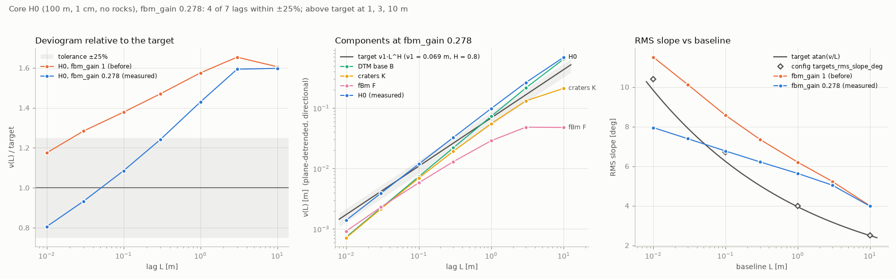

# Terrain stage: implementation report

Owner: terrain agent (phase 2). Implements DESIGN.md sections 2-4 and the terrain part of section 13.
All numbers below were measured on the real Apollo 16 data with the real config (preset `full`, seed 16)
on this machine (WSL2, 12 cores, 15.9 GB). The build directory is
`/home/nargon/togo_assets/lunar/build/apollo16_core/terrain/`.

## What was built

| File | Contents |
|---|---|
| `lunar_world_gen/terrain/base.py` | Band-limited DTM base B per zone through `tools/dtm_extract.py` (subprocess); caching; harmonic nodata fill |
| `lunar_world_gen/terrain/fbm.py` | fBm spectral synthesis (float32, rfft2), complementary coarse/fine bands with the DTM weight W(k), unit-gain caches, `CubicSampler` |
| `lunar_world_gen/terrain/craters.py` | `CraterSet`, SFD sampling, DESIGN section 4 profile, numba relief with a bucket index |
| `lunar_world_gen/terrain/compose.py` | H0 as one global function, fades, zone grids, `height_at`, caches, consistency checks, build CLI |
| `lunar_world_gen/terrain/calibrate.py` | Deviogram estimator, exact gain fit, apply, rebuild, verification, figure |
| `lunar_world_gen/terrain/__init__.py` | Package docstring and lazy attribute access to the API |
| `tests/test_world_terrain.py` | 23 tests (unit, plus a small real-DTM layout) |
| `config/apollo16_core.yaml` | Only `terrain.roughness.fbm_gain`: 1.0 -> **0.278** (comment kept) |
| `docs/impl/img/terrain_deviogram.png` | Calibration figure |

### The height function

```
H0(x, y) = B(x, y) + w_ring (F_coarse + K_big) + w_core (F_fine + K_small)        (fillets: rocks stage)
```

- **One global function.**
  - `TerrainModel.evaluate(x, y, zone)` is the only implementation.
  - Every grid is that function evaluated at lattice-exact node coordinates `(l0 + i*step) * 0.01`.
  - `height_at` is the same function at arbitrary points, rounded to float32 like the grids.
  - H0 does **not** depend on the zone; the `zone` argument is validated and kept for the API.
  - Points within 1e-8 m of the 1 cm lattice are snapped to it, so `height_at` at a grid node returns the stored value bit for bit.
- **Nested B.** Each DTM extraction is wider than its zone square:
  - core: + `core.margin_m` = 0.5 m;
  - ring: + `RING_MARGIN_M` = 20 m;
  - far: + `FAR_SKIRT_M` = 200 m.

  B is assembled from the horizon inward. Inside a zone's square, B is exactly that zone's extraction. Over the extra border it blends (raised cosine) into the next outer one. So shared boundary nodes of different zones are **bit-identical**, and the blends absorb the real differences between extractions (see below).
- **F_coarse.**
  - Unit field on a 10 cm grid over ±252 m.
  - Scaled by `sqrt(fbm_gain)`.
  - Sampled with `CubicSampler`, which is numerically `Grid.sample(order=3)` (max difference 1.6e-15). It runs the spline prefilter once instead of on every call.
- **F_fine.** 1 cm grid over core + margin (±50.5 m), sampled by node index (bilinear off the lattice).
- **K_big.** Craters 1-16 m over the ring + 23 m margin. **K_small.** Craters 0.2-1 m over the core + 1.44 m margin.
- **Fades.**
  - Each fade is a product of per-axis raised cosines (C1): `s((half - |x|)/w) * s((half - |y|)/w)`.
  - `w_core`: half 50 m, w 1 m. `w_ring`: half 250 m, w 20 m.
  - Both are exactly 0 on the zone boundary and exactly 1 inside the band.

### DTM extractions (`dtm_extract.py`, site `core`: lat -8.973448, lon 15.511126, href 8.1955 m, yaw 0)

| zone | spacing | extraction | processing | nodes | time / child RSS |
|---|---|---|---|---|---|
| core | 1 cm | ±50.5 m (101 m) | Butterworth λc 10 m, order 4, cubic | 10101² | 27-30 s / 2.78 GB |
| ring | 25 cm | ±270 m | same | 2161² | 2.6 s / 0.40 GB |
| far | 2 m | ±1300 m | same + `--deseam default` | 1301² | 3.5 s / 0.57 GB |
| horizon | 20 m | ±10 km | block average + auto anti-alias (DESIGN: "block-averaged") + `--deseam default`; 20436 NaN nodes (2.0 %, N-NE edge) filled harmonically (Laplace) | 1001² | 17-19 s / 1.09 GB |

`base_grid(cfg, zone)` returns the zone extent:
- core: 101 m (memory-mapped);
- ring: 500 m;
- far: 2.2 km;
- horizon: 20 km.

`margin_m` asks for more, up to the cached extraction.

### fBm

- **Spectrum.** Two-sided isotropic PSD `S(f) = psd_S0_m4 * fbm_gain * f^-(2+2H)`, f in cycles/m.
- **Synthesis.**
  - Unit-variance float32 white noise from `config.rng(cfg, "terrain.fbm.<band>")`.
  - Filter: `F = irfft2(rfft2(w) * sqrt(S)/dx)`, which gives exactly PSD S.
  - The field is synthesised on a padded square and the centre cropped, so it is non-periodic.
- **Bands.**
  - Coarse: f < 2 cycles/m, times W(f) = (fλc)^4/sqrt(1+(fλc)^8).
  - Fine: 2 ≤ f ≤ 50 cycles/m.
  - Sharp radial masks, complementary.

| band | grid | FFT | pad/side | synth time | unit-gain RMS |
|---|---|---|---|---|---|
| coarse | 10 cm, 5041² (±252 m) | 6400² | 64 m | 2.2-2.5 s | 64.5 mm |
| fine | 1 cm, 10101² (±50.5 m) | 10800² | 2 m | 5.7-7.4 s | 5.72 mm (analytic 5.7 mm) |

- **Caching and the gain.** The fields are cached at unit gain. The gain is applied as `sqrt(gain)` when the heights are composed, so recalibrating never re-synthesises (same noise, exactly scaled).
- **Memory.** The fine synthesis peaks at **1.49 GB** process RSS, far below the 6 GB limit.
- **Determinism.** FFT output is bitwise identical across worker counts (tested 1/2/4/12).

### Craters

- **Sampling.**
  - Poisson count, then D by inverse transform of `N(>=D) = C D^-b` between D_lo and D_hi.
  - Uniform centres.
  - Linear thinning between 8 and 16 m.
  - Freshness `rho = exp(-U(0, 3))`, with `d = 0.13 rho D` and `h = 0.03 rho D`.
  - Effective radius `R = D/2 (1 + 0.15 (1 - rho))`.
- **Profile.** Exactly DESIGN section 4 (smooth-min rim, quadratic polynomial smin, `k = 2h + 1e-4`), using the effective R.
  - The smooth minimum lowers the crest to `h - k/4`, about h/2. This is the DESIGN definition and is kept.
  - Continuity is tested: no step > 0.1 mm at r = R or r = 2.5 R; C0 everywhere.
- **Relief.**
  - Pure superposition: numba, parallel.
  - Uniform-cell bucket index: big craters use 3.9 m cells (90k entries), small ones 0.77 m cells (65k entries).
  - Grid and point evaluation share one per-point routine, so they are bit-identical. They agree with a brute-force numpy sum to 2e-17 m.
- **Sets.** Big set: 14764 craters. Small set: 12605. Saved as `craters/{big,small}.npz` with x, y, D, rho, d, h, R, id plus the parameters.

### Calibration estimator (definition)

The estimator works on H0 over the core square (|x|, |y| ≤ 50 m, 10001² nodes at 1 cm, no rocks):

1. Subtract the least-squares plane `a + b x + c y`.
2. For lag L = k·dx, compute `Dx = mean (r[j,i+k] - r[j,i])²` and `Dy = mean (r[j+k,i] - r[j,i])²` over all pairs inside the square.
3. `nu = sqrt((Dx + Dy)/2)`; the RMS slope is `atan(nu/L)`. Accumulation is in float64.

**Exact gain fit.** H0 = B + K + sqrt(g) F, and detrending and differencing are linear. So one pass over the four component fields (B, K, Fc_unit, Ff_unit), computing all cross sums for all lags, gives ν(L; g) exactly for any gain.

The fit is a grid search over g ∈ [0, 4] in steps of 0.001, with a lexicographic objective:

1. Maximise the number of lags within ±`tolerance_frac`.
2. Minimise the largest |ln(ν/target)| over those lags, which centres them in the band.
3. Minimise the sum of squares over them.

Lags that no gain can fix do not bias the fit.

**Workflow.** `--apply` writes the gain into the config, rebuilds the tiles and zone grids, and re-measures on the core assembled from the cached tiles. The cross statistics are gain-independent and stored in `calibration.json`, so a re-fit does not recompute the fields.

## Public API

```python
# base
base_spec(cfg, zone) -> BaseSpec
extract_base(cfg, zone, rebuild=False) -> Grid            # full cached extraction (core: mmap)
base_grid(cfg, zone, margin_m=None) -> Grid               # zone extent (+ margin)
build_all_bases(cfg, rebuild=False) -> dict
fill_nodata_harmonic(z) -> (np.ndarray, int)
RING_MARGIN_M = 20.0; FAR_SKIRT_M = 200.0

# fbm
coarse_field(cfg, unit=False) -> Grid                     # 10 cm, ±252 m; sqrt(gain) applied unless unit
fine_field(cfg, unit=False) -> Grid                       # 1 cm, ±50.5 m
unit_field(cfg, band, rebuild=False, mmap=True) -> Grid   # cached unit-gain field
band_params(cfg, band) -> dict; band_transfer(p, f, gain=1.0); band_psd(p, f, gain=1.0)
fbm_psd(f, S0, hurst); dtm_weight(f, lambda_c, order=4); fbm_scale(cfg) -> float
synthesize(rng, n_fft, spacing, transfer, crop=None) -> np.ndarray
CubicSampler(grid)(x, y) -> np.ndarray                    # == Grid.sample(order=3)
radial_psd(z, spacing, ...) -> (f, psd); loglog_slope(f, p, fmin, fmax)

# craters
CraterSet(x, y, D, rho, d, h, R, id, which, ejecta_extent_R, ejecta_exponent, meta)
    .save(path) / CraterSet.load(path) / .subset(mask) / .count_ge(D_values, rect) / .index()
sample_craters(cfg, which) -> CraterSet                   # which = 'big' | 'small' (deterministic)
get_craters(cfg, which, rebuild=False) -> CraterSet       # cached build_dir/terrain/craters/<which>.npz
crater_relief(craters, x, y) -> np.ndarray                # float64, any shape
crater_relief_grid(craters, grid, lattice_exact=True) -> np.ndarray
crater_profile(r, R, d, h, rho, ...) ; sample_population(...) ; expected_count_ge(...)

# compose (H0 = heights without fillets; float32 grids, row 0 south)
core_tile_height(cfg, tile: TileId, margin_m=None) -> Grid   # 1 cm, tile ± 0.5 m: 1101² nodes
core_height(cfg, x0, x1, y0, y1, parts=PARTS, fbm_scale=None) -> Grid
ring_height(cfg, margin_m=0.0) -> Grid                    # 25 cm, 2001²
far_height(cfg) -> Grid                                   # 2 m, 1101²
horizon_height(cfg) -> Grid                               # 20 m, 1001²
height_at(cfg, x, y, zone) -> np.ndarray[float32]         # == grids at their nodes (bit-identical)
load_core_tile(cfg, tile, mmap=False, build=True) -> Grid # cached core_tiles/tile_ii_jj.npy/.json
load_zone_height(cfg, zone, mmap=False, build=True) -> Grid  # cached {ring,far,horizon}_height
assemble_core(cfg) -> Grid                                # 10001² core from the tiles
w_core(cfg, x, y); w_ring(cfg, x, y); edge_fade(x, y, half, width); extent_weight(cfg, zone, x, y)
TerrainModel(cfg).evaluate(x, y, zone, parts=PARTS, fbm_scale=None); get_model(cfg)
build_all(cfg, rebuild=False, stages=(...), tiles=None) -> manifest dict
consistency_checks(cfg) -> dict; crater_counts(cfg) -> dict

# calibrate
deviogram(z, spacing, lags_m=LAGS_M) -> dict
cross_stats(comps, spacing, lags_m) -> dict; nu_of(stats, coef) -> dict
fit_gain(stats, target, tol, g_max=4.0, step=1e-3) -> dict
run(cfg, apply=False, rebuild=True, config_path=None, figure=FIGURE, lags_m=LAGS_M, reuse_stats=True) -> dict
write_gain_to_config(path, gain) -> str                   # edits only the fbm_gain value
```

## How to run (WSL, from `src/lunar_world_gen`)

```bash
PY=/home/nargon/.venvs/lunar_world/bin/python
$PY -m lunar_world_gen.terrain.compose --all            # build/validate every cached product (+ manifest.json)
$PY -m lunar_world_gen.terrain.compose --all --rebuild  # ignore caches
$PY -m lunar_world_gen.terrain.calibrate                # measure + fit (writes calibration.json + figure)
$PY -m lunar_world_gen.terrain.calibrate --apply        # ... and write fbm_gain, rebuild, verify
$PY -m pytest tests/test_world_terrain.py -q
```

`LUNAR_WORKERS=<n>` limits the FFT threads and `NUMBA_NUM_THREADS=<n>` limits numba.

Caches are keyed by hashes of their inputs, so stale data is rebuilt automatically:

- base grids: the site, DTM files, zone, dtm settings and the dtm_extract.py hash;
- fBm: the band parameters and seed;
- craters: their parameters and seed;
- height grids: all component keys, the gain, the fades and the version.

## Measured (real data, preset full)

### Timings and memory (clean `compose --all --rebuild`)

| stage | wall time | process peak RSS after the stage | notes |
|---|---|---|---|
| base (4 × dtm_extract) | 53.6 s | 0.18 GB (child peak 2.78 GB) | core 30.1 s, ring 2.6 s, far 3.5 s, horizon 17.2 s (incl. nodata fill) |
| fbm coarse | 2.3 s | 0.63 GB | 6400² FFT |
| fbm fine | 6.2 s | **1.49 GB** | 10800² FFT, float32/complex64 |
| craters | 1.0 s | 1.49 GB | 14764 + 12605 craters |
| 100 core tiles (1101² each) | 49.7 s | 1.55 GB | 0.5 s per tile |
| ring / far / horizon H0 | 1.6 / 0.4 / 0.3 s | 1.81 GB | |
| consistency checks + core assembly | 0.7 s | 2.18 GB | |
| **total** | **1:57 wall** (131 s user + 19 s sys) | **2.18 GB** self, 2.78 GB child | `/usr/bin/time` max RSS 2.85 GB |

- **Calibration** (`calibrate`, first run):
  - component fields over 10001² nodes: 71 s (B 15.8, K 23.9, Fc 14.8, Ff 16.4 s);
  - cross statistics for 7 lags × 2 directions: 8.4 s;
  - peak RSS 3.31 GB.
- **`calibrate --apply`** (statistics reused): rebuild 49.7 s, verification 2.5 s, total 56 s, peak RSS 2.18 GB.
- **Small-layout test build** (core 4 m): 7-10 s.

### Disk use (build_dir/terrain)

| item | bytes |
|---|---|
| base (4 extractions + mask) | 439 MB |
| fbm (coarse 102 MB + fine 408 MB) | 510 MB |
| craters | 1.8 MB |
| core_tiles (100 × 4.85 MB) | 485 MB |
| ring/far/horizon heights | 25 MB |
| **total** | **1.46 GB** |

### Crater counts N(≥D) with centres in the core (100 × 100 m), both sets

| D ≥ | 0.2 m | 0.5 m | 1 m | 2 m | 5 m | 10 m |
|---|---|---|---|---|---|---|
| sampled | 12433 | 2026 | 524 | 125 | 21 | 2 |
| expected (truncation + 8-16 m fade) | 12496 | 1996 | 496 | 121 | 16.1 | 1.4 |
| target C·D⁻² (C = 0.05) | 12500 | 2000 | 500 | 125 | 20 | 5 |
| sampled / target | 0.995 | 1.013 | 1.048 | 1.000 | 1.05 | 0.40 |

- **Ring square** (big set, 500 × 500 m), sampled / expected: 12318 / 12402 at 1 m, 3034 / 3027 at 2 m, 373 / 402 at 5 m and 44 / 35 at 10 m.
- **Why the 10 m bin is low against the target.** That deficit is intended: the fade keeps about 0.67 of the 8-16 m craters, and the DTM supplies craters of 16 m and larger.
- **Unit test.** A 4 km² synthetic sample matches the expected counts within 3 % (or 4σ) from 1 to 5 m. The freshness classes come out as 10.5 % / 69.5 % (target about 10 % / 70 %).

### Calibration: fbm_gain 1.0 -> **0.278**

ν(L) of the composed core H0 (plane-detrended, directional), measured on the rebuilt tiles. The verification matches the exact prediction to 1.4e-9 relative.

| L (m) | target ν (m) | ν at gain 1.0 | **ν at gain 0.278** | ratio | within ±25 % | RMS slope (°) | target slope (°) |
|---|---|---|---|---|---|---|---|
| 0.01 | 0.00173 | 0.00204 | **0.00140** | 0.806 | yes | 7.95 | 9.83 |
| 0.03 | 0.00417 | 0.00536 | **0.00389** | 0.932 | yes | 7.39 | 7.92 |
| 0.1 | 0.01094 | 0.01507 | **0.01187** | 1.085 | yes | 6.77 | 6.24 |
| 0.3 | 0.02634 | 0.03871 | **0.03268** | 1.241 | yes | 6.22 | 5.02 |
| 1 | 0.06900 | 0.10869 | **0.09864** | 1.430 | **no** | 5.63 | 3.95 |
| 3 | 0.16617 | 0.27479 | **0.26479** | 1.594 | **no** | 5.04 | 3.17 |
| 10 | 0.43536 | 0.69908 | **0.69560** | 1.598 | **no** | 3.98 | 2.49 |

Components, as ν alone in m, at L = 0.01 / 0.1 / 1 / 3 / 10 m:

| component | 0.01 | 0.1 | 1 | 3 | 10 |
|---|---|---|---|---|---|
| B (DTM) | 0.00074 | 0.0074 | 0.0732 | 0.216 | 0.650 |
| K (craters) | 0.00072 | 0.0070 | 0.0554 | 0.132 | 0.212 |
| F at gain 0.278 | 0.00092 | 0.0058 | 0.0289 | 0.048 | 0.048 |

**Shortfall: no gain fits all scales.** At 1, 3 and 10 m the composite is 1.43-1.60× the target even at gain 0, where the ratios are 1.37 / 1.58 / 1.60.

- **The real DTM alone exceeds the target** at 1, 3 and 10 m (1.06 / 1.30 / 1.49×). F1 was chosen for its relief: it is the west half of a degraded 180 m bowl, with a fresh 23 m crater at its south edge. The target ν1 = 0.069 m, H = 0.8 comes from the smoother LM area.
- **The crater population adds** 0.055 m at 1 m.
- **The relief is anisotropic.** B has ν_y / ν_x = 1.4-1.7 at 1-10 m.
- **What the gain does fit.** It fits the four lags it can influence (0.01-0.3 m), centred in the band.

Per-lag gains that would hit the target exactly:

| L | 0.01 m | 0.03 m | 0.1 m | ≥ 0.3 m |
|---|---|---|---|---|
| gain | 0.625 | 0.400 | 0.099 | none (B + K already above the target) |

The all-lags least-squares optimum would be 0.305, which leaves 0.3 m at the band edge (1.250).

**DESIGN section 13 acceptance** (±25 % at 0.01 / 0.1 / 1 / 10 m) **fails at 1 m and 10 m** for this site. The decision is not mine. The options are:

- accept that the site's own relief governs 1-10 m and relax the target there;
- lower the crater density or d/D, which helps only at 0.3-3 m;
- choose a smoother site.



### Core H0 and zone grids

| grid | z range (m) |
|---|---|
| core H0 (100 m square, gain 0.278) | **-4.543 .. +5.891** (B alone: -4.31 .. +5.97) |
| core tiles with margins | -4.543 .. +5.981 |
| ring 500 m | -4.53 .. +18.61 |
| far 2.2 km | -117.6 .. +43.7 |
| horizon 20 km | -188.4 .. +578.5 |

### Zone-boundary consistency (max |Δ| at shared lattice nodes)

| pair | max \|Δ\| | note |
|---|---|---|
| core tiles vs ring grid, 1604 nodes on the core boundary | **0** | bit-identical (nested B) |
| neighbouring tiles, all overlap bands | **0** | |
| ring vs far, 1004 nodes on the ring boundary | **0** | task limit < 1 cm |
| far vs horizon, 444 nodes on the far boundary | **0** | |
| `height_at` vs tile and ring nodes | **0** | |
| *raw* B_core vs B_ring extractions (164k common nodes) | 5.4 µm (RMS 1.2 µm) | inside the core B_core is used |
| *raw* B_ring vs B_far extractions (73k nodes) | 1.29 mm (RMS 0.11 mm) | absorbed by the 250-270 m blend |
| *raw* block-averaged horizon vs B_far on the far boundary | 2.40 m (RMS 0.30 m) | absorbed by the 1100-1300 m blend |

- **Why the far extraction differs from the ring.** dtm_extract switches on its vertical-sampling iteration when |h|·d/R exceeds 5 % of the spacing. The 2.6 km far extraction does (0.115 m > 0.1 m); the ring does not. That shifts samples by h·d/R, about 1 mm at 250 m. Without the nested B the ring/far boundary differed by 0.61 mm.

### Determinism

- Same seed gives identical fBm fields, crater sets and composed grids (tests).
- A clean `--rebuild` reproduced the SHA-256 of all 15 checked outputs (four base grids and the horizon mask, both fBm fields, three tiles, three zone grids, both crater sets' arrays): **all identical**.

## Tests

`tests/test_world_terrain.py`, run in WSL with the venv: **`23 passed in 28.66s`**. The DTM tests use a 4 m / 40 m / 200 m / 2 km layout. pyflakes is clean, and the existing `tests/test_world_dtm_extract.py` still passes (7 passed).

| Area | What the tests check |
|---|---|
| Crater profiles | C0 and no step > 0.1 mm at R and 2.5 R, for 5 (D, rho) cases; floor, crest and outer value |
| Crater relief | Superposition against brute force; grid path bit-identical to the point path |
| Crater SFD | Against the target within 3 % or 4σ; fade fraction; freshness classes |
| Crater sets | I/O and determinism |
| fBm bands | Complementary: they sum to S·W², and \|H\|² + W² = 1 |
| fBm PSD | Log-log slope -3.6 ± 0.1 and absolute level within 15 %, for both bands (4 seeds each) |
| fBm caches | Unit fields cached and deterministic; the gain scales the amplitude by sqrt(gain); a new seed changes the field |
| CubicSampler | Equals `Grid.sample(order=3)` |
| Fades | Exact 0 and 1 at the boundaries, 0.5 at the midpoint, C1; horizon blend weights |
| Deviogram estimator | Analytic sinusoid + plane; linear-combination statistics exact; the fit recovers a known gain |
| Config edit | Only the value changes, comment column kept |
| Harmonic nodata fill | Exact on a linear field; maximum principle at a corner hole |
| Cross-zone consistency (real DTM) | Core/ring, ring/far and far/horizon boundaries bit-identical; tile overlaps identical; H0 zone-independent; nested B continuous across every extraction border |
| `height_at` | Equals all four grids at random nodes, bit for bit |
| Composition | Equals the sum of its parts |
| End to end | Calibration on a temporary config copy (verifies that the real config is untouched); manifest contents |

## Contract details and deviations

1. **B is one global nested function** instead of "B per zone".
   - Why: extractions differ by up to 1.3 mm because of dtm_extract's data-dependent vertical iteration, which would break DESIGN's 0.1 mm consistency rule at the ring boundary (measured 0.61 mm without nesting).
   - With nesting, all zone boundaries are bit-identical.
   - Inside each zone's square, B is still exactly that zone's own extraction.
2. **Far field uses the Butterworth low-pass** (DESIGN section 3 lists only `--deseam default`). Without it the far field differs from the ring by decimetres at the ring boundary.
3. **The horizon blends into B_far** over a 200 m skirt outside the 2.2 km square. The far extraction is therefore 2.6 km, and `base_grid(cfg, 'far')` crops 2.2 km. The horizon also uses `--deseam default`.
4. **Crater centre margin** is `2.5 · 1.15 · D_max/2`, which includes the degraded-crater widening. It is a superset of DESIGN's `2.5 · D_max/2`, and the density per m² is unchanged.
5. **Config fields not used.** `rim_width_over_R`, `ejecta_fraction_of_rim` and `fresh_profile` are not used: the DESIGN section 4 profile fixes the shape. `ejecta_extent_R` and `ejecta_exponent` are used.
6. **`fbm_gain` multiplies the PSD** (DESIGN, task), so the amplitude scales with sqrt(gain). The config comment says "multiplier on the synthetic fBm amplitude"; it is inaccurate, but the comment was kept as instructed.
7. **The fine band omits W(k).** W² = 1 - 4e-11 at f ≥ 2 cycles/m.
8. **`height_at` returns float32** so that it equals the float32 grids bit for bit.
9. **The coarse field covers ±252 m** (ring + 2 m). Points outside the ring get no F_coarse or K_big, because w_ring = 0 there.
10. **New helpers that other modules may use:** `assemble_core`, `load_core_tile`, `load_zone_height`, `core_height` (any 1 cm window), and `CubicSampler`. No foundation module was changed.

## Known limitations and open questions

- **Deviogram shortfall at 1-10 m.** See the calibration section; this needs a decision.
- **Rocks are excluded.** The calibration measures H0 without rocks or fillets, as DESIGN says. Rocks of 2 cm and larger will add cm-dm roughness on top.
- **The 1 cm scale sits at 0.81 of the target.** Raising it would push 0.3 m out of tolerance. The two are coupled through the single gain, and the fine and coarse bands share it.
- **Numba compiles in each process** (about 5-10 s); caching is off so no cache files are written into the repo.
- **Horizon nodata.** Filled smoothly, but the 2 % N-NE corner beyond 8.9 km is interpolated, not real data.
- **Horizon seams.** Seams outside the traced ±3 km rows are not corrected (0.2-0.7 m steps).
