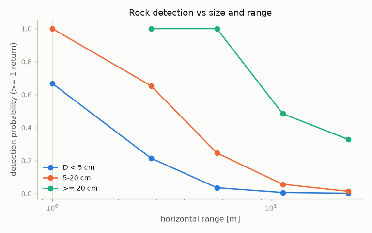
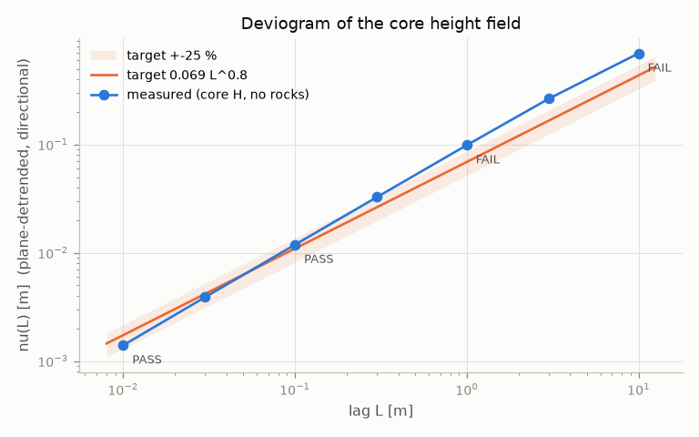

# Validation owner: acceptance checks, Gazebo benchmarks, LiDAR checks, robot tests, report

Implements DESIGN section 13 so the integration stage can run every acceptance check with one
command each. Every number below comes from a run that was executed and inspected; scratch data
and scripts are in `/home/nargon/togo_assets/lunar/experiments/impl_validation/` (`EXP` below).

## Files

| File | Contents |
|---|---|
| `lunar_world_gen/validate/stats.py` | Plane-detrended directional deviogram (block-wise, NaN-aware, any size), RMS slope, slope distribution, radially averaged PSD + power-law fit, Hurst fit, cumulative counts, exact Poisson intervals and acceptance ranges, single / broken power laws, the DESIGN crater population model, truncated-Pareto slope fit |
| `lunar_world_gen/validate/static_checks.py` | `run_static_checks(cfg)` -> `world_dir/reports/static_checks.json`; input discovery; numpy-only GLB reader/writer; `TinLocator` (point location in a TIN); stitching checker on GLB files; GLB, SDF, world_info checks; CLI |
| `lunar_world_gen/validate/lidar_checks.py` | Capture loading, edge check, returns per range bin, ground residuals, missing-return (leak) ray march, rock detection vs size and range, mesh rasteriser; CLI |
| `lunar_world_gen/validate/report.py` | `build_report()` -> `reports/validation_report.md` + figures from all JSON results; CLI |
| `tools/bench_world.py` | Headless world benchmark with injected static gpu_lidar(s); shared Gazebo helpers (SDF injection, `GzServer`, `/proc` probes, GPU sampler, gz-transport watcher) |
| `tools/lidar_capture.py` | Static LiDAR captures at a list of poses -> one npz per pose |
| `tools/run_robot_tests.py` | Full robot launches (world owner's launch or the stock chain), controller wait, drive tests per site, spawner reliability, timeline |
| `tests/test_world_validation.py` | 21 tests on synthetic data |

## How to run (WSL, from `src/lunar_world_gen`)

```bash
PY=/home/nargon/.venvs/lunar_world/bin/python        # analysis (numpy 2, trimesh)
SYS=/usr/bin/python3                                  # Gazebo / ROS side (gz-transport13 bindings)
W=~/togo_assets/lunar/worlds/apollo16_core

# 1. static checks (all inputs discovered from the config's build/world dirs)
$PY -m lunar_world_gen.validate.static_checks [--preset fast] [--only roughness,craters,...] \
    [--input core_grid=PREFIX] [--out FILE]                       # -> $W/reports/static_checks.json
# 2. world-only Gazebo benchmark (static LiDAR injected into a copy of the SDF)
$SYS tools/bench_world.py $W/apollo16_core.sdf --out $W/reports/bench_world.json \
    --pose-agl 0,0,0.449,0 --config config/apollo16_core.yaml [--lidar robinw]
# 3. LiDAR captures + analysis
$SYS tools/lidar_capture.py $W/apollo16_core.sdf --out $W/reports/lidar --auto-poses 6 --config config/apollo16_core.yaml
$PY -m lunar_world_gen.validate.lidar_checks $W/reports/lidar --config config/apollo16_core.yaml --auto-inputs \
    --out $W/reports/lidar_checks.json
# 4. robot tests (world owner's launch; 3 launches = spawner reliability; sites from world_info.yaml)
$SYS tools/run_robot_tests.py --out $W/reports/robot --config config/apollo16_core.yaml --sites flat,slope,rock
cp $W/reports/robot/robot_tests.json $W/reports/
# 5. report (reads every *.json in reports/ by its "kind")
$PY -m lunar_world_gen.validate.report                             # -> $W/reports/validation_report.md
$PY -m pytest tests/test_world_validation.py -q
```

The Gazebo tools default to `GZ_PARTITION=claude_validation`, `ROS_DOMAIN_ID=75` and a private
`ROS_HOME` under their output folder; they start everything with `setsid`, put the server under
`timeout --foreground -k 10 LIMIT` (keeps it in our process group), stop it by process group
(SIGTERM, wait, SIGKILL) in a `finally` block, and record other agents' load
(`machine_before/after`, `contention_window`).

## Public API

```python
# stats
deviogram(z, lags_m=DEFAULT_LAGS_M, spacing=None, *, detrend="plane", window_m=None, stride=1,
          block_rows=512) -> DeviogramResult      # .lags_m .lag_used_m .nu_m .nu_x_m .nu_y_m .n_pairs .rms_slope_deg
compare_deviogram(result, nu1_m, hurst, tolerance_frac, check_lags=CHECK_LAGS_M) -> list[dict]
nu_target(L, nu1_m=0.069, hurst=0.8); rms_slope_deg(nu, L); fit_hurst(lags, nu) -> (H, nu1)
plane_fit(z, spacing) -> Plane; slope_distribution(z, baseline_m, spacing=None, detrend="plane") -> dict
radial_psd(z, spacing=None, *, segment=None, overlap=0.5, detrend="plane", window="hann", n_bins=40) -> dict
fit_power_law(f, S, f_min=None, f_max=None) -> {beta, S0, H, r2, n}
cumulative_counts(sizes, D_values) -> ndarray; poisson_ci(n, sigma=1.0) -> (lo, hi); poisson_range(lam, sigma=3.0)
power_law_N(D, C, b); broken_power_law_N(D, A_at_anchor, segments, anchor_D=1.0)
crater_expected_N(D, C, b, D_min, D_max, fade=(8, 16)); fit_cumulative_slope(sizes, D_min, D_max=None)
sfd_rows(sizes, area_m2, D_values, expected_per_m2, *, sigma=3.0, frac_tol=None) -> list[dict]

# static_checks
run_static_checks(cfg, *, build_dir=None, world_dir=None, inputs=None, only=None, write=True,
                  out_path=None, n_dz_samples=200_000, stride=1, with_trimesh=True) -> dict
locate_inputs(cfg, build_dir=None, world_dir=None, overrides=None) -> dict
load_core_grid(inputs, cfg) -> (Grid | None, source)     # single core grid, or assembled from tile grids
load_catalog(path) -> dict; load_crater_catalogs(paths) -> dict   # crater union de-duplicated on (x, y, D)
check_roughness / check_craters / check_rocks / check_visual_vs_collision / check_glbs /
check_stitching / check_sdf / check_world_info  (cfg, inputs) -> dict
read_glb(path, header_only=False) -> GlbData; write_glb(path, positions, triangles, normals=None, uvs=None, ...)
trimesh_load_check(path) -> dict; mesh_checks(glb, kind, rect, roughness_expected=None) -> dict
TinLocator(xy, triangles).locate(qx, qy) / .interpolate(values, qx, qy); MeshHeightField(paths).height(x, y)
shared_segment(rect_a, rect_b) -> Segment | None; check_stitched_pieces(pieces: list[Piece]) -> dict
dz_stats(dz, target_median, median_tol=0.003, rms_max=0.010, p99_max=0.030) -> dict
parse_sites(world_info) -> {name: {x, y, z, yaw, description}}; summarize_results(results) -> dict

# lidar_checks
run_lidar_checks(capture_paths, *, heights=None, rocks=None, zone_half=None, out=None) -> dict
load_capture(path) -> Capture; load_captures(paths) -> list[Capture]
edge_check(caps, ...); range_histogram(caps); ground_residuals(caps, heights, rocks=None, ...)
missing_returns(caps, heights, *, margin=0.05, k_ang=0.5, ...); rock_detection(caps, rocks, heights=None, ...)
GridHeights(grids, tin_error_m=None); FnHeights(fn, ...); rasterize_meshes(paths, spacing=0.02, rect=None) -> Grid
sdf_visual_meshes(sdf) -> list[str]

# report
build_report(reports_dir, *, extra_json=(), out_md=None, figures=True) -> Path

# tools (importable helpers; tools/ on sys.path)
bench_world.prepare_world(sdf_in, sdf_out, lidars, *, strip_lidars=False, ensure_sensors=True, gravity=None, ...)
bench_world.GzServer(world, log_path, env, limit_s).start()/.stop()/.find_server_pid()/.log_summary()
bench_world.Watcher(world_name, lidar_topics, keep_clouds=0, skip_clouds=1); bench_world.judge(result) -> dict
run_robot_tests.evaluate_drive(site, record, gravity) -> dict; run_robot_tests.judge(result) -> dict
```

## Definitions (what each acceptance number means)

- **Deviogram** (matches the science scripts so the targets are comparable). The least-squares plane of
  the analysis window (whole core) is removed; for lag `L`, `k = max(1, round(L/s))`; forward differences
  of the detrended heights along x and along y over all finite pairs; `nu = sqrt(mean(d^2))` over the
  **pooled** x and y differences, exactly `fbm_check.nu()` and the "directional RMS" of
  `detrended_compare.py`; RMS slope `atan(nu/L)`. Plane removal is done analytically (subtract
  `a k s` from every x-difference), so no detrended copy of the 10001^2 grid is ever made. The terrain
  owner's estimator averages the two directional means instead of pooling; on the square core the
  pair counts are equal, so both give identical numbers (verified below).
  Verified against `fbm_check.py` on its own synthetic fBm: identical to 12 significant digits;
  `nu` = 0.0018 / 0.0046 / 0.0118 / 0.0278 / 0.069 / 0.1513 / 0.2989 m at 0.01 ... 10 m, the values
  in `fbm_check.txt`.
- **PSD**: two-sided 2-D periodogram normalised so that `sum S df^2 = variance` (the synthesis
  convention `S(f) = S0 f^-(2+2H)`); plane-detrended, Hann-tapered Welch segments, log-spaced annuli.
  On a synthetic fBm with S0 = 2.539e-5, H = 0.8: fitted beta -3.603, S0 2.59e-5 (+2 %), H 0.802.
- **Crater counts**: craters whose centres lie in the core rectangle; expected
  `= area * int_D^{Dmax} keep(x) C b x^(-b-1) dx` (the generator's truncated population with the
  8-16 m fade). Pass: `|n/lambda - 1| <= 0.20`.
- **Rock counts**: zone-0 rocks; expected `(N_bpl(D) - N_bpl(D_max)) * core area`. Pass: n inside
  the central Poisson(lambda) range at +-3 sigma (exact quantiles). The rocks owner normalises the
  density field so the core keeps the SFD totals (rocks.md, point 182), so this plain model applies.
  Catalog sanity (fields, tile assignment by centre, `collide` flag, quaternion norms, D range) is
  part of the check.
- **Visual vs collision**: `dz = z_collision - z_visual` at 200k deterministic random core points
  farther than `D + 0.15 m` from every rock of `D >= collision_min_D_m`; heights by point location
  in the actual GLB TINs (tile ground meshes vs `core_collision.glb`), grids only as fallback.
  Pass: `|median + 0.020| <= 0.003`, RMS about the median <= 0.010, p99 of `|dz - median|` <= 0.030.
- **Stitching**: for every pair of same-group pieces (visual: tiles, ring/far/horizon strips;
  collision: core, ring, far) whose rectangles share a segment, the boundary vertices of both GLBs on
  that segment are keyed by positions rounded to 1e-5 m (bit-identical float32 values give equal keys).
  Reported: vertices present in only one piece, of which T-junctions (strictly inside an edge of the
  other piece; collinear or not), uncovered stretches, height mismatches (> 1e-5 m), and missing
  boundary edges between consecutive vertices. Each piece is also checked for boundary edges that are
  not on its rectangle (interior cracks/holes) and non-manifold edges.
- **GLB**: loads in trimesh (`process=False`); one primitive; float32 positions, uint32 indices;
  identity node transforms; exactly one material with an **explicit** `metallicFactor` 0 (glTF's
  default is 1) for visual meshes; no embedded images; xy bounds equal to the piece rectangle
  (catches Y-up exports and offsets); `+z` vertex normals >= 99.9 % and CCW faces for ground pieces.
- **LiDAR ground residuals**: `z - H(x, y)`; threshold `max(0.03, 5 sigma_z(r)) + TIN tolerance`,
  `sigma_z(r) = 0.176 * beam_spacing * r` (the gazebo agent's range-quantisation noise).
- **Leaks (missing returns)**: a no-return ray is marched through the height field; it is a leak
  candidate if it gets deeper than `max(0.05 m, 0.5 * beam_spacing * t)` below the surface within
  range. (A crack leak hits nothing in a single-layer world, so it shows up as a missing return,
  not as a point below ground.)
- **Rock detection**: per size class and range bin, visible rocks (in FOV, terrain line of sight)
  with >= 1 return inside the footprint cylinder (radius 1.05 D/2 + 5 mm, from 0.3 x exposed height to
  the top + noise); mean returns vs an ideal ray-casting count (projected exposed area / beam solid
  angle). Pass rule for bins with >= 5 rocks and >= 3 ideal returns: returns/ideal in [0.4, 1.6] and
  p_detect >= 0.8 where >= 5 returns are expected.

## Measured

### Unit tests

`tests/test_world_validation.py`: **21 passed in 10.7 s** (WSL venv; all modules and tools also compile
and import under the system python with numpy 1.26). Synthetic fBm deviogram vs the
reference estimator and H; plane detrending, NaN handling, stride, windows; PSD recovery; Poisson
intervals and coverage; SFD models and pass/fail; GLB round trip + trimesh; `TinLocator` exactness and
bounded index; segment geometry; stitching OK / **deliberate collinear T-junction** (found: 1, collinear)
/ **deliberate 2 mm gap** (found: mismatches + uncovered); flipped faces, holes and a Y-up export
detected; dz statistics (bias, roughness, outliers); a synthetic mini world (core 20 m, every zone)
through `run_static_checks` end to end (all 8 checks run, 7 pass, roughness evaluated); skipping when
nothing is built; discovery ignoring component grids (`base/core`, `fbm/fine_unit`) and assembling the
core from per-tile grids with margins; the CPU-contention helper; synthetic ray-cast LiDAR captures (flat ground + cylinder rock: residuals, rock
detection, **5 dropped returns found as leaks**, an out-of-ring point fails the edge check);
`prepare_world` (URI rewriting, Sensors system, lidar injection, stripping, gravity); pose
resolution; bench and robot pass/fail logic; spawner-death regex; stall metric; report generation.

### Static checks on the real terrain build (`EXP/static_real/static_checks.json`)

Run on `build/apollo16_core` as it is now (terrain only; no rocks, meshes or SDF yet, so those checks
are `skipped`): **33.9 s wall, 1.45 GB peak RSS** (core assembled from the 100 cached tile grids).

| L (m) | nu (m) | target (m) | ratio | RMS slope (deg) | target (deg) | DESIGN check |
|---|---|---|---|---|---|---|
| 0.01 | 0.00140 | 0.00173 | 0.806 | 7.95 | 9.83 | pass |
| 0.03 | 0.00389 | 0.00417 | 0.932 | 7.39 | 7.92 | - |
| 0.1 | 0.01187 | 0.01094 | 1.085 | 6.77 | 6.24 | pass |
| 0.3 | 0.03268 | 0.02634 | 1.241 | 6.22 | 5.02 | - |
| 1 | 0.09864 | 0.06900 | **1.430** | 5.63 | 3.95 | **fail** |
| 3 | 0.26479 | 0.16617 | 1.594 | 5.04 | 3.17 | - |
| 10 | 0.69560 | 0.43536 | **1.598** | 3.98 | 2.49 | **fail** |

- These equal the terrain owner's calibration table to every printed digit (two independent
  implementations). The 1 m / 10 m failure is the site's own relief (terrain.md: the DTM alone is
  1.06-1.49x the target); it needs the decision terrain.md asks for.
- Anisotropy nu_y/nu_x = 1.10 at 1 cm rising to 1.61 at 10 m. Log-log fit H = 0.91, nu1 = 0.094 m.
  PSD (0.1-20 cycles/m) slope -3.95. Gradient slopes at 0.1 / 1 / 10 m baselines: median 6.8 / 5.4 /
  4.2 deg, p99 26.9 / 24.3 / 14.4 deg.
- **Craters: pass.** Core counts 12433 / 2026 / 524 / 125 vs expected 12496 / 1996 / 496 / 121 at
  D >= 0.2 / 0.5 / 1 / 2 m (ratios 0.995 / 1.015 / 1.056 / 1.032). Freshness mix 10.3 / 19.8 / 69.9 %
  (target 10 / 20 / 70). ML slope b = 1.97 +- 0.02.

### Cross-checks of other owners' outputs with the independent checkers

- **Mesh owner's stitched trial** (`impl_mesh/real_trial_v2/meshes`, 100 tiles + 4 ring strips):
  stitching **pass**, 224 pairs (180 tile-tile, 40 tile-ring, 4 ring-ring), 0 mismatches, 0 T-junctions;
  GLB **pass** (104 files load in trimesh, +z normals 100 %, explicit metallicFactor 0, roughness 0.95).
- **Positive control on real meshes**: the perf agent's `terrain_10M` tiles were meshed tile by tile
  without stitching. The checker finds **37 non-collinear T-junctions** (|dz| up to 2.9 mm = the TIN
  tolerance) on 23 of 180 tile seams (5.8 s for 100 tiles of 100k triangles).
- **Rocks owner**: rocks.md reports that `check_rocks` passes on their catalog (all fields, 0 tile and
  0 collide-flag mismatches, all core rows within +-3 sigma).

### `bench_world.py` vs the perf agent (`A_10M_tiles.sdf`, 10 M triangles, LiDAR at (0, 0, 0.3151))

The perf world's own LiDAR was stripped and an identical 209 x 122 @ 20 Hz sensor injected
(`--strip-existing-lidars --pose 0,0,0.3151,0`); 5 s warm-up, 30 s window.

| run | load: first LiDAR (s) | render init -> LiDAR advertised (s) | RTF (window) | RTF min (field) | server CPU % | peak RSS (MB) | GPU util % (idle) | other agents' CPU in window |
|---|---|---|---|---|---|---|---|---|
| perf agent (idle machine) | 10.54 | 2.84 -> 10.42 | 1.000 | 0.993 | 64.7 | 1398 | 37.9 (27.0) | none |
| r1 (cold page cache) | 19.14 | 3.30 -> 18.87 | 0.989 | 0.281 | 90.8 | 1396 | 22.4 (15.8) | not recorded |
| r2 | 13.43 | 3.10 -> 13.28 | 0.983 | 0.073 | 81.3 | 1425 | 18.9 (5.0) | not recorded |
| r3 | 13.10 | 3.20 -> 12.96 | 0.963 | 0.120 | 93.4 | 1393 | 19.0 (13.0) | python 168 %, system 2.9 cores |

- All three runs pass the DESIGN world-only checks (no `[Err]` lines, `libd3d12` mapped in the server,
  load <= 30 s, RTF >= 0.95, peak RSS <= 5 GB). Memory matches perf within 2 %.
- Load time and RTF are worse than perf's. Likely causes (inferred, not isolated): r1 probably read the
  536 MB of GLBs from a cold page cache (r2, minutes later, loaded 5.7 s faster); around r2 `top` showed
  another agent's python at ~150 % CPU and another robot simulation (ruby ~105 %), and during r3 the
  measured `contention_window` shows that python at 168 % (system 2.9 busy cores); the GPU may also have
  been shared. The window RTF is gz's own `sim/real` from `/world/<w>/stats`. A final benchmark on a
  quiet machine is needed for numbers comparable with perf's.
- LiDAR: 20.0 Hz sim rate, 25,498 points per message (209 x 122), 12,770 finite in the first message,
  identical to perf's count.

### LiDAR captures and checks on real gpu_lidar data

Six auto poses (centre; four poses 35 m out, facing outward; one diagonal facing the centre) at the
rover LiDAR height 0.449 m above the ground; ground from the world's own GLB tiles. Capture: one batch,
6 sensors at 10 Hz, first clouds 17.0-17.1 s after start; 6 npz of ~320 kB; beam directions agree with
the nominal angles to 4e-5 deg (order verified per capture).

**`A_10M_tiles`** (no rocks; heights = the 100 GLB tiles rasterised at 2 cm in 29 s; checks 2.3 s):

| range (m) | 0-2 | 2-4 | 4-8 | 8-16 | 16-32 | 32-64 |
|---|---|---|---|---|---|---|
| returns | 45445 | 17568 | 7339 | 3418 | 923 | 168 |
| residual std (mm) | 2.1 | 5.3 | 11.1 | 21.7 | 37.2 | 76.6 |
| gazebo agent, flat ground, 0.7 m sensor (mm) | 2.3 | 5.3 | 10.7 | 23.9 | 42.3 | - |

- The residual noise reproduces the gazebo agent's range-quantisation measurement, which validates
  the capture pipeline (frames, beam order, world transform). Edge: all 74,870 returns in the core
  zone. Below ground: 0. Return fraction 0.49.
- **Leak check, first version: 22 false positives**, all in the most grazing downward row (-0.29 deg)
  from one pose, clipping low bumps by 5-6 cm at 38-43 m. None passes within 0.24 m of any of the 37
  T-junctions, and no returning ray in that row passes within 20 mm of one. Cause: the gpu_lidar
  reads ranges from a depth texture with up to ~0.5 beam spacing of angular quantisation
  (about +-0.2 m at 40 m). The margin is now `max(5 cm, 0.5 * beam_spacing * t)`: **0 leak
  candidates** on all six poses; the synthetic dropped-return test still catches 5 of 5.

**`C_merged_216k`** (perf world with 216k merged rocks, the LM-site density of rocks >= 2 cm; catalog
converted from `field_216k.npz` with tilt-aware exposed heights; ground = rock-free `A_10M` tiles):
all checks **pass** (45 s including the raster): 0 below ground, 559 above-ground returns all inside
rock footprints (0 floating), 0 leak candidates, rock detection consistent in all 5 judged bins.

| D (m) | 0-2 m | 2-4 m | 4-8 m | 8-16 m | 16-32 m |
|---|---|---|---|---|---|
| 0.02-0.03 | 0.60 (1.14 ret) | 0.18 (0.18) | 0.025 | 0.004 | 0.001 |
| 0.03-0.05 | 0.88 (2.66) | 0.32 (0.38) | 0.064 | 0.012 | 0.002 |
| 0.05-0.10 | 1.00 (5.6) | 0.59 (1.07) | 0.19 (0.20) | 0.037 | 0.008 |
| 0.10-0.20 | 1.00 (43, n=5) | 0.95 (4.3) | 0.56 (1.01) | 0.18 | 0.046 |
| 0.20-0.50 | - | 1.00 (26, n=4) | 1.00 (3.1) | 0.48 (0.87) | 0.27 |

Values are p_detect (mean returns per rock). Returns/ideal: 0.86 / 0.84 for 2-3 cm pebbles at 0-2 / 2-4 m,
falling to 0.25-0.4 beyond 8 m (partial occlusion by other rocks and terrain is not modelled in the
ideal count). For comparison, the gazebo cubes gave: 2 cm p = 0.83 / 0.17 / 0.33 at 2 / 4 / 8 m,
5 cm p = 1 / 1 / 0.67 at 2 / 4 / 8 m. Half-buried rocks expose only ~0.41 D (median), so a 5 cm rock
shows ~2 cm of height; detection of the 5-10 cm class at 2-4 m (0.59) sits between the 2 cm and 5 cm cubes.



### Robot tests

Trial world: a copy of `togo_gz/worlds/flat_bullet_test.sdf` (`EXP/worlds/flat_lunar_patched.sdf`;
original untouched; no relative URIs to fix) with lunar gravity, the world owner's patched Bullet plugin
(absolute path), plane mu 0.40 (config `ground_mu`) and CUSTOM_SURFACE spherical coordinates. Site
`flat` given on the command line (`--site-pose flat:0,0,0.19,0`, passed as `robot_x/y/z/yaw`).

**World owner's launch (`apollo16_sim.launch.py`), 3 launches** (`EXP/robot_flat_ours/robot_tests.json`,
141 s wall in total, i.e. ~47 s per launch including the 25 s standard drive and shutdown):

| launch | robot created (s) | LiDAR advertised (s) | sensor gate (s) | jsb / pvc active (s) | controllers seen active (s) | spawner exits | fwd dist ratio | v_ss / cmd | yaw tracking | airborne | RTF driving | server peak RSS |
|---|---|---|---|---|---|---|---|---|---|---|---|---|
| 0 | 2.37 | 7.43 | 8.34 | 9.98 / 11.11 | 15.99 | 0, 0 | 0.946 | 1.015 | 0.953 | 0 | 0.977 | 651 MB |
| 1 | 2.94 | 8.92 | 9.63 | 12.17 / 13.31 | 18.22 | 0, 0 | 0.947 | 1.015 | 0.951 | 0 | 0.855 | 650 MB |
| 2 | 0.74 | 6.81 | 7.63 | 8.88 / 11.15 | 13.38 | 0, 0 | 0.945 | 1.015 | 0.951 | 0 | 0.995 | 661 MB |

**Stock chain (`togo_gz sim_gz.launch.py`), 1 launch** (`EXP/robot_flat_stock/`, 58 s wall): robot created at
10.62 s (fixed 10 s delay), LiDAR advertised 15.09 s, pvc / jsb active 15.31 / 15.88 s, no spawner
failure on this light world, fwd 0.948, v_ss 1.014, yaw 0.952, airborne 0, RTF 0.999 (no other
simulation running: `contention_drive.other_gz_servers = 0`).

- **Pass:** controllers active and no spawner failure in 3 of 3 launches (`list_controllers` service,
  plus the launch log); in-place yaw tracking 0.95 >= 0.85 (patched plugin); airborne 0 <= 2 %; renderer
  `libd3d12` in every launch; every launch group stopped cleanly (SIGTERM, ~5 s, 0 processes left).
- **Fail: forward distance 0.945-0.948 < 0.95.** The steady-state speed is 1.015 x the command (the
  +1.6 % wheel-radius mismatch), so this is the friction-limited start: at mu 0.4 and 1.62 m/s^2 the
  rover accelerates at most 0.65 m/s^2 and needs ~0.8 s to reach 0.5 m/s, costing ~0.2 m of the 3 m
  segment. The DESIGN criterion as written cannot be met on a mu 0.4 ground with the `standard`
  preset; the tool also reports `pass_fwd_steady_info` (v_ss >= 0.95: pass). Decision for the
  integrator / DESIGN owner (relax to ~0.93, judge steady-state speed, or a longer segment).
- **RTF 0.855 in launch 1**: another agent's simulation was running at the start of the series
  (`machine_before.other_gz_sim_procs = 2`); launches 0 and 2 reached 0.977 and 0.995. Per-launch
  `contention_drive` (CPU of other process groups, other gz servers) is now recorded for this reason.
- `slope` and `rock` sites need the generated world's `world_info.yaml`; their sequences and pass
  rules (climb: >= 80 % of 6 m and mean climb angle >= 5 deg; rock: >= 80 % of 4.5 m and no 1 s window
  slower than 0.05 m/s) are implemented and unit-tested on synthetic trajectories, not yet run in Gazebo.

### Demo report

`EXP/report_demo/validation_report.md` was built by `report.py` from the real-data results above
(static checks on the real terrain build, bench r3, the 216k-rock LiDAR checks, the 3 robot launches):
20 summary rows (10 pass, 3 fail, 7 skipped because no mesh/world is built yet), the per-section tables
and figures (deviogram, crater SFD, LiDAR returns per range bin, rock detection).



## Contract notes and deviations

1. **LiDAR preset `real` = 209 x 122**, not 210 x 122: the robot's expanded SDF (rover agent's
   `robot_model/togo_sim.sdf`) has `<samples>209</samples>` (`round(2.0944/0.01)`); the perf agent used 209
   too. `--lidar real210` gives the gazebo agent's 210 x 122.
2. **Controller check through the service, not the CLI.** `ros2 control list_controllers` constructs a
   ros2cli `NodeStrategy`, which spawns a detached ros2 daemon (its own session) that outlives the
   test. `run_robot_tests.py` calls `/controller_manager/list_controllers` (the same service) with a
   tiny rclpy helper under `timeout`.
3. **World-only benchmark adds the Sensors system** to its SDF copy when missing (generated worlds
   leave Sensors to the robot, DESIGN 8), and rewrites relative URIs to absolute so the copy can live
   elsewhere. The original world is never modified.
4. **Input discovery** (no file names are fixed by DESIGN for build products): height grids are
   recognised from Grid/dtm_extract JSON headers by spacing, extent and path tokens (component folders
   such as `base/`, `fbm/` are excluded; the core is assembled from `core_tiles/tile_ii_jj` when there is
   no single core grid); crater catalogs are npz with `x, y, D` + `rho|d|h`; the rock catalog is
   `rocks_catalog.npz` (world dir preferred). Explicit paths: `validation.inputs.<key>` in the config,
   `inputs=` or `--input key=path`.
5. **Static check thresholds**: p99 of the dz check is taken on `|dz - median|`. Ring rock counts are
   reported but not part of the verdict (DESIGN lists core sizes only).
6. **Leak margin**: see the measurements above (range-aware margin, documented in `missing_returns`).

## Known limitations

- RTF and load times measured in this session are affected by other agents' jobs; the JSON results
  carry `machine_before/after` and `contention_window` so a final run on a quiet machine can be
  compared.
- Rock detection uses footprint cylinders and an ideal count without rock-rock occlusion; it is a
  consistency check, not a sensor model. Bins with fewer than 5 rocks are reported, not judged.
- The leak ray-march judges a ray only where a height source exists (core grid, ring grid or a
  raster of meshes) and is insensitive to leaks on very grazing rays far away (by construction).
- `check_visual_vs_collision` needs the tile ground GLBs and `core_collision.glb` (else the grids).
  Rock exclusion radius `D + 0.15 m` around rocks of `D >= 5 cm`.
- The report embeds camera images found in `reports/` but does not create them (the world/mesh owners'
  render scripts do).
