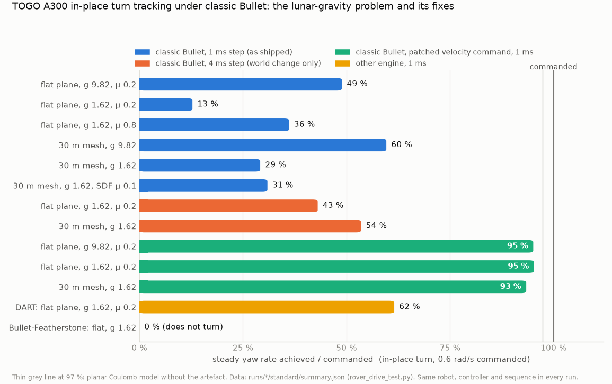

# Rover integration baseline: TOGO A300 in Gazebo Harmonic, classic Bullet

Task "rover", 2026-10-25. Gazebo Sim 8.11.0, gz-physics 7.6.0 (ROS Jazzy vendor packages), ROS 2 Jazzy,
WSL2 Ubuntu 24.04 with the RTX 2080 rendering through Mesa d3d12. Every Gazebo/ROS run used
`GZ_PARTITION=claude_rover` and `ROS_DOMAIN_ID=61`. No existing file was changed. Raw data, scripts and
logs are in `/home/nargon/togo_assets/lunar/experiments/rover/` (called `EXP` below).

## Key findings

1. **The lunar-gravity "cannot turn" problem is mostly a physics-plugin artefact, not traction.**
   gz-physics classic Bullet implements a joint velocity command by overwriting the wheel's whole
   angular velocity with `axis × value` every step (`bullet/src/JointFeatures.cc`,
   `SetJointVelocityCommand`). The chassis yaw rate that the wheels share through the hinges is thrown
   away every 1 ms. That works like a yaw damper of `4 · I_wheel⊥ / dt = 4 · 0.01976 / 0.001 ≈ 79 N·m·s/rad`.
   The damper does not depend on gravity, but the traction yaw moment scales with μ·m·g. Results of an
   in-place turn commanded at 0.6 rad/s:
   - Stock plugin: 49 % of the command on the μ 0.2 plane at Earth gravity, 13 % at 1.62 m/s².
     On the legacy 30 m mesh: 60 % at Earth gravity, 29 % at lunar gravity.
   - Patched plugin (~12-line change, see §7.3): 95 / 95 / 93 %. The patch also removes the drift during
     in-place turns.
   - A planar Coulomb model with this damper and no fitted parameter (§7.2) matches the 10 flat-plane
     in-place yaw rates within 16 %. It matches the mesh and arc cases within 2–40 %; the worst case is the
     lunar arc, 0.073 vs 0.052 rad/s.
2. **Classic Bullet ignores `<surface><friction>` on mesh collisions.** A mesh behaves as μ = 0.5
   (Bullet's default), multiplied by the other body's μ.
   - Incline test: a mesh ramp with SDF μ 0.1 holds a box that should slide. A mesh ramp with SDF μ 1.0
     gives μ_eff 0.30 against a μ 0.6 box (0.6 × 0.5).
   - Rover runs: terrain μ 0.8 and μ 0.1 drive the same.
   - SDF friction on primitives (plane, box) is honoured as a product.
3. **Physical behaviour at 1.62 m/s².**
   - Straight-line steady speed is unaffected (+1.6 %, from the wheel-radius mismatch).
   - Starting and braking are friction-limited (μg). On μ 0.2 the robot needs ~1.5 s to reach 0.5 m/s and
     slides 0.41 m to stop. At Earth gravity: 0.07 m.
   - On the rough 30 m mesh the chassis is airborne (all wheels off) 12–16 % of the time at 0.5 m/s.
     It is never airborne at Earth gravity.
4. **Headless full-robot recipe works** (§2). GPU rendering was verified per process: the gz server maps
   `libd3d12.so`/`libdxcore.so`.
   - Controllers were active ~16–21 s after `ros2 launch` on the flat world, ~24–27 s on the 30 m world.
   - RTF with the GPU lidar at a 1 ms step was 0.97–1.00 while the machine was otherwise quiet. It dropped
     to 0.58–0.86 when other agents loaded 6–12 cores.
5. **Spawning the robot stalls the simulation** while its Sensors system builds the render scene:
   - 4.6–7.9 s on the flat world, 11.3–14.4 s on the 30 m world (116 MB visual DAE).
   - The stall pushed a `switch_controller` call past the spawner's 10 s service timeout in **6 of 6**
     30 m-world launches. The `platform_velocity_controller` spawner exited with code 1, but the
     controller was active.
   - Larger worlds will make this worse (§8).
6. **Robot-side issues (not changed, reported):**
   - Right wheels sit 19 mm inboard (y = −0.2639 vs +0.2829).
   - The 1 kg lidar has 1 kg·m² inertia on every axis, which doubles the chassis roll inertia.
   - The base_link carries 4 × 46.6 k-triangle motor and a 174 k-triangle lidar collision mesh, 10 cm
     above the ground.
   - Controller wheel radius 0.1625 vs collision radius 0.1651.
   - `base_footprint` is 0.165 m *above* base_link.



## 1. Robot facts (as simulated)

Source: `togo_gz/urdf/togo_gz.urdf.xacro` expanded with `xacro … is_sim:=true` (exactly as
`control.launch.py` does) and converted with `gz sdf -p`. Copies are in
`EXP/robot_model/togo_sim.{urdf,sdf}`. Analysis scripts: `EXP/analyze_sdf.py` and
`EXP/collision_extents.py`.

### 1.1 Mass, inertia, geometry

| item | value |
|---|---|
| total mass | **81.01 kg**: base_link 71.01 kg (chassis 70.0 + Seyond base 1.0 + laser 0.01, lumped through fixed joints) + 4 wheels × 2.5 kg. Enclosure, arch, bumpers, motors, beams, lights, IMU and GNSS have **no mass**. |
| base_link CoM | (0.0057, 0, 0.1170) m in base_link; whole-robot CoM (0.0050, 0.0012, 0.1062) m = **0.242 m above flat ground** |
| base_link inertia (about CoM) | Ixx 2.165, Iyy 5.805, Izz 6.307, Ixz −0.062 kg·m². The chassis box alone gives 1.141 / 4.622 / 5.148. The rest is the lidar's **1.0 kg·m² per axis** (upstream `clearpath_sensors_description/seyond_lidar.urdf.xacro`). |
| whole-robot yaw inertia | 7.79 kg·m² about the CoM |
| wheels | 4 × cylinder **r 0.1651 m, width 0.1143 m**, 2.5 kg, Iyy 0.03407, Ixx = Izz 0.01976 kg·m²; revolute (continuous) joints, axis y, no damping or friction |
| wheel centres (base_link) | x ±0.256 (wheelbase 0.512); **y +0.2829 left, −0.2639 right** (track 0.5468, centre line +9.5 mm); z +0.0291 → **base_link is 0.1360 m above flat ground** |
| suspension | **none**. The "suspension beams" are fixed joints; the A300 model is a rigid body on 4 wheels. |
| ground clearance | 0.101 m (suspension beams), 0.102 m (motors), 0.136 m (chassis underside), 0.154 m (bumpers) |
| collision extents | x −0.526…+0.498, y ±0.372, top 1.133 m above ground (GNSS spheres r 0.112) |
| base_link collisions | 22: chassis mesh (196 tris), 2 spacers (748), 2 beams (3 004), **4 motors (46 604 tris each)**, 2 bumpers (106), enclosure (140), arch (116), **lidar (173 872 tris)**, antenna box, 4 light boxes, 2 GNSS spheres, INS box |
| contact / friction | no `<surface>` on any robot collision → SDF defaults (μ = μ2 = 1). The upstream WheelSlip system was removed (`togo_description/urdf/a300/outdoor_wheel_no_slip.urdf.xacro`). |

The static wheel loads are statically indeterminate on a rigid 4-point support. A planar-spring estimate
at 9.82 m/s² gives FL 197, RL 189, FR 209, RR 201 N; the right side is heavier because of the 19 mm
inboard offset.

### 1.2 Sensors (all on base_link after lumping)

| sensor | pose in base_link | Gazebo topic (type, rate) | ROS topic (bridge.yaml) |
|---|---|---|---|
| Seyond Robin W `lidar3d_0`, gpu_lidar | (0.400, 0, 0.3129) → **0.449 m above flat ground** | `/sensors/lidar3d_0/scan` (LaserScan) and `/sensors/lidar3d_0/scan/points` (PointCloudPacked, 209 × 122, 32 B/point, 0.82 MB/msg), 20 Hz | `/husky/sensors/seyond/points` (best-effort override), frame `lidar3d_0_laser` |
| Phidgets IMU `imu_0` | (0.059, 0, 0.161) | `/sensors/imu_0/data` (IMU, 100 Hz); reads +1.62 m/s² at rest in a 1.62 world | `/husky/sensors/imu_0/data_raw`, frame `imu_0_link` |
| Fixposition GNSS `ins_0_gps_0/1`, navsat | (−0.403, ∓0.26, 0.853) | `/sensors/ins_0/gps_{0,1}/fix` (NavSat, 1 Hz) | `/husky/sensors/ins_0/gps_{0,1}/data_raw` |
| OAK-D cameras | commented out in `togo_macro.xacro`, but still bridged; `gz_rgbd_point_fixer` logs a FATAL (unequal in/out topic lists) | – | – |
| 4 spot lights `driving_light_1..4` | sensor arch corners | `cast_shadows true`, range 20 m. Render cost only; the lidar does not see light. The `libAttachLightPlugin.so` they reference is a Gazebo-Classic plugin. | – |

Measured on the 30 m world at g 1.62, RTF ≈ 0.9 (`EXP/runs/sensors_lunar_g1.62`):
- gz lidar 20.0 Hz (sim time); ROS `/husky/sensors/seyond/points` only **16.7–17.7 Hz**, measured with a
  Python best-effort subscriber.
- IMU 100 Hz on both sides; odom and joint_states 50 Hz; GNSS 1 Hz.

### 1.3 ros2_control and the controller (`togo_gz/config/gazebo_controllers.yaml`)

The gz_ros2_control plugin `GazeboSimROS2ControlPlugin` loads this file in simulation;
`togo_deploy/config/controllers_a300.yaml` is the hardware twin. Hardware `a300_hardware`
(`gz_ros2_control/GazeboSimSystem`) exposes 4 wheel joints, each with a velocity command interface and
position + velocity state interfaces.

| parameter | value |
|---|---|
| controller_manager update_rate | 50 Hz (`use_sim_time` True). `read` and `update` run in the gz PostUpdate at 50 Hz of sim time. `write` runs in **every** PreUpdate ("Always set commands on joints", gz_ros2_control jazzy `gz_ros2_control_plugin.cpp`), so `JointVelocityCmd` is applied every 1 ms step. Controller switches therefore happen inside the simulation loop and cannot complete while the sim is stalled. |
| platform_velocity_controller | `diff_drive_controller/DiffDriveController`; left = FL, RL; right = FR, RR |
| wheel_separation × multiplier | 0.562 × **1.75** = 0.9835 m effective |
| wheel_radius | **0.1625** (collision cylinder 0.1651 → the robot drives 1.6 % faster than commanded; odometry under-reports distance by 1.6 %) |
| limits | linear ±0.8 m/s, accel 2.0, decel 4.0 m/s²; angular ±2.0 rad/s, ±4.0 rad/s² |
| cmd_vel_timeout | 0.5 s. Commands must be stamped with **sim time** (or a zero stamp); older stamps are dropped. |
| odometry | open_loop False, position_feedback False (wheel velocities); 50 Hz; frames `odom` → `base_link`; **enable_odom_tf False** (no odom TF in sim) |
| publish_limited_velocity | True → `/platform_velocity_controller/cmd_vel_out` |

### 1.4 Topics

| purpose | topic |
|---|---|
| command | **`/platform_velocity_controller/cmd_vel`** (geometry_msgs/TwistStamped, reliable) |
| odometry | `/platform_velocity_controller/odom` (nav_msgs/Odometry, 50 Hz) |
| limited command | `/platform_velocity_controller/cmd_vel_out` (TwistStamped) |
| joints | `/joint_states` (50 Hz), `/dynamic_joint_states`; TF from robot_state_publisher |
| IMU | `/husky/sensors/imu_0/data_raw` (ROS) ← gz `/sensors/imu_0/data` |
| **ground truth** | gz **`/model/togo/pose`** (gz.msgs.Pose_V, 50 Hz, from the robot's PosePublisher). The entry named **`togo`** (frame_id = world name) is the model pose in the world, which equals the base_link pose. Entries `togo::<link>` are relative to the model. The Pose_V outer header stamp is 0; use the per-pose header stamp (sim time). Not bridged to ROS. |
| clock / stats | gz `/clock` (bridged to ROS `/clock` by `clock_bridge`), `/stats` and `/world/<world>/stats` (~1 kHz) |

### 1.5 Systems: what the robot brings and what a world must provide

The robot model loads, as model-level systems:
- `gz_ros2_control::GazeboSimROS2ControlPlugin`
- `gz::sim::systems::PosePublisher` (publish_link_pose, publish_nested_model_pose → model pose too,
  Pose_V, 50 Hz)
- `gz::sim::systems::Sensors` (ogre2, default settings)
- `gz::sim::systems::Imu`
- `gz::sim::systems::NavSat`

**A world must not add Sensors, Imu or NavSat.** gz-sim would load a second instance of each next to the
robot's. Not tested here; avoid it. The world **must** provide:
- `Physics`, with the engine choice
- **`UserCommands`**, needed by `ros_gz_sim create`
- `SceneBroadcaster`, for GUI and clients (all existing worlds have it)
- **`<spherical_coordinates>`**: without it NavSat warns twice per second and reports lat/lon 0.

`<surface_model>MOON_SCS</surface_model>` works in gz-sim 8.11. Test world
`EXP/worlds/flat_g1.62_moonscs.sdf`: LM site lat −8.97301, lon 15.50019, ENU. GNSS reported
lat −8.9730186, lon 15.5001766, which matches the antenna offset on a 1737.4 km sphere. No warnings.

## 2. Headless run recipe (verified)

```bash
source /opt/ros/jazzy/setup.bash
source /home/nargon/togo_ws_native_clean/install/setup.bash
export GZ_PARTITION=<unique> ROS_DOMAIN_ID=<unique>
export ROS_HOME=<private dir>    # isolates logs AND the spawner lock (see §8)
export GALLIUM_DRIVER=d3d12 MESA_D3D12_DEFAULT_ADAPTER_NAME=NVIDIA
export LD_LIBRARY_PATH=/usr/lib/wsl/lib:$LD_LIBRARY_PATH   # prepend; do NOT overwrite after sourcing ROS
export DISPLAY=:0 WAYLAND_DISPLAY=wayland-0 XDG_RUNTIME_DIR=/mnt/wslg/runtime-dir
setsid bash -c 'echo $$ > pgid; exec ros2 launch togo_gz sim_gz.launch.py \
    world:=/ABS/PATH/world.sdf rviz:=false use_sim_time:=true robot_x:=0 robot_y:=0 robot_z:=0.19' \
    > launch.log 2>&1 < /dev/null &
# stop: kill -TERM -- -$(cat pgid); sleep 5; kill -KILL -- -$(cat pgid)
```

- `start_world.launch.py` uses `os.path.join(share/worlds, world)`, so an absolute `world:=` path works.
  The server is started as `gz sim -r -s -v 4 <world>` (server only, no GUI window). There is no
  `--headless-rendering`, so the WSLg display variables of the verified recipe are exported. I did not
  test the launch without them.
- **GPU check per process.** `~/.gz/rendering/ogre2.log` is rewritten by every Gazebo start, including
  other agents', and in one of my runs it was overwritten 40 s later by someone else. The reliable
  check: `grep -E 'd3d12|dxcore' /proc/<gz-server-pid>/maps`. Every run showed `libd3d12.so
  libd3d12core.so libdxcore.so libgallium-25.2.8…`, and ogre2.log showed
  `GL_RENDERER = D3D12 (NVIDIA GeForce RTX 2080)`.
- Scripts (all in `EXP`):
  - `env_rover.sh`: environment
  - `sim_start.sh <run_dir> <world> <x> <y> <z>`: setsid, pgid file, time-stamped log
  - `sim_stop.sh <run_dir>`: TERM, then KILL of the process group, then verification
  - `run_baseline.sh <name> <world> <x> <y> <z> [presets]`: one complete run
  - `timeline.py`, `stalls.py`, `plot_run.py`, `aggregate.py`: analysis
- Optional, for accurate log timing only: `LD_PRELOAD=/usr/libexec/coreutils/libstdbuf.so _STDBUF_O=L`.
  Without it, gz `[Msg]`/`[Dbg]` lines reach the log in blocks, several seconds late.
- Harmless noise in every log:
  - `Dummy SetJointVelocity` / `Dummy function SetJointPosition` (Bullet)
  - the `cmd_vel` TwistStamped GZ→ROS bridge cannot be created
  - Ogre material-script and COLLADA `COLOR` warnings
  - `gz_rgbd_point_fixer` FATAL
  - a segfault of `gz sim` on SIGTERM

## 3. Startup timeline

Seconds after `ros2 launch` starts, from `EXP/runs/*/launch.log` (line-buffered, time-stamped) and
`timeline.json`. 8 flat-world runs and 6 runs on the 30 m world.

| event | flat world | 30 m world (`lunar_surface` copy) |
|---|---|---|
| gz server process started | 0.8–2.7 | 0.8–2.4 |
| world initialized (`World [...] initialized`) | 1.1–3.5 | 1.1–3.4 |
| `create` + bridge started (world_load_delay 6 s + launch overhead) | 6.8–8.7 | 6.8–8.4 |
| robot_state_publisher + both spawners started (controller_spawn_delay 10 s) | 11.1–13.1 | 11.1–12.7 |
| **robot spawned** (`Entity creation successful`) | 11.2–13.2 | 11.2–12.9 |
| gz_ros2_control loads controller_manager | +0.4 s | +0.4 s |
| render engine loading (robot's Sensors system) | 13.9–16.6 | 13.9–16.4 |
| lidar advertised (scene built) | 15.7–19.1 | **22.4–25.9** |
| **both controllers active** | 15.9–20.8 | 24.0–26.7 (velocity-controller spawner **failed with exit 1 in 6/6**, controller active) |
| sim stalled around spawn (wall s with < 0.02 s of sim progress) | 4.6–7.9 | **11.3–14.4**, of which 7.8–8.8 s is the scene load |

- **The robot does not spawn at world_load_delay (6 s).** `ros_gz_sim create -topic robot_description`
  waits until robot_state_publisher publishes the description, and robot_state_publisher only starts with
  the controllers at `controller_spawn_delay` (10 s, a launch argument). The spawn therefore happens at
  about 11–13 s, whatever world_load_delay is.
- `create` retries the world service with 5 s timeouts, without limit (ros_gz jazzy `create.cpp`; the
  logs show the retry loop), so a slow world load only delays the spawn.
- Time to settle after spawn (first 1 s window with speed < 1 cm/s and rates < 0.02 rad/s):
  - 0.10–0.24 s on the flat world (5 cm drop)
  - 0.26 s at 9.82 m/s² and 0.62–0.90 s at 1.62 m/s² on the 30 m mesh (spawned 5 cm above the highest
    point under the footprint; 9.3 cm actual drop)
  - 0.66 s from the launch default `robot_z 0.5` at 1.62 m/s² (0.36 m drop, no tipping)

## 4. The test tool: `tools/rover_drive_test.py`

System `python3` with ROS sourced, run with the same `GZ_PARTITION` and `ROS_DOMAIN_ID` as the sim.

```bash
python3 rover_drive_test.py --out DIR                          # standard: fwd 0.5 m/s 6 s, stop 3 s, turn 0.6 rad/s 6 s, stop 3 s
python3 rover_drive_test.py --out DIR --preset extended        # turn -0.6, turn 1.5, arc 0.4/0.3, fwd 0.8, reverse -0.3, with stops
python3 rover_drive_test.py --out DIR --step fwd:0.5:0:6 --step turn:0:0.6:6 [--gravity 1.62]
python3 rover_drive_test.py --out DIR --sequence '[{"name":"fwd","vx":0.5,"wz":0,"duration":6}]'
python3 rover_drive_test.py --out DIR --resummarize --gravity 1.62   # offline re-analysis of the CSVs
```

What the tool does:
- It waits for the sim clock, the ground truth (gz `/model/togo/pose`) and an **active** controller. It
  asks `/controller_manager/list_controllers` rather than trusting spawner exit codes (§3).
- It optionally waits for settling, then publishes sim-time-stamped TwistStamped at 50 Hz of sim time.
- It records `gt.csv` (50 Hz), `odom.csv` (50 Hz), `cmd.csv`, `cmd_out.csv`, `joints.csv` (50 Hz) and
  `stats.csv` (gz /stats throttled to 50/s).
- It writes `summary.json` with `status`, events with wall/sim times, a spawn/settle block, per-segment
  metrics and run-level RTF.
- Sim time comes from gz stats and pose stamps by default. Subscribing to ROS `/clock` at 1 kHz in Python
  cost 64–91 % of a core.
- Robustness: timeouts on every wait (clock 180 s, ground truth 240 s, controller 300 s, overall 1200 s
  wall). SIGINT/SIGTERM handling. Outputs are always written, with a status field. A zero command is
  sent on exit. Exit codes: 0 ok, 2 timeout, 3 error, 130 interrupted. It uses `os._exit` after flushing,
  because the gz-transport threads otherwise abort the interpreter ("terminate called without an active
  exception", exit 134).

Per-segment metrics:
- `gt_dist_long_m` / `gt_dist_lat_m`: displacement along / across the heading at segment start.
- `dist_ratio_gt_over_cmd` and `gt_dyaw_deg` vs `cmd_dyaw_nominal_deg`; `*_limited` integrates
  `cmd_vel_out`, i.e. after the acceleration limits.
- `speed_tracking_ratio`, `yawrate_tracking_ratio`: steady-state window `[t0+2 s, t1]`.
- `long_slip_ratio` = 1 − v_gt / (r_true · mean wheel rate) over that window; `long_slip_ratio_segment`
  is the same over the whole segment.
- `effective_track_m`, `implied_separation_multiplier`, `yaw_slip_ratio`.
- `max_abs_roll/pitch_deg`; `max_*_dev_deg` relative to the segment start.
- `z_detrended_std/p2p_mm`, `vz_rms`. With `--gravity`: `ballistic_frac`, the share of 50 Hz samples
  with |a_z + g| < 0.15 g (chassis in free fall = all wheels off the ground), plus `max_ballistic_s` and
  `max_abs_az`.
- `stop_time_s`, `stop_dist_m`, `residual_creep_mps`; `odom_minus_gt_dist/dyaw`.

Offline unit tests: `tests/test_sim_drive_test.py`, 4 tests on synthetic trajectories (perfect
tracking, slip and poor turning, a free-fall hop, CLI parsing). Run them with the venv and **without**
ROS sourced, because ROS pytest plugins need `lark`:
`/home/nargon/.venvs/lunar_world/bin/python -m pytest -q src/lunar_world_gen/tests/test_sim_drive_test.py`
(4 passed).

## 5. Baseline results

World copies in `EXP/worlds` (originals untouched; mesh URIs made absolute; generator `EXP/make_worlds.py`):
- Flat runs: `flat_bullet_test.sdf`, a plane with ode μ 0.20, spawn (0, 0, 0.19).
- 30 m runs: `lunar_surface.world`, the 30 m mesh. Spawn at (−10, −10, 0.905), heading +x, the smoothest
  patch with a 1.2 cm rough, −1° path; the origin sits in a crater.

Classic Bullet, 1 ms step, unless stated. Full table: `docs/research/rover_baseline_results.csv`;
per-run `EXP/runs/<run>/{standard,extended}/summary.json`, CSVs and `plot.png`.

### Standard sequence (fwd 0.5 m/s 6 s → stop 3 s → turn 0.6 rad/s 6 s → stop 3 s)

| run | g | μ_eff | fwd dist (cmd 3.0 m) | v_ss/cmd | slip (segment) | stop dist / time | turn Δyaw (cmd 206°) | yaw-rate ratio | drift in turn (6 s) | odom yaw error | airborne frac (fwd) | RTF |
|---|---|---|---|---|---|---|---|---|---|---|---|---|
| flat | 9.82 | 0.2 | 2.971 | 1.016 | −0.001 | 0.066 m / 0.27 s | 100.9° | **0.489** | 0.49 m | +83° | 0 | 0.58* |
| flat | 1.62 | 0.2 | 2.642 | 1.016 | +0.109 | 0.407 m / 1.52 s | 26.0° | **0.128** | 0.27 m | +174° | 0 | 0.68* |
| flat | 1.62 | 0.8 | 2.947 | 1.016 | +0.007 | 0.099 m / 0.38 s | 78.0° | 0.361 | 0.59 m | +113° | 0 | 0.99 |
| flat, 4 ms step | 1.62 | 0.2 | 2.641 | 1.016 | +0.102 | 0.407 m / 1.52 s | 84.6° | 0.431 | 0.08 m | +105° | 0 | 1.00* |
| flat, **patched** | 1.62 | 0.2 | 2.639 | 1.014 | +0.110 | 0.406 m / 1.52 s | 179.4° | **0.953** | 0.04 m | +21° | 0 | 1.00 |
| flat, **patched** | 9.82 | 0.2 | 2.965 | 1.016 | −0.007 | 0.076 m / 0.28 s | 191.8° | **0.951** | 0.10 m | −3° | 0 | 0.98 |
| flat, DART | 1.62 | 0.2 | 2.644 | 1.016 | +0.110 | 0.398 m / 1.51 s | 87.9° | 0.615 | 0.13 m | +116° | 0 | 0.68* |
| flat, Bullet-Featherstone | 1.62 | 0.2 | **1.165** | 0.517 | +0.608 | never stops (0.23 m/s creep) | **0°** | 0.000 | 1.25 m (glides) | +203° | 0 | 0.73* |
| 30 m mesh | 9.82 | 0.5 | 2.929 | 1.024 | +0.004 | 0.060 m / 0.43 s | 121.0° | **0.596** | 0.25 m | +41° | 0.000 | 0.66* |
| 30 m mesh | 1.62 | 0.5 | 2.799 | 1.014 | +0.050 | 0.174 m / 0.72 s | 59.0° | **0.292** | 0.45 m | +136° | **0.124** | 0.97 |
| 30 m mesh, SDF μ 0.1 | 1.62 | 0.5 | 2.793 | 1.008 | +0.053 | 0.212 m / 1.54 s | 59.4° | 0.309 | 0.36 m | +136° | 0.117 | 0.86 |
| 30 m mesh, 4 ms step | 1.62 | 0.5 | 2.794 | 1.012 | +0.040 | 0.195 m / 1.04 s | 109.5° | 0.535 | 0.31 m | +63° | 0.010 | 1.00 |
| 30 m mesh, **patched** | 1.62 | 0.5 | 2.788 | 1.018 | +0.059 | 0.210 m / 1.26 s | 183.4° | **0.934** | 0.25 m | +15° | 0.157 | 0.97 |

- μ_eff on the mesh is 0.5 whatever the SDF says (§7.4).
- \* RTF: whole-sequence sim/wall from gz stats. Starred runs were measured while other agents loaded the
  machine (load average 6–12 at the start or end of the run, versus ≤ 5 for the unstarred runs).
- Spawn-from-0.5 m run (`flat_g1.62_spawn0.5`): identical driving metrics (2.648 m, turn 0.137).

Additional mesh-run figures:
- Roll/pitch along the forward path were terrain-driven and similar at both gravities: max |roll| 4.2–4.6°,
  |pitch| 5.3–6.8°, pitch excursion 8.4–8.9°.
- Detrended z std was 15 mm, mostly terrain shape.
- At 1.62 the peak vertical acceleration was 6.7–8.3 m/s² (4–5 g_moon), with ballistic hops up to 0.1 s.

### Extended preset (flat plane, μ 0.2): yaw-rate tracking ratio

| run | turn −0.6 | turn +1.5 | arc 0.4 m/s / 0.3 rad/s (yaw; speed) | fwd 0.8 v_ss/cmd | stop from 0.8 m/s |
|---|---|---|---|---|---|
| stock, 9.82 | 0.465 (backward drift 0.12 m/s) | 0.253 (forward drift 0.42 m/s: drives a circle) | 0.686; 1.023 | 1.016 | 0.17 m |
| stock, 1.62 | 0.128 | 0.065 | 0.173; 0.724 | 1.010 | 1.03 m / 2.5 s |
| stock, 1.62, 4 ms | 0.432 | 0.234 | 0.586; 0.897 | 1.007 | 1.03 m |
| stock, 1.62, μ 0.8 | 0.407 | 0.230 | 0.588; 1.057 | 1.016 | 0.27 m |
| DART, 1.62 | 0.773 | 0.924 | 1.022; 0.868 | 1.006 | 0.94 m |
| **patched**, 1.62 | **0.950** | **0.915** | 1.136; 0.871 | 1.008 | 1.03 m |

## 6. What happens at 1.62 m/s² compared with 9.82

1. **Cannot turn.** In-place turns reach 13 % of the commanded yaw rate on the μ 0.2 plane and 29 % on the
   mesh. At Earth gravity: 49 % and 60 %.
   - Faster commands make it worse: 6.5 % at 1.5 rad/s.
   - Arcs bend too little (17 % of the commanded yaw rate) and also lose speed (72 %).
   - The controller's odometry assumes the commanded turn happened, so the odometry yaw is wrong by up to
     +174° per 6 s turn.
   - This is the artefact of §7, not a gravity effect of a Coulomb contact: in the ideal model, and in the
     patched and DART runs, the yaw-rate ratio is the same at 1.62 and 9.82.
2. **Drift while turning in place.** The centre translates 0.27–0.6 m during a 6 s in-place turn. It moves
   forward for counter-clockwise turns and backward for clockwise ones. At 1.5 rad/s and Earth gravity the
   "in-place" turn becomes a 1.1 m-radius circle. The drift disappears with the patched plugin
   (0.04–0.10 m), so it is part of the same artefact. The asymmetric wheel track probably sets its
   direction.
3. **Sliding at start and stop (physical).** Wheels spin up instantly: a velocity command is an
   infinite-torque actuator. The body then accelerates at μg.
   - μ 0.2 at 1.62: 0.32 m/s², so 1.5 s to reach 0.5 m/s. Segment distance 2.64 m instead of 2.97 m;
     wheel-based slip 11 % in that segment.
   - Braking slides 0.41 m in 1.5 s, against 0.07 m in 0.27 s at Earth gravity. From 0.8 m/s it slides
     1.03 m.
   - On the mesh (μ_eff 0.5) the effects are smaller: 2.80 m, 0.17–0.21 m stop.
   - Steady-state speed is unaffected (v_ss/cmd 1.008–1.024 everywhere; 1.016 = r_true/r_ctrl) and
     steady-state slip is ≈ 0.
   - The controller's odometry over-reports the start (+0.28 m) and misses the slide (−0.36 m).
4. **Bouncing (physical for a rigid rover).** On the rough 30 m mesh at 0.5 m/s the chassis is in free
   fall 12–16 % of the time at 1.62, with hops up to 0.1 s, and never at 9.82. A 4 ms step reduced this
   to 1 %; the reason is not established. On the flat plane there is no bounce at either gravity.
   Roll/pitch are terrain-driven and similar.
5. **Changing the terrain friction does not help** under classic Bullet. The mesh's SDF μ is ignored
   (0.8 and 0.1 give the same result), so the user cannot raise traction from the world file.
   - On a primitive plane, μ 0.8 instead of 0.2 lifts the lunar in-place turn from 13 % to 36 %. That is
     still poor, because the artefact damper is unchanged.

## 7. Root causes (with evidence)

### 7.1 Classic-Bullet velocity command destroys the wheels' yaw momentum

`gz-physics7 bullet/src/JointFeatures.cc`, lines 372–381 of the 7.6.0 source (verified in the tarball and
on the branch head):

```cpp
btVector3 motion = quatRotate(trans.getRotation(), convertVec(...jointInfo->axis));
btVector3 angular_vel = motion * static_cast<btScalar>(_value);
link->setAngularVelocity(angular_vel);   // overwrites ALL components, parent motion ignored
```

How the command reaches this code:
- gz_ros2_control writes `JointVelocityCmd` every physics step, and Physics.cc calls
  `SetVelocityCommand` every step.
- Each wheel's yaw (and roll) angular momentum, `I⊥·r`, is removed every step, and the hinge constraint
  then takes it out of the chassis.
- The equivalent torque is `−c·r` with `c = 4·0.01976/dt`: 79 N·m·s/rad at 1 ms, independent of gravity.
- The traction yaw moment is at most ~μ·m·g·(track/2): 174 N·m at μ 0.8 on Earth, 7 N·m at μ 0.2 on the
  Moon.

### 7.2 Planar model (`EXP/model_skid.py`)

The model:
- rigid body, m 81.01 kg, Iz 7.79 kg·m²
- the real wheel positions
- planar-spring normal loads with load transfer
- regularised Coulomb friction at 4 contacts
- rim speeds imposed (controller kinematics with limits)
- the damper `c`

No parameter was fitted.

| case | c (N·m·s) | model wz_ss | measured |
|---|---|---|---|
| flat 9.82, μ 0.2, +0.6 / −0.6 / +1.5 | 79 | 0.318 / −0.318 / 0.438 | 0.293 / −0.279 / 0.379 |
| flat 1.62, μ 0.2, +0.6 / +1.5 | 79 | 0.084 / 0.088 | 0.077 / 0.098 |
| flat 1.62, μ 0.2, 4 ms step, +0.6 / +1.5 | 19.8 | 0.254 / 0.318 | 0.258 / 0.351 |
| flat 1.62, μ 0.8, +0.6 / −0.6 / +1.5 | 79 | 0.244 / −0.244 / 0.312 | 0.217 / −0.244 / 0.345 |
| mesh 9.82 / 1.62 / 1.62 4 ms (μ 0.5) | 79 / 79 / 19.8 | 0.448 / 0.178 / 0.395 | 0.358 / 0.175 / 0.321 |
| arc 0.4/0.3 at 1.62 / 9.82 (μ 0.2) | 79 | 0.073 / 0.210 | 0.052 / 0.206 |
| **no artefact (c = 0)**, any g, +0.6 / +1.5 | 0 | **0.584 / 1.381** | patched: 0.572 / 1.372 |

Sweep: in-place yaw rate for a 0.6 rad/s command against the physics step.

| g | μ | 0.5 ms | 1 ms | 2 ms | 4 ms | 8 ms | ideal |
|---|---|---|---|---|---|---|---|
| 1.62 | 0.2 | 0.044 | 0.084 | 0.153 | 0.254 | 0.365 | 0.584 |
| 1.62 | 0.5 | 0.101 | 0.178 | 0.286 | 0.395 | 0.476 | 0.584 |
| 9.82 | 0.2 | 0.201 | 0.318 | 0.421 | 0.492 | 0.535 | 0.584 |
| 9.82 | 0.5 | 0.354 | 0.448 | 0.508 | 0.544 | 0.563 | 0.584 |

- Agreement: within 16 % on all 10 flat in-place cases.
- The mesh cases are 2–25 % high: terrain and slope are not modelled, and μ_eff is assumed to be 0.5.
- The lunar arc case is 40 % high, but the absolute rates are small.
- The model reproduces the drift only qualitatively (sign and order of magnitude).

### 7.3 Decisive tests

**Step size.** Only `max_step_size` (and real_time_update_rate) was changed in the world copy:
- 1 ms → 4 ms raised the lunar in-place turn from 0.077 to 0.258 rad/s, as predicted (0.084 → 0.254).
- Straight-line metrics were identical (2.642 vs 2.641 m; stop 0.407 m in both).

**Patch.** `tools/gz_physics_bullet_velcmd_fix/` contains `bullet_velcmd.patch`,
`patch_bullet_velcmd.py` and `build_patched_bullet_plugin.sh`:
- The patch sets only the joint-axis component of the child's angular velocity *relative to the parent*.
- The script downloads the gz-physics 7.6.0 tarball, patches it, builds only `gz-physics7-bullet-plugin`
  against the ROS vendor libraries (~20 s, no sudo) and writes
  `libgz-physics7-bullet-yawfix-plugin.so`.
- A world uses it with `<engine><filename>/abs/path/libgz-physics7-bullet-yawfix-plugin.so</filename></engine>`.
  The log confirms `Loaded [gz::physics::bullet::Plugin] from library [...yawfix...]`.
- Results: lunar in-place turn **0.572 rad/s (95 %)** on the plane and **0.560 (93 %)** on the mesh;
  Earth 0.571 (95 %); 1.5 rad/s → 1.372 (91.5 %).
- The odometry yaw error falls to −3…+21° per 6 s turn. The implied separation multiplier is 1.71–1.83,
  so the configured 1.75 is right once the artefact is gone.
- Straight-line metrics are unchanged.
- Tested only on the flat plane and the 30 m mesh, at a 1 ms step.

### 7.4 Friction on meshes is ignored by classic Bullet

Code:
- `SDFFeatures::ConstructSdfCollision` has no mesh branch.
- Physics.cc sends mesh geometry to `ShapeFeatures::AttachMeshShape`, which builds a
  `btGImpactMeshShape` and sets no friction. The link keeps btRigidBody's default friction 0.5.
- For primitives, friction is applied per *rigid body* as `setFriction(1)` +
  `setAnisotropicFriction((mu, mu2, 1))` (last collision of a link wins), and Bullet multiplies the two
  bodies.

Incline test, 20° (tan 20° = 0.364), `EXP/friction_mesh_test/`:

| ramp | ramp SDF μ | box μ | μ_eff measured | reading |
|---|---|---|---|---|
| OBJ mesh | 0.1 | 1.0 | sticks (≥ 0.364; 2 cm creep in 2 s) | 0.1 would slide at 2.4 m/s² → ignored; mesh acts as 0.5 |
| OBJ mesh | 1.0 | 0.6 | **0.302** | 0.6 × 0.5, not 0.6 × 1.0 |
| `<box>` primitive | 0.1 | 1.0 | **0.100** | honoured |

This refines `gazebo_capabilities.md` §6, which tested friction box-on-box only.

### 7.5 Other engines (flat plane, 1.62)

- **DART** turns (62–92 %) and its straight-line behaviour equals Bullet's. The project notes say DART
  could not build the terrain mesh collision; I did not re-test that.
- **Bullet-Featherstone** reproduces the reported failure:
  - only 52 % of the commanded forward speed
  - no braking: it keeps gliding at 0.23 m/s with zero wheel command
  - zero yaw while commanded to turn

## 8. Notes for the much larger world

- **Spawn height.** `robot_z = max(collision height under the footprint) + 0.136 + clearance`, with the
  footprint about x ±0.55, y ±0.40 m around the spawn point (`EXP/terrain_probe.py`).
  - Use ≥ 0.03–0.05 m clearance; it must also be ≥ 15 mm above the collision mesh. Cylinders on a mesh rest
    about 10 mm high (Bullet margin), and bodies spawned inside that band are ejected
    (`gazebo_capabilities.md`).
  - At 1.62 a 0.36 m drop settles in 0.66 s, so clearance is cheap.
  - The legacy world's origin is in a crater: the footprint maximum is 0.33 m above the centre point. Never
    spawn at a fixed z.
- **Re-base heights near z = 0** at the core. The DTM spans −163…+765 m. Ubuntu's Bullet is single
  precision (`bullet.pc` has no `BT_USE_DOUBLE_PRECISION`), and float32 resolution is 0.06 mm at 500 m but
  about 1 mm at 8 km.
- **world_load_delay (6 s) is not the gate.** The spawn waits for robot_description, which arrives at
  `controller_spawn_delay`, ~11–13 s after launch. `create` waits for the world indefinitely. A world that
  loads in more than ~10 s is still spawned correctly, only later.
- **Spawner limits** (`togo_deploy/launch/control.launch.py`, Jazzy `spawner.py`):
  - `--controller-manager-timeout 300`: each spawner waits up to 300 s for `/controller_manager`.
  - Both spawners serialise on a **file lock** `$ROS_HOME/locks/ros2-control-controller-spawner.lock`.
    The lock is held while waiting for the controller manager, and the second spawner gives up after 5
    attempts × (20 s + 3 s) ≈ **115 s**. If the controller manager appears more than ~115 s after the
    spawners start (world load plus spawn longer than ~2 min), one controller is not spawned.
  - The lock is **shared by every spawner of the user on the machine**, across ROS_DOMAIN_IDs. Concurrent
    simulations block each other unless each sets its own `ROS_HOME`.
  - Each service call has a **10 s timeout** with 3 attempts. A sim stall longer than 10 s during a call
    makes the spawner fail even when the controller comes up (6/6 on the 30 m world).
- **Scene-load stall at spawn.** The rendering scene, with every world visual, is built when the
  *robot's* Sensors system starts. Gazebo does not step meanwhile: 7.8–8.8 s for the 116 MB DAE, against
  1.2–2.0 s on the plane. With a 1 km world, a 1 cm core and a rock field, this will be longer. Mitigations:
  - keep the spawn-time visual load small (LOD, GLB, instancing)
  - raise the spawner `--service-call-timeout` / `--switch-timeout` (code change in togo_deploy)
  - check controllers through `list_controllers`, as the test tool does
- **Physics cost.** Every Bullet mesh is a `btGImpactMeshShape`, including static terrain.
  - The robot's 46.6 k-triangle motor meshes sit only 10 cm above the ground. Rocks over ~10 cm between
    the wheels will touch them (GImpact-vs-GImpact) and can also high-centre the rover.
  - Prefer primitive rock collisions: friction honoured, cheaper, and spheres rest exactly
    (`gazebo_capabilities.md`).
- **Rendering.** The robot adds 4 shadow-casting spot lights.

## 9. Robot-side issues (evidence; nothing was modified)

1. **Wheel track asymmetry.** In the generated SDF, FL/RL are at y = +0.2829 and FR/RR at y = −0.2639. In
   upstream `clearpath_platform_description/urdf/a300/drivetrain/suspension_beam.urdf.xacro`, the front/rear
   mount offset `y 0.0095` is not mirrored for the right beam; only its visual is rotated.
   - Effects: track 0.547 m instead of ~0.566 m, and about 6 % more load on the right wheels.
   - Low impact on its own.
2. **Lidar inertia 1.0 kg·m² per axis for a 1 kg sensor** (upstream `seyond_lidar.urdf.xacro`). It nearly
   doubles the chassis roll inertia (1.14 → 2.17 kg·m²). It probably damps roll and pitch response on
   rough terrain; not tested.
3. **High-poly collision meshes on base_link.** 4 × 46 604 (motors) and 173 872 (lidar) triangles. Use
   primitives in a sim override.
4. **Wheel radius mismatch.** The controller uses 0.1625 against the 0.1651 collision radius: +1.6 % speed
   and −1.6 % odometry distance, seen in every run (v_ss/cmd 1.016).
5. **`base_footprint`** is placed +0.1651 m above base_link (upstream `a300.urdf.xacro`), so about 0.30 m
   above the ground, not on it.
6. **No mass on the enclosure, arch and other attachments.** The 81 kg total may underestimate the real
   robot; not verified.
7. Sim-only gaps:
   - no odom TF (`enable_odom_tf False`)
   - the cameras are still bridged, and the point fixer logs FATAL
   - ROS receives the lidar at about 17 Hz against 20 Hz in Gazebo (Python subscriber, best-effort; worth
     re-checking with a C++ consumer)

## 10. Recommendations

1. **Fix the turning artefact before tuning anything else.**
   - Preferred: use the patched classic-Bullet plugin, referenced by absolute path in the world SDF the
     generator writes, and report or upstream the fix to gz-physics.
   - Without a custom build: use a 4 ms step (54 % instead of 29 % on the mesh at 1.62, RTF ≈ 1.0). Re-check
     contact quality on the new terrain.
   - Do not compensate with a larger `wheel_separation_multiplier`: the artefact is speed- and
     gravity-dependent.
2. **Do not rely on SDF friction for mesh terrain or rock meshes** in classic Bullet: they are fixed at 0.5 ×
   wheel μ.
   - For tunable regolith traction, patch `AttachMeshShape` to apply the collision's `<ode><mu>` (a similar
     small patch, not done here), or use primitive collisions.
   - On primitives, μ is applied per rigid body, and the wheel's anisotropic `(mu, mu2, 1)` sits in the
     *spinning* wheel frame. Keep wheel μ = μ2 = 1.
3. **World generator:**
   - Include Physics, UserCommands and SceneBroadcaster. Do not include Sensors, Imu or NavSat.
   - Add `<spherical_coordinates>` with MOON_SCS (tested).
   - Set gravity to 1.62 and keep DLIO's gravity in sync with it, since the IMU reads the world gravity.
   - Re-base z; write a spawn-z helper that uses the collision height field.
   - Use primitive rock collisions.
4. **Launch robustness for big worlds:**
   - Give each simulation its own `ROS_HOME`.
   - Raise `controller_spawn_delay` only if the world load approaches ~100 s.
   - Raise spawner service timeouts in togo_deploy, or start the spawners after the lidar is advertised.
   - Have test scripts check `list_controllers`.
5. **Robot sim overrides** (in togo_gz, if the team agrees):
   - realistic lidar inertia
   - primitive collisions for the motors and lidar
   - matching wheel radius in the controller (0.1651)
   - mirrored right-side wheel offset
6. **Measure RTF on a quiet machine.** Other agents' load cut the 1 ms RTF to 0.58–0.86 in this session;
   the 4 ms runs stayed at 0.995–0.997.

## 11. Reproduction and files

- `src/lunar_world_gen/tools/rover_drive_test.py`: the test tool.
- `src/lunar_world_gen/tests/test_sim_drive_test.py`: offline tests.
- `src/lunar_world_gen/tools/gz_physics_bullet_velcmd_fix/`: patch, patch script, build script.
- `src/lunar_world_gen/docs/research/rover_baseline_results.csv` and `figures_rover/turn_tracking.png`.
- `EXP/`:
  - Environment and process control: `env_rover.sh`, `sim_start.sh`, `sim_stop.sh`, `run_baseline.sh`,
    `waitfor.sh`, `tstamp.py`.
  - Analysis: `timeline.py`, `stalls.py`, `show_summary.py`, `plot_run.py`, `aggregate.py`
    (→ `results.csv`/`results.md`), `model_skid.py`.
  - Sensor checks: `sensor_check.py`, `sensor_run.sh`, `navsat_check.sh`.
  - Robot and terrain: `gen_robot_model.sh`, `analyze_sdf.py`, `collision_extents.py`, `terrain_probe.py`,
    `terrain_map.png`.
  - World copies: `worlds/`.
  - Runs: `runs/<run>/`, each with `launch.log`, `launch_cmd.txt`, `timeline.txt`, `system.txt`
    (load, GPU libraries), `cpu.log` and `<preset>/{gt,odom,cmd,cmd_out,joints,stats}.csv`,
    `summary.json`, `plot.png`.
  - Friction incline test: `friction_mesh_test/`.
  - Gazebo source excerpts used for the analysis: `ref_src/`.
  - Patched build: `build/`.
- Re-run one case:
  `bash EXP/run_baseline.sh <name> EXP/worlds/flat_g1.62.sdf 0 0 0.19 standard extended`, with
  `GRAV=1.62` in the environment for the airborne metric.

### Limitations

- The single-run turn ratios repeat to ±0.01–0.02. Earth flat: 0.489 and 0.488 in two launches; lunar
  flat: 0.128 and 0.137.
- Mesh runs vary more, because the contact sequence differs from run to run.
- RTF and startup times were measured while other agents loaded the CPU and GPU. Use them as ranges.
- The patched plugin was not tested with the new world's tiles, rocks or long runs.
- The bounce reduction at 4 ms is observed but not explained.
- The ROS lidar rate deficit was measured with a Python subscriber only.
