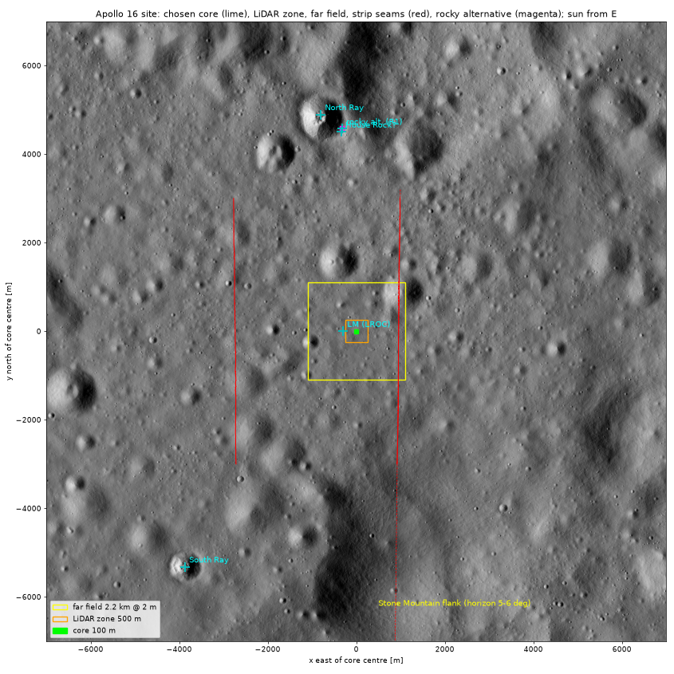
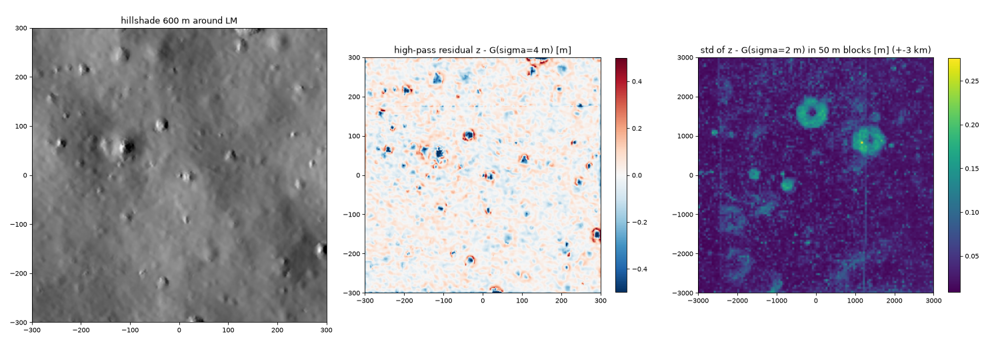
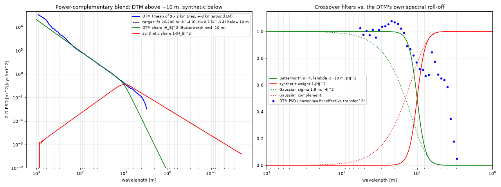
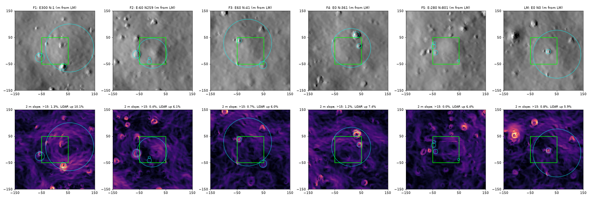
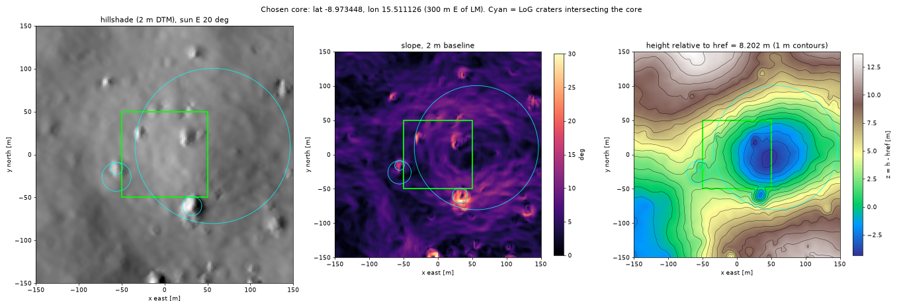

# Apollo 16 DTM analysis and site selection

Research task "site" for the TOGO lunar world (2026-10-25). Machine-readable results are in
[`site_selection.yaml`](site_selection.yaml). The extraction tool is [`tools/dtm_extract.py`](../../tools/dtm_extract.py),
with tests in [`tests/test_world_dtm_extract.py`](../../tests/test_world_dtm_extract.py). The seam traces are in
[`dtm_seams_apollo16.json`](dtm_seams_apollo16.json) and the figures in [`figures_site/`](figures_site/). The scratch
scripts (`s01`..`s21`, `t01`..`t04`) and all previews are in `/home/nargon/togo_assets/lunar/experiments/site/` (WSL).

## Summary

| Item | Result |
|---|---|
| DTM | LROC `NAC_DTM_APOLLO16` v1.9: 2 m posting, float32. Equirectangular projection on a sphere (R = 1737400 m, standard parallel −9°, central meridian 180°, false easting/northing 0). Heights are above the 1737.4 km sphere. |
| LM (LROC 2016 / Wagner et al. 2017) | Lat −8.9734, lon 15.5011 → DTM col 5402.355, row 5449.776. The DTM height there is 7.79 m, which matches the LROC table value of 8 ± 3 m. |
| Data around the LM | No nodata within 5 km of the LM. The `_filled` file is bit-identical wherever the original has data. |
| Noise floor | White-noise-equivalent σ ≈ 1.2 cm. There are no isolated spikes or pits and no terracing. |
| Main artifacts | Stereo-strip seams along N-S lines with **0.3-0.9 m steps**: 1.26 km E and 2.44 km W of the LM, plus more seams farther out. A swirl ("orange-peel") matching texture at 10-30 m. |
| Effective resolution | **About 8-10 m** (4-5 posts). Craters with D ≥ 16 m keep their full depth; craters with D = 7-9 m keep about 70 %. |
| Cut-off wavelength | **λc = 10 m.** The DTM is used above it through a Butterworth low-pass (order 4, \|H\| = 0.707 at 10 m, 0.998 at 20 m). Synthetic detail fills in below it with the power-complementary weight. |
| **Chosen core** | **"F1"**, centred at lat **−8.973448**, lon **15.511126** (DTM pixel centre col 5552, row 5450). It is 300 m east of the LM, 100 × 100 m, yaw 0 (x = east, y = north), with **href = 8.1955 m** above the sphere. |
| Core terrain | The west half of a degraded ~180 m bowl (10 m of relief). It includes a fresh 23 m crater (d/D 0.22) at the south edge and a degraded 34 m crater at the west edge. 2 m slopes: mean 6.1°, p95 10.5°, 1.3 % of the area > 15°, 98.7 % connected at ≤ 15°. 10 m slopes: max 14.0°. Best LiDAR context of all feasible candidates. |
| Rocky alternative | "R1" on the outer SE rim of North Ray (lat −8.822541, lon 15.500308), 4.57 km N of the LM and 74 m from the largest rim boulder (a House Rock candidate). 21 % of the area is > 15° and 2.8 % is > 25°. |
| Far field | LiDAR zone 500 m @ 0.25 m: ~0.5 M triangles at 5 cm tolerance. Far field 2.2 km @ 2 m (seam-feathered): 121 k triangles at 0.2 m. Horizon 20 km @ 20 m: 103 k triangles at 2 m. All counts measured with pydelatin on real data. |



## 1. Data and coordinate system

**Files in `src/togo/togo_gz/media/dem/`.** I inspected these with gdalinfo and rasterio; the scripts are s01, s19 and s20.

| File | What it is |
|---|---|
| `NAC_DTM_APOLLO16.TIF` | The LROC RDR DTM: 11985 × 15653 px, 2 m, float32, nodata −3.4028227e38. 9.21 % of the grid is nodata, all in the irregular outer footprint. **Use this file.** |
| `NAC_DTM_APOLLO16_filled.tif` | Same grid. It fills 4.27 M interior hole pixels (2.3 % of the grid), leaving 6.93 % nodata. On all common valid pixels it is identical to the original (max \|diff\| = 0). It is only needed beyond 8 km from the LM. |
| `NAC_DTM_APOLLO16_2049.tif` | A UInt16 Gazebo heightmap of a 4098 m window centred on the **DTM centre** (−9.130, 15.541), not on the LM. The scaling is h = 0.014331·DN − 168.284 m, a **1.43 cm quantum** (residual 4 mm). It would produce terraces at 1 cm, so do not use it. |
| `NAC_DTM_APOLLO16_slipmap.tif` | **Not a slip map.** It is an 8-bit scaled height of the same 4098 m window (correlation with h = 1.000; values 23-205, about 3.7 m per DN). Do not use it. |
| `slipmap-2048.tif` | An RGB binary mask of blue discs (rocks or obstacles), 80 × 80 m at 3.9 cm/px. It is in a stereographic projection centred exactly on the LROC LM position. It probably comes from an earlier rover-slip setup and is not used here. |

**Product metadata.** From the PDS label and the LROC RDR page: v1.9, created 2020-10-13. It was built from 6 NAC stereo pairs (12 images, 2010-02-02 to 2011-07-19) with ISIS 3 and SOCET SET 5.5 (NGATE) as 6 sub-DTMs. The relative linear error is 0.88 m (90 % confidence) and the RMS against LOLA is 1.02 m.

**Projection and conversions.** These are exact and agree with pyproj to 0.0 m and with the gdalinfo corners. `dtm_extract.py --selftest` checks them.

```
R = 1737400 m, lat_ts = -9 deg, lon_0 = 180 deg, x_0 = y_0 = 0, K = R cos(lat_ts) = 1716009.72295 m/rad
x = K * rad(wrap180(lon - 180))          y = R * rad(lat)
lon = wrap180(deg(x / K) + 180)          lat = deg(y / R)
col = (x - X0) / DX,  row = (y - Y0) / DY      X0 = -4937550.0000015, Y0 = -261204.00000008, DX = -DY = 2.0000000000006
(GDAL corner convention: pixel (c, r) spans [c, c+1) x [r, r+1); its centre is (c+0.5, r+0.5); row 0 = north edge)
PDS: sample = col + 0.5 = x/MAP_SCALE + SAMPLE_PROJECTION_OFFSET + 1;  line = row + 0.5 = LINE_PROJECTION_OFFSET + 1 - y/MAP_SCALE
```

At the core, grid north is true north (the projection's meridians are straight vertical lines). The E-W scale factor (true/projected) is 1.0000734. `dtm_extract.py` maps every node exactly, through a gnomonic tangent plane, so neither effect matters.

**LM position.** I used the LROC "Coordinates of Lunar Anthropogenic Targets" table (28 July 2016, Wagner et al. 2017, Icarus 283, 92-103; mean-Earth/polar-axis frame). The NSSDC landing-site page repeats it.

| Object | Lat | Lon | LROC elev. | DTM col / row | DTM h | ENU in core frame (m) |
|---|---|---|---|---|---|---|
| LM | −8.9734 | 15.5011 | 8 ± 3.0 m | 5402.355 / 5449.776 | 7.79 m | (−300.30, 1.45, −0.43) |
| ALSEP | −8.9759 | 15.4986 | 12 ± 3.0 m | 5364.918 / 5487.681 | 11.90 m | (−375.18, −74.36, 3.66) |
| LRV (final) | −8.9729 | 15.5037 | 10 ± 3.7 m | 5441.290 / 5442.196 | 9.42 m | (−222.43, 16.62, 1.22) |

The older Davies & Colvin (2000) / ALSJ value (−8.97301, 15.50019) lies 29.7 m from the LROC position (27.3 m W, 11.8 m N). The LROC value is the one consistent with the LROC-controlled DTM, as the height check above confirms. The DTM cannot resolve the LM descent stage, which is about 4 m across.

Reference features located in the DTM (s02, s08):

- **North Ray.** Centre −8.811988, 15.484282, which is 4.90 km N and 0.50 km W of the LM; the gazetteer gives −8.82, 15.48. The rim crest radius is 517 m (median), the rim height 81 m and the floor −164 m, so the depth is about 245 m.
- **South Ray.** Centre −9.148890, 15.381844, 6.4 km SW of the LM; the gazetteer gives −9.15, 15.38. The depth is about 139 m.
- **Stone Mountain flank.** It forms the highest horizon seen from the core: 5.6° elevation, 5.6 km away, toward the S-SSE.

## 2. DTM quality within ±3 km of the LM

The analysis window was 3000 × 3000 px (6 × 6 km) centred on the LM, from scripts s01 and s03-s05, s09, s13 and s19. Heights in the window range from −119 to 232 m.



**Holes and filling.** The window has no nodata, and there is none within 5 km of the LM. Within 8 km the nodata fraction is 0.01 %; within 10 km it is 1.1 %, all at the N/NW footprint edge. Hole filling is therefore irrelevant for the core and the far field. Only the horizon ring touches nodata, and only beyond 8.9 km.

**Noise floor and small-scale content.**

| Test | Result |
|---|---|
| Second differences (white-noise equivalent σ = robust std / √6) | x 1.2 cm, y 1.3 cm. This is an upper bound on post-level noise. |
| High-pass z − G(σ) robust std (std) | σ = 2 m: 2.1 cm (4.6 cm). σ = 4 m: 6.1 cm (10.5 cm). σ = 8 m: 14.6 cm (22.1 cm). The kurtosis is 14-22, with the tails coming from craters. |
| Autocorrelation of the σ = 8 m high-pass, lag 1..5 posts | x: 0.92, 0.76, 0.59, 0.43, 0.30. y: 0.93, 0.78, 0.62, 0.47, 0.35. The content is smooth over 3-4 posts, with no independent post-level information. |
| Isolated 1-px spikes or pits (\|z − med3×3\| > 0.25 m and > 2× the neighbour range) | **0** |
| Terracing or stair-steps | **None.** Values are continuous float32 (39947 unique values in 200×200 px). The mod-q histogram χ²(19) is 19-40 for q = 0.05-1 m, with all bins within ±1 %. Only 0.055 % of steps are exactly zero. |
| Interpolation smears (50 m blocks with < 1/3 of the median small-scale roughness) | 0.03 % of blocks |
| Swirl texture from stereo matching (worm-like 10-30 m patterns in the 2 m slope map) | 5-20 m band RMS 12.6 cm in the core. It is removed by the 10 m crossover only below about 12 m. |

**Seams.** The DTM is a mosaic of N-S stereo strips about 4 km wide. Strip boundaries show as straight N-S lines, tilted about 0.5°, where the height steps beyond the local trend. I traced them with the median of the signed step anomaly s = Δz(c→c+1) − ½(Δz(c−1→c) + Δz(c+1→c+2)) over 50-100-row segments, requiring sign coherence > 0.8 and > 6σ (scripts s04b, s15c, s16; the full-DTM image is `figures_site/seams_full_dtm.png`):

| Seam | Position | \|step\| median / p90 / max | Notes |
|---|---|---|---|
| East strip seam | +1258 m E of the LM, **+958 m E of the core** | 0.52 (signed) / 0.71 / 0.91 m | Inside the 2.2 km far field. It is feathered by `--deseam default`. |
| West strip seam | −2441 m E of the LM | 0.28 / 0.54 / 0.57 m | Outside the far field. It is also in the seam file. |
| Far west | −7.1 km | 0.23 / 0.56 / 0.68 m | Horizon ring only; below the horizon tolerance. |
| Far east | +9.06 km | 0.38 / 0.59 / 0.70 m | Horizon ring only. |

There are also faint one-pixel E-W lines, typically with 3-5 cm coherent steps, which do not matter after the low-pass. Within ±150 m of the core the strongest line steps are 1.7 cm (E-W) and 1.2 cm (N-S), at the per-pixel noise level of 1.3-1.5 cm. **The core is clean.**

Seam feathering (`dtm_extract.py --deseam`): z −= sign(d)·step/2·½(1 + cos(π|d|/L)) for |d| < L = 300 m, using per-row seam traces. In the 2.2 km far field it reduces the east seam from a median step of 0.448 m (max 0.908 m) to **0.039 m** (p90 0.284 m, max 0.329 m). A control band is unchanged at 0.011 m, and the core changes by 0.000 m.

**Spectrum and effective resolution.**



- **PSD.** I averaged nine 2 km tiles (Hann window, plane-detrended). The radially averaged 2-D PSD follows P = 10^−5.054 · k^−3.997 m²/(cyc/m)² between 20 and 200 m (H ≈ 1.0: a smooth, degraded crater plain). The ratio of the measured PSD to the fit is 1.00 ± 0.07 down to 15 m, then 0.89 at 13.7 m, 0.82 at 11.3 m, 0.77 at 10.3 m, 0.71 at 8.5 m and 0.67 at 7.7 m. A bump of 0.84 at 6.4 m is probably matching texture. The ratio is 0.65 at 4.8 m and collapses to 0.35 at 3.6 m and 0.05 at 3.0 m (Nyquist is 4 m).
- **Crater depth test.** I ran LoG detection on 5135 crater-like depressions. The p90 of d/D (the freshest craters) per diameter bin is:

  | D (m) | 5-7 | 7-9 | 9-12 | 12-16 | 16-22 | 22-30 | 30-40 |
  |---|---|---|---|---|---|---|---|
  | p90 d/D | 0.101 | 0.134 | 0.153 | 0.166 | 0.178 | 0.189 | 0.193 |

  Depth is preserved for D ≥ 16 m, about 80 % is kept at 9-12 m, 70 % at 7-9 m and 53 % at 5-7 m (`figures_site/crater_dD.png`).
- **Structure function** (LM tile). The RMS slope is 5.2° at a 2 m baseline, 4.9° at 10 m, 4.2° at 50 m and 3.7° at 100 m. The local Hurst exponent rises toward small scales: 0.80 (50-100 m), 0.90 (20-50 m), 0.93 (10-20 m), 0.94 (6-10 m), 0.95-0.97 (2-6 m). Values near 1 mean the surface is effectively smoothed at small scales.
- **Conclusion.** The effective horizontal resolution is **about 8-10 m (4-5 posts)**. **The cut-off wavelength is λc = 10 m.** Use the DTM fully above about 16 m, cross over between 8 and 16 m, and use synthetic detail below 8 m.

## 3. Resampling to 1 cm and blending synthetic detail

1. **Band-limit the float32 2 m DTM** with a Butterworth low-pass, H(k) = 1/√(1 + (k·10 m)^8), applied in the Fourier domain. The best-fit plane is removed first, then the data are reflect-padded by 4λc. The transfer is 0.998 at 20 m, 0.981 at 15 m, 0.901 at 12 m, 0.707 at 10 m, 0.379 at 8 m and 0.129 at 6 m. This keeps real 15-50 m craters intact. It removes the post-scale smoothing artifacts and most of the matching swirl below about 10 m.
2. **Interpolate with a cubic B-spline** (spline prefilter plus `map_coordinates(order=3)`). The result is C2-continuous: no facets, creases or terraces. On the 1 cm core, the maximum second difference along a row is 1.9e-6 m, and 0.01 % of first differences are zero.
   - **Avoid bilinear** interpolation: it is C0 and leaves 2 m facets with creases that the LiDAR can see.
   - **Avoid nearest-neighbour**: it leaves 2 m terraces.
   - **Avoid the UInt16 and 8-bit derived files**: they have 1.4 cm and 3.7 m quanta.

   This is exactly `dtm_extract.py --site core --spacing 0.01 --lowpass-lambda 10`.
3. **Add synthetic detail with power-complementary weights**, so that no wavelength is counted twice: |H_dtm|² + |H_syn|² = 1, giving H_syn(k) = (k·λc)⁴/√(1 + (k·λc)⁸). Apply this to a synthetic field with the **target PSD**: P(k) = 10^−5.054·k^−3.997 for k < 0.1 cyc/m and P(0.1)·(k/0.1)^−(2+2H) below 10 m, with **H = 0.7** (plausible range 0.6-0.8). With amplitude-complementary weights (H + (1−H) = 1), uncorrelated layers lose half the power at the crossover.
   - **Gaussian alternative:** σ = 1.9 m gives |H| = 0.49 at 10 m. Its complement still carries 30 % of the power at 20 m and 9 % at 40 m, so it would replace real DTM content with synthetic content. The Butterworth filter keeps that leakage to 0.4 % at 20 m.
4. **Targets for the synthetic layer.** I derived these from the spectral model (s09b), for wavelengths from 2 cm to 100 m. Validate them on the generated core.

   | H below 10 m | Synthetic RMS height | Total RMS slope at 1 cm / 5 cm / 10 cm / 30 cm / 1 m / 2 m |
   |---|---|---|
   | 0.8 | 6.1 cm | 10.3 / 8.2 / 7.3 / 6.2 / 5.2 / 4.8° |
   | **0.7** | **6.5 cm** | **14.8 / 10.5 / 8.8 / 6.9 / 5.4 / 4.9°** |
   | 0.6 | 7.0 cm | 22.5 / 14.3 / 11.3 / 7.9 / 5.7 / 5.0° |

   Photometric and thermal roughness studies suggest cm-scale lunar RMS slopes of roughly 15-25°. That is a literature value quoted from memory and not re-verified here. It points to H ≈ 0.6-0.7.
5. **Discrete features.**
   - **Craters.** Keep the DTM's craters with D ≥ 16 m. Add synthetic craters only for D < 16 m, with a weight that tapers from 1 to 0 between D = 8 and 16 m to avoid double counting. The DTM-derived crater density (LoG crater-like detections, a lower bound) is N(≥D) = 124 / 106 / 74 / 51 / 34 / 18 / 13 per km² for D ≥ 8 / 10 / 12 / 16 / 22 / 30 / 40 m. The fit for 12-55 m is N(≥D) = 3.18e3·D^−1.50 per km².
   - **Rocks.** All rocks are synthetic. The DTM only shows boulders larger than about 5 m, such as the 8.6 m anomaly at North Ray.
   - **Calibration.** Fit the fBm amplitude after adding craters and rocks, so that their sum matches the target PSD.
   - **Placement.** The fresh 23 m crater at the core's south edge (d/D 0.22) is the natural place for a blocky ejecta and rock concentration.

## 4. Site selection

**Method** (scripts s06, s06b, s07, s07b, s11, s12; 100 × 100 m cores, yaw 0):

- **Search grid.** 31413 centres on a 10 m grid within 1 km of the LM.
- **Metrics per patch.**
  - 2 m-baseline slope: least-squares plane over 2 × 2 posts.
  - 10 m-baseline slope: plane over 6 × 6 posts.
  - Fractions above 10, 15, 20 and 25°, plus the maximum.
  - Relief, detrended standard deviation and plane tilt.
  - Craters of 10-50 m whose rim circle intersects the patch (from the LoG catalogue).
  - Distance to the strip seams.
  - Relief in a 300 m window.
- **LiDAR context.** A numba ray-caster of the actual sensor geometry against the 2 m DTM:
  - Sensor: 120° × 70°, 0.01 rad steps (210 × 123 rays), 0.1-150 m range, level, 0.5 m above the ground.
  - Map over 7841 centres: 5 poses × 3 headings each.
  - Finalists: 9 poses (3 × 3 at ±30 m) × 3 headings.
  - Reported metrics:
    - **Upward-ray returns:** the fraction of rays at or above horizontal that hit terrain within 150 m.
    - **Skyline coverage:** the fraction of 1° azimuths that have such a hit.
    - **Far returns:** the fraction of returns beyond 30 m.

  On a flat plain the upward-ray return fraction is 0.
- **Hard constraints.** Seam distance ≥ 200 m. Area with 2 m slope > 15° ≤ 5 % and > 20° ≤ 1 %. Area with 10 m slope > 15° ≤ 2 %. Maximum 2 m slope ≤ 30°. 82 % of centres pass.
- **Score.** 2 × the percentile of upward-ray returns, plus the skyline percentile, plus a bonus for 15-50 m craters (up to 2), plus undulation; minus steepness and distance from the LM.



| Core (centre E/N of LM, m) | 2 m slope mean / p95 / max | > 15° | > 20° | 10 m slope max | Relief | Craters intersecting (D, m) | Upward returns | Skyline | Connected ≤ 15° |
|---|---|---|---|---|---|---|---|---|---|
| **F1 (300, −1) chosen** | 6.1 / 10.5 / 26.8° | 1.3 % | 0.3 % | 14.0° | 10.2 m | 181 (bowl), 33.9, 22.6 (fresh), 14.1 | **10.1 %** | **93 %** | 98.7 % |
| F2 (−60, 259) | 5.2 / 10.1 / 19.0° | 0.4 % | 0 % | 13.6° | 8.6 m | 113, 28.3, 17.0, 8.5 | 6.1 % | 84 % | 99.6 % |
| F3 (60, −41) (≈ LM) | 4.3 / 8.3 / 23.3° | 0.7 % | 0.2 % | 13.9° | 6.2 m | 181, 28.3, 17.0 | 6.0 % | 84 % | 99.3 % |
| F4 (0, −361) | 5.3 / 9.9 / 21.9° | 1.2 % | 0.3 % | 16.2° | 6.9 m | 147, 22.6, 17.0 | 7.4 % | 81 % | 98.8 % |
| F5 (−280, −801) | 4.4 / 8.1 / 12.9° | 0 % | 0 % | 9.6° | 4.8 m | 17.0, 17.0, 11.3, 8.5 | 6.4 % | 97 % | 100 % |
| LM-centred (0, 0) | 4.2 / 7.8 / 23.3° | 0.8 % | 0.2 % | 13.9° | 7.1 m | 181, 17.0 | 5.9 % | 80 % | 99.2 % |

Over the whole ±3 km window, the 2 m slope has a mean of 6.6° and p90 of 12.6°, and the 10 m slope a mean of 6.3° and p90 of 12.1°. I also checked F1 shifted by ±20 m. Moving 20 m east gives slightly more LiDAR context (11.6 %) but loses the 34 m and 14 m craters. Moving 20 m south brings a crater wall in (5.1 % > 15°). F1 is therefore kept as is.

**Chosen core: F1.**

| Parameter | Value |
|---|---|
| Centre | lat −8.973448, lon 15.511126; x −4926445.010 m, y −272105.008 m; col 5552.4948, row 5450.5041 (the centre of pixel 5552/5450) |
| Distance from the LM | 300.3 m (300.30 m E, 1.46 m S) |
| Frame | ENU tangent plane at the centre; yaw 0 (x = east, y = north) |
| Size and tiling | 100 × 100 m, 10 m tiles |
| href | **8.1955 m**: the area mean of the band-limited DTM over the core, giving an area-mean z of −0.5 mm (curvature). The core z range is −4.31 to +5.88 m. |
| Seam distance | 958 m to the east strip seam |

**Why F1.** It is mostly traversable for 33 cm wheels:

- 2 m slope p95 is 10.5° and only 1.3 % of the area is above 15°, all on the walls of the fresh 23 m crater.
- 10 m slopes stay below 14°.
- 98.7 % of the patch is one connected area at ≤ 15°.

It has variety:

- the inner slope of a degraded ~180 m bowl gives 5-10° gentle undulation and 10 m of relief;
- a fresh 23 m crater straddles the south edge as an obstacle;
- a degraded 34 m crater sits at the west edge.

It has the best LiDAR context of all feasible candidates:

- 16.4 m of relief in the 70-150 m annulus;
- the bowl's far wall and rims are visible;
- upward-ray returns are 1.7× those of the LM site.

It is free of seams, line artifacts and holes. Synthetic detail will steepen the small-scale slopes: the targets in section 3 give 5.4° RMS at 1 m. Regions already near 15° at 2 m, such as the 23 m crater wall, will exceed 20° and are intended obstacles.



**Rocky alternative: R1, North Ray SE rim** (s08; `figures_site/north_ray_alternative.png`).

| Parameter | Value |
|---|---|
| Centre | lat −8.822541, lon 15.500308; col 5390.4951, row 3162.5012 |
| Position | 4.57 km N of the LM (and 24 m W). In North Ray's frame it is 480 m E and 320 m S of the crater centre, i.e. 577 m from the centre on the outer rim flank. |
| href | 80.4583 m |
| Slopes | 2 m slope mean 10.9° (max 35.4°); 21 % of the area > 15°, 8.4 % > 20°, 2.8 % > 25°; 11 % > 15° at the 10 m baseline |
| Relief | 20 m |
| LiDAR context | Upward returns 8.6 %, skyline 47 % |
| House Rock candidate | 74 m away: the largest positive 2-12 m anomaly on the SE rim, +8.6 m at −8.824915, 15.499707. It is consistent with House Rock, the ~15-20 m boulder on North Ray's SE rim, but the identification is not confirmed. |
| Data | No nodata |

The North Ray rim has the densest boulder population of the Apollo 16 site (Station 11), so it suits a "hard" variant with high rock density. It needs its own far field, and its seams should be checked before use. South Ray ejecta, around the crater centre −9.148890, 15.381844, is the other rocky option.

## 5. Far-field plan and triangle budgets

All zones are centred on the core and use the core frame and href. I measured the triangle counts with pydelatin on grids produced by `dtm_extract.py` (s10). Each count is for the full square; with the inner square cut out, the rings are 1-5 % smaller.

| Zone | Extent | Grid | Source | pydelatin triangles |
|---|---|---|---|---|
| Core | 100 × 100 m | 1 cm | DTM (Butterworth 10 m) + synthetic | Per 10 m tile with fBm (H 0.7) to 2 cm wavelength, no rocks: 554 k at 2 mm, 142 k at 5 mm, 38 k at 1 cm, 7.7 k at 2 cm. **× 100 tiles** gives 55 M / 14 M / 3.8 M / 0.8 M. |
| LiDAR zone | **500 × 500 m** | 0.25 m | DTM (Butterworth 10 m) + synthetic to 0.5 m wavelength | 1.94 M at 2 cm, **0.50 M at 5 cm**, 0.13 M at 10 cm |
| Far field | **2.2 × 2.2 km** (1 km beyond the core) | 2 m native | DTM, `--deseam default` | 453 k at 5 cm, 249 k at 10 cm, **121 k at 20 cm**, 38 k at 50 cm, 12 k at 1 m |
| Horizon | **20 × 20 km** (10 km) | 20 m (50 m) | DTM block-averaged (nodata-aware) + anti-alias + cubic | 20 m: 508 k at 0.5 m, 239 k at 1 m, **103 k at 2 m**, 32 k at 5 m. 50 m: 188 k / 116 k / 60 k / 22 k. |

Notes on these zones:

- **LiDAR zone extent.** LiDAR beams are 0.01 rad apart, i.e. 0.01 × range: 10 cm at 10 m, 50 cm at 50 m and 1.5 m at 150 m. Every point within the 150 m sensor range of any core position lies within 200 m of the centre, so the 500 m zone covers it with 50 m to spare. Beyond it, terrain is only for cameras and the horizon.
- **Moon curvature** is included by `dtm_extract.py`. The drop is 0.29 m at 1 km, 7.2 m at 5 km and 28.8 m at 10 km.
- **Horizon geometry.** On a flat sphere, a sensor 0.5 m high sees the horizon only 1.32 km away. From the core centre, the local bowl rim at 0.1-0.3 km forms the horizon for 74 % of azimuths. The other 26 % look S-SSE to the Stone Mountain flank, 5-9 km away, at up to 5.6° (`figures_site/horizon_profile.png`). The horizon ring therefore matters mainly for cameras looking south.
- **Horizon nodata.** 2.0 % of the 20 km grid is nodata, all beyond 8.9 km in the N-NE (azimuth 51-122° CCW from east), at the DTM footprint edge. Fill it by nearest-neighbour or clip the ring there. From the core, the DTM edges are 11.1 km to the west, 10.9 km to the north, 12.9 km to the east and 20.4 km to the south, so the DTM cannot support a ring larger than about 11 km to the west or north.
- **Suggested budget.** Core at 5 mm (about 14 M triangles before rocks; use LOD per tile), LiDAR zone at 5 cm (0.5 M), far field at 20 cm (0.12 M) and horizon at 2 m (0.1 M).

## 6. Tool: `tools/dtm_extract.py`

The tool crops and reprojects a region around a lat/lon, or around a `--site` from the YAML, into a float32 ENU grid. It writes `PREFIX.npy` with row 0 at the south edge by default, an optional `PREFIX_mask.npy`, `PREFIX.json` (centre, frame, href, grid, processing, statistics, conversion constants and the command line) and an optional `PREFIX.png` hillshade.

How it works:

- Gnomonic node mapping with curvature included. For large extents it runs one fixed-point iteration so that the terrain is sampled on the local vertical.
- Butterworth (`--lowpass-lambda`) or Gaussian (`--lowpass-sigma`) low-pass.
- Cubic or linear interpolation.
- Nodata-aware block-average decimation for coarse spacings.
- Fallback to the filled DTM where the original has nodata.
- Seam feathering (`--deseam`).
- `--selftest`.

Usage is documented in the module docstring.

Tests run on the chosen site (`t03`, `t04` and the pytest file; **7 pytest tests pass in 7.6 s**):

| Run | Grid | Time / memory | Result |
|---|---|---|---|
| Core @ 1 cm, `--lowpass-lambda 10` | 10001² nodes (400 MB .npy) | 24 s compute (28 s wall), 1.45 GB max RSS | z from −4.31 to 5.88 m, mean −0.2 mm |
| Core @ 5 cm | 2001² | 1.8 s | Identical to the 1 cm grid at common nodes (max \|diff\| 0) |
| Far field 2.2 km @ 2 m + deseam | 1101² | 2.2 s | Seam step reduced as above |
| Horizon 20 km @ 20 m | 1001² | 15.7 s | 2.0 % NaN beyond 8.9 km |

The test suite also checks:

- the `--row0 north` grid is the exact flip of the south-up grid;
- core, 400 m and 1000 m band-limited extracts agree on the core nodes to < 0.1 mm (the window size does not affect results);
- the curvature drop at the corner of a 2 km grid is d²/2R within 2 cm;
- `--deseam` reduces the seam step below 0.1 m without touching the core.

## 7. Caveats and open points

- The effective resolution (8-10 m) is inferred from the spectral roll-off, crater d/D and autocorrelation, with no independent higher-resolution truth. The DTM's 5-15 m content includes some stereo-matching texture: the swirl pattern and the 6.4 m PSD bump. The 10 m crossover is a compromise. A crossover of 12-15 m would remove more texture but also more real 10-20 m craters.
- The H = 0.7 below 10 m and the cm-scale roughness targets come from extrapolation plus literature recalled from memory. They should be cross-checked by the science task. The crater SFD is a lower bound because degraded craters are under-detected.
- The LiDAR context metric assumes a level sensor 0.5 m above the ground, uses the 2 m DTM without synthetic detail, and ignores the mount offset and rover tilt. It ranks candidates relative to each other only.
- Seam traces are valid within ±3 km of the LM latitude (rows 3950-6949), which covers the core's far field. Seams in the horizon ring are not corrected; their 0.2-0.7 m steps are below the 2 m horizon tolerance.
- The House Rock identification is tentative. The rocky alternative still needs its own seam and far-field check.
- Named craters near the core (for example Spook and Flag) are not labelled, because I found no reliable published coordinates for them.

## References

- LROC RDR product page `NAC_DTM_APOLLO16` (Relative LE 0.88, LOLA RMS 1.02; 12 source images): https://data.lroc.im-ldi.com/lroc/view_rdr/NAC_DTM_APOLLO16
- PDS label `NAC_DTM_APOLLO16.LBL` (projection, MAP_SCALE, offsets, v1.9): https://pds.mcp.nasa.gov/data/store/img/lunar_reconnaissance_orbiter/pds4/lroc/lro-l-lroc-5-rdr/LROLRC_2001/DATA/SDP/NAC_DTM/APOLLO16/NAC_DTM_APOLLO16.LBL
- LROC Science Operations Team, Coordinates of Lunar Anthropogenic Targets (28 July 2016): https://lroc.im-ldi.com/data/support/downloads/2016_LROC_Coordinates_of_Human_Features.pdf. See also Wagner et al. (2017), Icarus 283, 92-103.
- NSSDC Apollo landing-site coordinates: https://nssdc.gsfc.nasa.gov/planetary/lunar/lunar_sites.html
- NAC DTM shapefile README (definition of relat_le = 90 % vertical precision): https://pds.lroc.im-ldi.com/data/LRO-L-LROC-5-RDR-V1.0/LROLRC_2001/EXTRAS/SHAPEFILE/NAC_DTMS/NAC_DTMS_README.TXT
- Henriksen et al. (2017), "Extracting accurate and precise topography from LROC narrow angle camera stereo observations", Icarus 283, 122-137.
- Gazetteer of Planetary Nomenclature, North Ray (Feature 4342) and South Ray: https://planetarynames.wr.usgs.gov/Feature/4342
- North Ray depth, House Rock and Station 11 context: https://en.wikipedia.org/wiki/North_Ray_(crater), https://www.nasa.gov/wp-content/uploads/static/history/alsj/a16/a16.sta11.html
